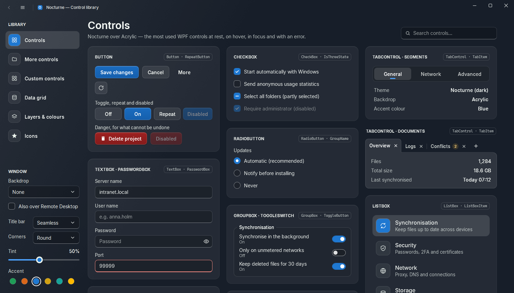
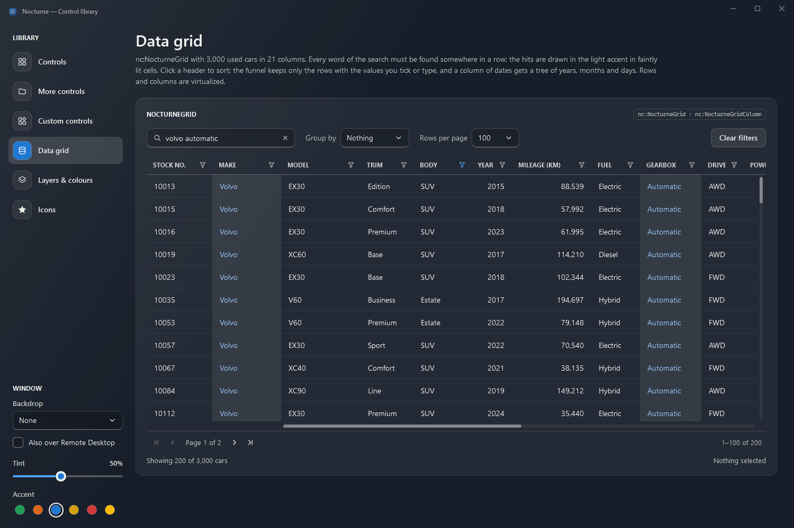
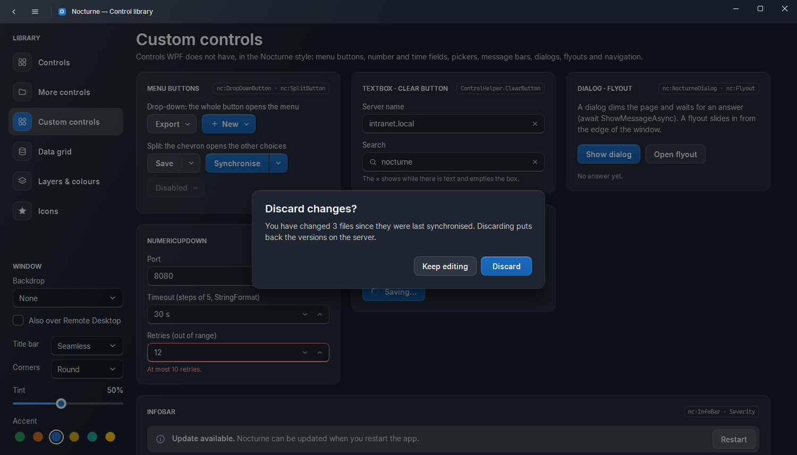

# Nocturne for WPF

[](https://github.com/Montago/NocturneTheme/actions/workflows/ci.yml)
[](https://github.com/Montago/NocturneTheme/releases)
[](LICENSE)

A dark theme for WPF on .NET 8 and later. The Windows 11 backdrop (Acrylic by default, or Mica /
Mica Alt) shows through a tinted window with a soft light from the top-left corner, and cards and
controls sit on top as light, translucent surfaces. One resource dictionary styles every standard
control; the package adds the controls a desktop app usually needs on top.

**[Documentation](https://montago.github.io/NocturneTheme/)** ·
[Getting started](https://montago.github.io/NocturneTheme/getting-started.html) ·
[Controls](https://montago.github.io/NocturneTheme/controls.html) ·
[Resource keys](https://montago.github.io/NocturneTheme/resource-keys.html) ·
[Releases](https://github.com/Montago/NocturneTheme/releases)



## What is in it

- **The window.** `NocturneWindow` draws the backdrop, the tint and the light, its own 44px title bar
  and caption buttons, and hosts in-window dialogs and flyouts.
- **Every standard control**, styled as soon as `Nocturne.xaml` is merged, plus named variants such as
  `Nocturne.Styles.Button.Primary` or `Nocturne.Styles.TabControl.Document`.
- **Own controls** (`nc:` namespace): `DropDownButton`, `SplitButton`, `Tile`, `Badged`,
  `NumericUpDown`, `TimePicker`, `ColorPicker`, `AutoSuggestBox`, `SearchComboBox`, `RangeSlider`,
  `Rating`, `ProgressRing`, `BusyIndicator`, `InfoBar`, `Accordion`, `HamburgerMenu`, `NocturneDialog`,
  `Flyout` and `NocturneGrid`, a data grid for large lists with search, header filters, grouping and
  paging.
- **Accents.** Blue by default; `NocturneTheme.SetAccent` switches to green, orange, yellow, red or the
  accent colour chosen in Windows, at run time.
- **Building blocks**: cards, tags, pills, badges, icon tiles, a type scale and a set of line icons
  (`nc:StrokeIcon`).

| | |
| --- | --- |
|  |  |

## Install

The package `Nocturne.Wpf` is attached to each [GitHub release](https://github.com/Montago/NocturneTheme/releases)
(download the `.nupkg` and add its folder as a package source); nuget.org follows. Once it is there:

```bash
dotnet add package Nocturne.Wpf
```

The project must target `net8.0-windows` or later with `<UseWPF>true</UseWPF>`. The backdrop needs
Windows 11 22H2 with transparency effects on; elsewhere the window paints an opaque ground of the
same colour.

## Quick start

Merge the theme in `App.xaml`:

```xml
<Application.Resources>
    <ResourceDictionary>
        <ResourceDictionary.MergedDictionaries>
            <ResourceDictionary Source="pack://application:,,,/Nocturne.Wpf;component/Styles/Nocturne.xaml" />
        </ResourceDictionary.MergedDictionaries>
    </ResourceDictionary>
</Application.Resources>
```

Make the main window a `NocturneWindow` and put the controls on cards:

```xml
<nc:NocturneWindow x:Class="MyApp.MainWindow"
                   xmlns="http://schemas.microsoft.com/winfx/2006/xaml/presentation"
                   xmlns:x="http://schemas.microsoft.com/winfx/2006/xaml"
                   xmlns:nc="urn:nocturne-wpf"
                   Title="My app" Width="1100" Height="720">
    <StackPanel Margin="24">
        <TextBlock Style="{StaticResource Nocturne.Styles.TextBlock.Title}" Text="Settings" />
        <HeaderedContentControl Margin="0,20,0,0" Style="{StaticResource Nocturne.Styles.Card}" Header="SYNCHRONISATION">
            <StackPanel>
                <CheckBox Style="{StaticResource Nocturne.Styles.ToggleSwitch}" Content="Synchronise in the background" IsChecked="True" />
                <Button Margin="0,16,0,0" HorizontalAlignment="Left" Style="{StaticResource Nocturne.Styles.Button.Primary}" Content="Save" />
            </StackPanel>
        </HeaderedContentControl>
    </StackPanel>
</nc:NocturneWindow>
```

```csharp
public partial class MainWindow : Nocturne.Wpf.Controls.NocturneWindow
{
    public MainWindow() => InitializeComponent();
}
```

Switch the accent at run time with `NocturneTheme.SetAccent(NocturneAccent.Green)`. The
[documentation](https://montago.github.io/NocturneTheme/) has a page per group of controls, each with
a picture and XAML, and every resource key.

## The repository

```
src/Nocturne.Wpf/          the library (NuGet package Nocturne.Wpf)
src/Nocturne.Wpf.Demo/     the demo: every control on five pages, with backdrop, tint and accent settings,
                           and the gallery (Views/GalleryPage.xaml) the docs pictures come from
samples/                   two sample apps built with the theme: Admin (HamburgerMenu; dashboard,
                           employees, timesheets, projects) and Portal (side bar; products, orders, customers)
docs/                      the documentation site (Just the Docs on GitHub Pages)
tools/                     update_docs.py (pictures, resource keys, checks), generate_icon.ps1
```

## Build and run

```bash
dotnet build NocturneTheme.slnx
```

```bash
dotnet run --project src/Nocturne.Wpf.Demo
```

```bash
dotnet run --project samples/Nocturne.Wpf.Samples.Admin
```

```bash
dotnet run --project samples/Nocturne.Wpf.Samples.Portal
```

The demo and the samples take `--snapshot <folder>`: they render their pages to PNG and exit.
`python tools/update_docs.py` does that for all of them and copies the pictures into `docs/`.

## Licence

MIT, see [LICENSE](LICENSE). Everything in the repository, including the icons, is drawn for Nocturne;
the font is Segoe UI, which comes with Windows.
