# Avalonia controls

Every control below gets the Nocturne look as soon as `<nc:NocturneTheme />` is in `Application.Styles`.
The variants are ControlThemes, set with `Theme="{StaticResource …}"`; the keys are the same as in WPF.
The controls Nocturne adds are in the `nc:` namespace (`urn:nocturne-avalonia`). Each picture is drawn
from the demo's gallery (`src/Nocturne.Avalonia.Demo/Views/GalleryPage.axaml`), with drop-downs and
menus open where the control has one.

1. TOC
{:toc}

## Buttons

### Button

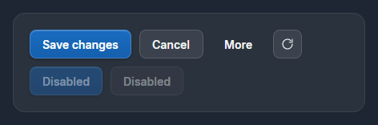

A light translucent surface with a 1px border and 8px corners; hover lightens it (120 ms).

| Theme | Look |
| --- | --- |
| *(implicit)* / `Nocturne.Styles.Button` | Light surface, for most actions |
| `Nocturne.Styles.Button.Primary` | The accent with a light top edge and a small shadow; one per view |
| `Nocturne.Styles.Button.Danger` | A deep red, for actions that cannot be undone |
| `Nocturne.Styles.Button.Subtle` | No surface until hovered |
| `Nocturne.Styles.Button.Icon` | A 36×36 square for an icon |
| `Nocturne.Styles.Button.Icon.Subtle` | An icon button with no surface until hovered (title bar, tool bars) |

```xml
<Button Theme="{StaticResource Nocturne.Styles.Button.Primary}" Content="Save changes" IsDefault="True" />
<Button Content="Cancel" IsCancel="True" />
<Button Theme="{StaticResource Nocturne.Styles.Button.Icon}" ToolTip.Tip="Refresh" Content="{nc:Icon Refresh, Size=18}" />
```

### Danger

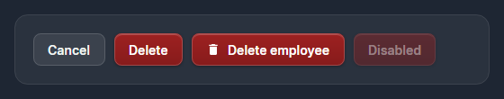

```xml
<Button Theme="{StaticResource Nocturne.Styles.Button.Danger}">
    <StackPanel Orientation="Horizontal" Spacing="8">
        <nc:NocturneIcon Kind="Delete" Width="16" Height="16" />
        <TextBlock Text="Delete employee" />
    </StackPanel>
</Button>
```

### ToggleButton and RepeatButton

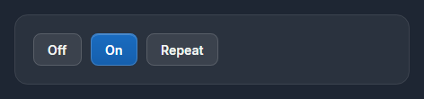

A checked `ToggleButton` takes the accent. `RepeatButton` looks like a button.

### HyperlinkButton

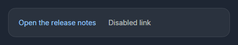

Text in the light accent, underlined on hover; set `NavigateUri` to open a page.

### DropDownButton and SplitButton

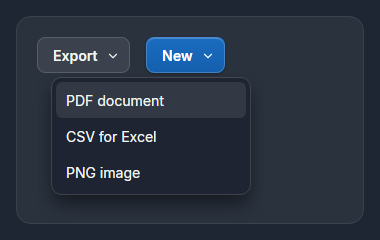

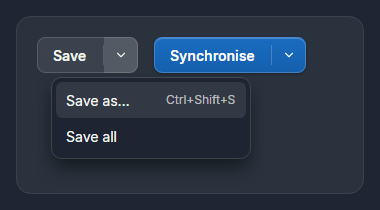

Avalonia's own `DropDownButton` (the whole button opens the menu) and `SplitButton` (the left part
runs the action, the arrow opens the menu), with a chevron and a `MenuFlyout` in the Nocturne menu
look. `Nocturne.Styles.DropDownButton.Primary` and `Nocturne.Styles.SplitButton.Primary` are the accent
versions.

```xml
<SplitButton Content="Save" Command="{Binding SaveCommand}">
    <SplitButton.Flyout>
        <MenuFlyout Placement="BottomEdgeAlignedLeft">
            <MenuItem Header="Save as…" InputGesture="Ctrl+Shift+S" />
            <MenuItem Header="Save all" />
        </MenuFlyout>
    </SplitButton.Flyout>
</SplitButton>
```

### Tile

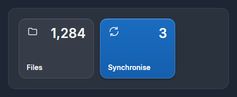

`nc:Tile` is a large button with an icon (its content), a `Count` and a `Title`, for dashboards.
`Nocturne.Styles.Tile.Accent` fills it with the accent.

```xml
<nc:Tile Width="150" Title="Files" Count="1,284">
    <nc:StrokeIcon Width="24" Height="24" Data="{StaticResource Nocturne.Icons.Folder}" />
</nc:Tile>
```

### Badged

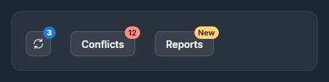

`nc:Badged` puts a small round badge on the top-right corner of its content: `Badge` (a count or a
word), `BadgeBackground` and `BadgeForeground`. With no `Badge` (null) there is no badge.

```xml
<nc:Badged Badge="12" BadgeBackground="{DynamicResource Nocturne.Brushes.Error}">
    <Button Content="Conflicts" />
</nc:Badged>
```

## Text and input

### TextBox

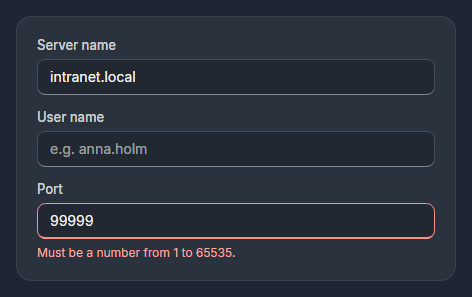

A field is a dark, slightly sunken strip with a lighter bottom edge; focus draws a 2px accent line
along the bottom. `PlaceholderText` shows hint text. `Classes="hasError"` (or
`nc:ControlHelper.HasError="True"`) gives the red look without a validation binding;
`Nocturne.Styles.TextBlock.Error` is the message under it.

### Validation

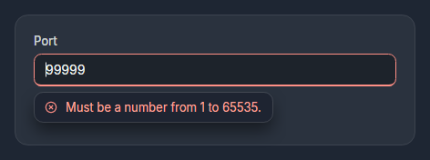

Fields with a data validation error (a binding to a property that throws, `INotifyDataErrorInfo` or
annotations) draw a red line, and while they have the keyboard focus or the pointer a callout under
them shows the first message. `Nocturne.Styles.DataValidationErrors.NoCallout` leaves the callout out,
for forms that show the messages themselves:

```xml
<StackPanel.Styles>
    <Style Selector="DataValidationErrors">
        <Setter Property="Theme" Value="{StaticResource Nocturne.Styles.DataValidationErrors.NoCallout}" />
    </Style>
</StackPanel.Styles>
```

### Search, clear button and multi-line

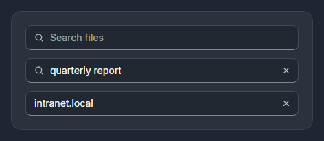

`Nocturne.Styles.TextBox.Search` puts a magnifier in front. `Classes="clearButton"` (or
`nc:ControlHelper.ClearButton="True"`) adds an × that empties a box with text, and
`nc:ControlHelper.Icon` puts any line icon in front.

```xml
<TextBox Theme="{StaticResource Nocturne.Styles.TextBox.Search}" Classes="clearButton" PlaceholderText="Search files" />
```

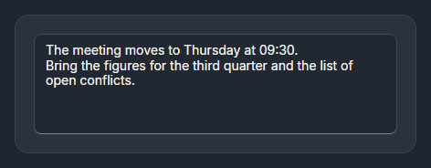

`Nocturne.Styles.TextBox.MultiLine` wraps, accepts Return and scrolls.

### Password

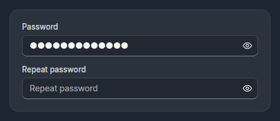

Avalonia's password field is a `TextBox` with `PasswordChar`; `Classes="revealPasswordButton"` adds the
eye button that shows the text while it is pressed. Its right-click menu has Paste only
(`Nocturne.ContextMenu.Password`).

```xml
<TextBox PasswordChar="●" Classes="revealPasswordButton" PlaceholderText="Password" />
```

### ComboBox

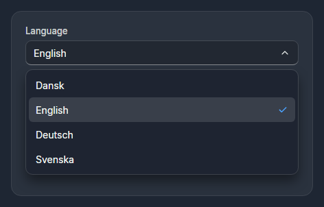

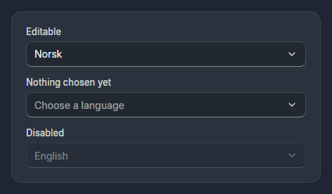

The field look with a chevron that turns when the list opens; the list is a popup surface with a tick
at the chosen item. Editable (`IsEditable`), with `PlaceholderText`, and disabled.

### NumericUpDown

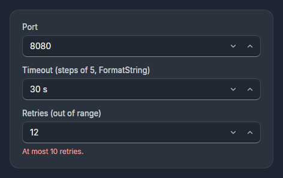

Avalonia's `NumericUpDown` in the field look, with small step buttons at the right; `FormatString`
formats the value (`"0 s"`), `Increment` sets the step.

### CalendarDatePicker and Calendar

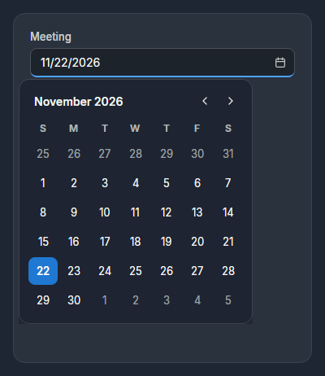

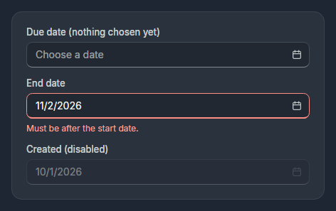

A field with a calendar button; the drop-down is the Nocturne `Calendar`. The chosen day is filled with
the accent and today has a ring (`IsTodayHighlighted`).

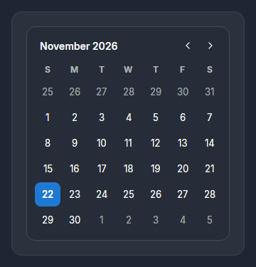

### DatePicker and TimePicker

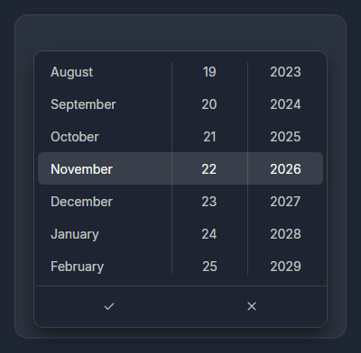

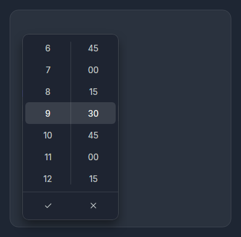

Avalonia's `DatePicker` and `TimePicker`: a field split into its parts, opening scrolling columns over
it with the chosen row on the field, and ✓ / × at the bottom. `MinuteIncrement` and `ClockIdentifier`
work as in Avalonia.

```xml
<TimePicker SelectedTime="09:30" MinuteIncrement="15" ClockIdentifier="24HourClock" />
```

### ColorPicker

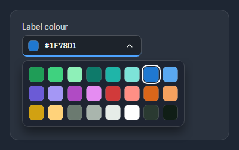

`nc:ColorPicker` is a field with a swatch and the colour's hex code that opens a grid of swatches
(`ColorPicker.DefaultPalette`, or your own `Palette`). The chosen colour is `SelectedColor`. From the
keyboard, Space, Alt+Down or F4 opens the grid, the arrow keys move, Enter takes the colour and Escape
closes without a change. (Avalonia's own ColorPicker, with a spectrum and sliders, is a separate
package; this is the theme's small swatch picker, the same as in WPF.)

```xml
<nc:ColorPicker Width="200" SelectedColor="{Binding LabelColour}" />
```

### AutoCompleteBox

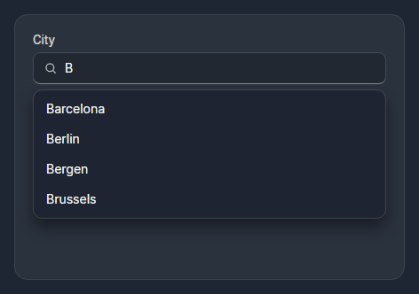

Avalonia's `AutoCompleteBox` in the field look, with the suggestions in a popup list. While the list is
open, Enter and Tab take the highlighted suggestion, else the one that equals the text, else the first
one, so a match can be taken without the arrow keys (Avalonia's own box takes only an item moved to with
Up or Down). Enter stays in the box; Tab moves on. `nc:AutoCompleteBoxHelper.CommitMatch="False"` turns
this off.

### SearchComboBox

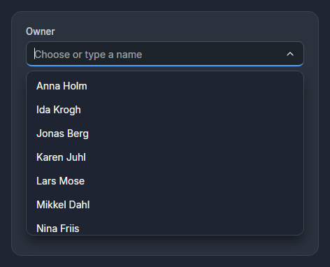

`nc:SearchComboBox` is a combo box you can type in to filter the list, for long lists (thousands of
items). `FilterMode` (StartsWith or Contains), `IsAutoCompleteEnabled` (completes the first match),
`OpenOnFocus`, `DisplayMemberPath`, `SelectedValuePath` and `NoMatchesText`.

```xml
<nc:SearchComboBox ItemsSource="{Binding People}" DisplayMemberPath="Name"
                   SelectedItem="{Binding Owner}" PlaceholderText="Choose or type a name" />
```

## Selection

### CheckBox, RadioButton and ToggleSwitch

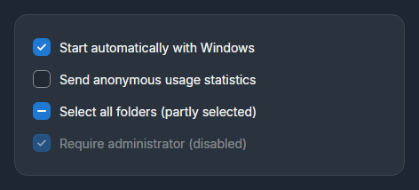

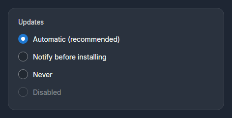

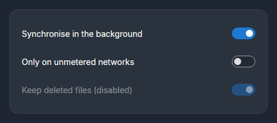

Checked boxes and dots take the accent; a three-state check box shows a dash. Avalonia's
`ToggleSwitch` is the switch (WPF uses a style on a check box for it).

### Slider and RangeSlider

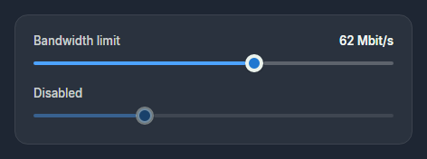

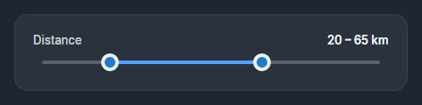

`nc:RangeSlider` has two thumbs, `LowerValue` and `UpperValue`, with the accent between them; each
thumb is a tab stop and moves by `SmallChange` with the arrow keys.

```xml
<nc:RangeSlider Minimum="0" Maximum="100" LowerValue="20" UpperValue="65" SmallChange="5" />
```

### Rating

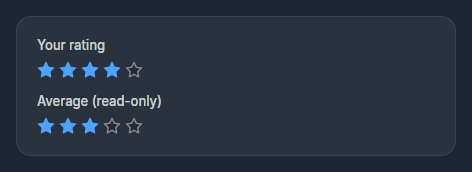

`nc:Rating` draws `Maximum` stars (5) and fills `Value` of them; click or the arrow keys change it
unless `IsReadOnly`.

## Lists and data

### ListBox

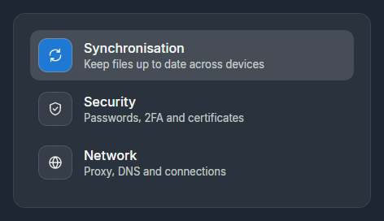

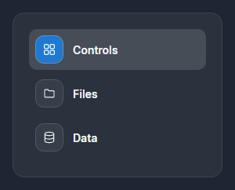

Items get a soft surface on hover and selection. `Nocturne.Styles.ListBox.Navigation` is the side bar
of the demo and the Portal sample, with an accent bar at the chosen item.
`Nocturne.Styles.IconTile` and `.IconTile.Small` are the icon squares.

### TreeView

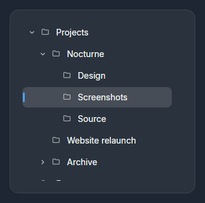

Chevrons that turn, an indent of 16px per level and the same selection as the ListBox.

### DataGrid

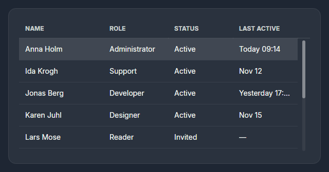

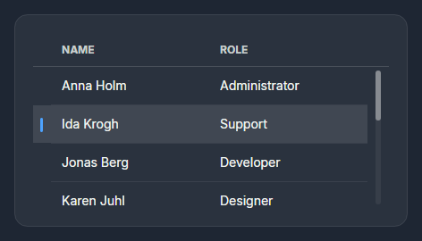

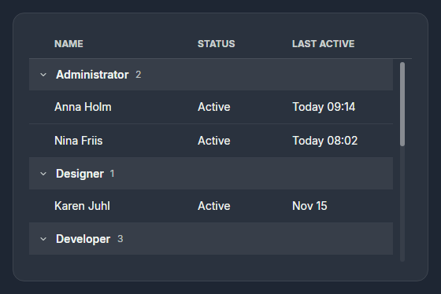

Avalonia's `DataGrid` (the `Avalonia.Controls.DataGrid` package, which Nocturne.Avalonia references):
small capital headers, 42px rows, the list selection, row headers (`HeadersVisibility="All"`) and group
headers. Group with a `DataGridCollectionView`:

```csharp
var view = new DataGridCollectionView(people);
view.GroupDescriptions.Add(new DataGridPathGroupDescription(nameof(Person.Role)));
grid.ItemsSource = view;
```

Right-aligned columns (numbers) use a cell class:

```xml
<DataGridTextColumn Header="TOTAL" Binding="{Binding Total}" CellStyleClasses="number" />
```

```xml
<DataGrid.Styles>
    <Style Selector="DataGridCell.number">
        <Setter Property="HorizontalContentAlignment" Value="Right" />
    </Style>
</DataGrid.Styles>
```

### NocturneGrid

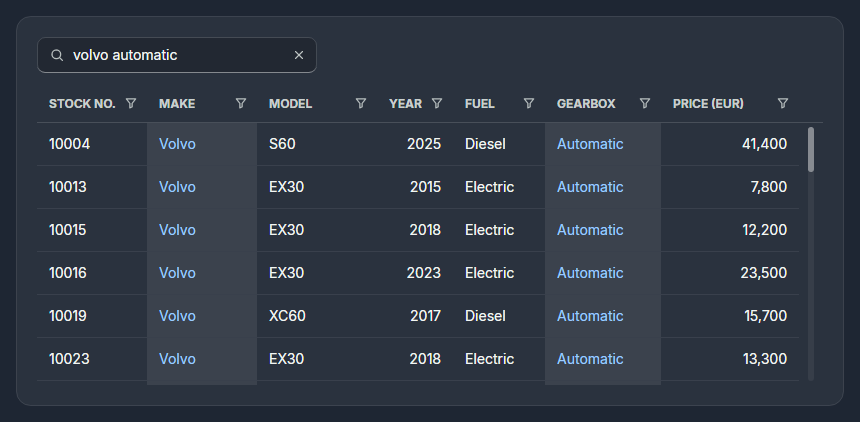

`nc:NocturneGrid` is a `DataGrid` for large lists, with the same members as in Nocturne.Wpf. It shows its
rows through a `DataGridCollectionView`: one it makes for the `ItemsSource` you give it, or the view
itself when you give it one. Rows and columns are virtualized.

- **Search**: `SearchText` filters the rows to those that contain every word somewhere (in the
  searchable columns); quotes keep a phrase together. The hits are drawn in the light accent in faintly
  lit cells (the cell gets the style class `searchHit`).
- **Filters**: every column header has a funnel. Its filter lists the column's values with their counts
  to tick, or takes typed values: `*` matches any text (`vol*`), and numbers and dates take ranges
  (`>50000`, `<=2019`, `2020-01-01..2020-06-30`). A column of dates gets a tree of years, months and days.
- **Sorting**: a click on a header sorts up, then down, then back to the original order.
- **Grouping**: `GroupMemberPath` groups the rows under the DataGrid's group headers, with the row count.
- **Paging**: `PageSize` shows one page at a time with a pager under the rows.
- A new search, filter or page keeps the selected row when it is still shown, and otherwise selects none.
- **Wheel**: a notch scrolls by whole rows, as in Nocturne.Wpf: Windows' "lines per notch" rows (3
  elsewhere), leaving a row's top edge at the top. A grouped grid, shown row details and Shift keep the
  DataGrid's own pixel scrolling.

```xml
<TextBox Name="Search" Theme="{StaticResource Nocturne.Styles.TextBox.Search}" Classes="clearButton" />
<nc:NocturneGrid ItemsSource="{Binding Cars}" SearchText="{Binding #Search.Text}">
    <nc:NocturneGrid.Columns>
        <nc:NocturneGridColumn Width="130" Header="MAKE" Binding="{Binding Make}" />
        <nc:NocturneGridColumn Width="150" Header="MODEL" Binding="{Binding Model}" />
        <nc:NocturneGridColumn Width="80" Header="YEAR" Binding="{Binding Year}" TextAlignment="Right" />
        <nc:NocturneGridColumn Width="136" Header="PRICE (EUR)" Binding="{Binding Price, StringFormat=N0}" IsSearchable="False" TextAlignment="Right" />
        <nc:NocturneGridCheckBoxColumn Width="92" Header="SOLD" Binding="{Binding IsSold}" />
    </nc:NocturneGrid.Columns>
</nc:NocturneGrid>
```

#### Header filters

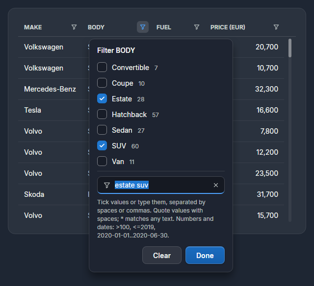

A column with at most `FilterListLimit` different values lists them to tick; with more, the values
are typed. A column's filter can be set from XAML or code with `FilterText` (`FilterDates` for dates).
`ClearFilter(column)` clears one column's filter, `ClearFilters()` the search and every filter.

```xml
<nc:NocturneGridColumn Header="BODY" Binding="{Binding Body}" FilterText="estate suv" />
```

#### Groups

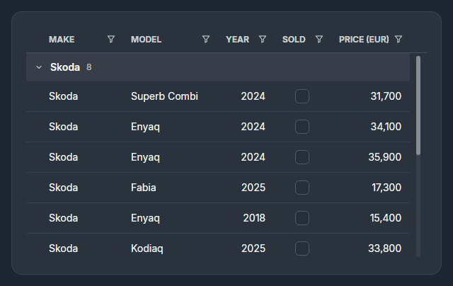

```xml
<nc:NocturneGrid ItemsSource="{Binding Cars}" GroupMemberPath="Make">
```

`ExpandAllGroups()` and `CollapseAllGroups()` unfold and fold every group.

#### Pages

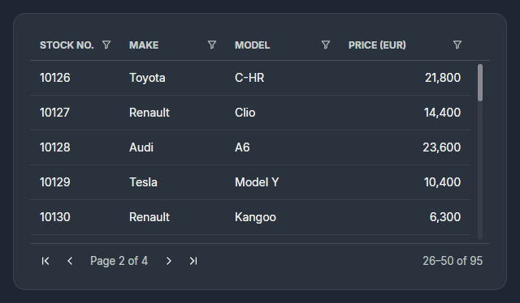

```xml
<nc:NocturneGrid ItemsSource="{Binding Cars}" PageSize="25">
```

#### Members

| Property | |
| --- | --- |
| `SearchText` | Words that must all be found in a row; quotes keep a phrase together |
| `SearchDelay` | Pause after the last change before the rows are filtered (zero filters at once) |
| `FilterListLimit` | A filter lists the values to tick when the column has at most this many |
| `GroupMemberPath` | Member the rows are grouped by; empty for none |
| `PageSize`, `PageIndex` | Rows per page (0 shows every row) and the page shown, from 0 |
| `PageCount`, `PageNumber`, `PageFirstRow`, `PageLastRow`, `IsPaging` | Read-only, for your own pager text |
| `FilteredItemCount`, `TotalItemCount`, `IsFiltered` | Read-only counts, for a status line |
| `HighlightForeground`, `HighlightBrush`, `HighlightCellBackground` | Colours of the search hits |
| `View` | The `DataGridCollectionView` the grid shows its rows through |

| Method or event | |
| --- | --- |
| `Filtered` | Raised after the rows have been filtered; `Count` and `TotalCount` in the event data |
| `SelectedItemChanged` | Raised when `SelectedItem` changes (not by combo boxes inside cells, unlike `SelectionChanged`) |
| `ApplyFilters()` | Filters now instead of after `SearchDelay`, and re-reads changed values |
| `ClearFilters()`, `ClearFilter(column)` | Clears the search and every column filter, or one column's |
| `GetVisibleItems()` | The rows left after the search and filters, in the order shown (all pages) |
| `MoveToFirstPage()` … `MoveToLastPage()` | Page through the rows, as the pager does |

Columns are `nc:NocturneGridColumn` (text; `TextAlignment` for numbers) and
`nc:NocturneGridCheckBoxColumn` (`TrueText` and `FalseText` name the values in the filter and the search;
its search is off by default). Both take `IsSearchable`, `IsFilterable`, `FilterMemberPath` and
`FilterText`; other `DataGrid` columns work too (attached: `nc:NocturneGrid.IsFilterable="False"`), and
are searched through `NocturneGrid.FilterMemberPath` or their `SortMemberPath`.

### ScrollViewer

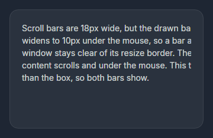

Scroll bars are 18px wide, but the drawn bar is a thin 6px line that widens to 10px under the pointer.
They fade in while the content scrolls or the pointer is over it, and out again a moment later
(`AllowAutoHide`, as in Avalonia), which is why the picture shows none.

A wheel turn stays in the scroll viewer under the pointer when it has something to scroll, also once it
has reached its end, so a list or grid inside a scrolling page does not move the page when it runs out;
one with nothing to scroll passes the turn on to the scroll viewer around it
(the theme turns `IsScrollChainingEnabled` off).

## Navigation and layout

### TabControl

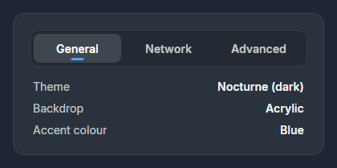

The default TabControl is a row of segments; the selected tab's pill and accent stripe glide to the
next one.

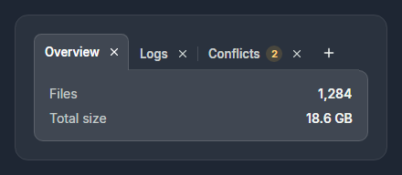

`Nocturne.Styles.TabControl.Document` gives document tabs. `nc:TabHelper.ShowCloseButton` (on the
TabControl or per tab) adds close buttons, `nc:TabHelper.Badge` a small count, and
`nc:TabHelper.ShowAddButton` a "+" after the last tab. Closing raises `TabHelper.TabClosing` (set
`Cancel` to keep the tab); "+" raises `TabHelper.AddTabRequested` and runs `TabHelper.AddCommand`.

```xml
<TabControl Theme="{StaticResource Nocturne.Styles.TabControl.Document}"
            nc:TabHelper.ShowCloseButton="True" nc:TabHelper.ShowAddButton="True">
    <TabItem Header="Overview">…</TabItem>
    <TabItem Header="Conflicts" nc:TabHelper.Badge="2" />
</TabControl>
```

### HamburgerMenu

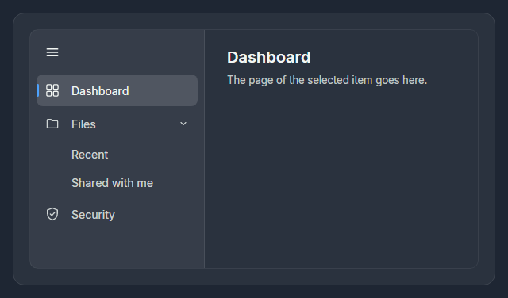

`nc:HamburgerMenu` is a navigation pane with a ☰ button that folds it to its icons (`IsPaneOpen`,
`PaneWidth`, `CompactPaneWidth`), and the page of the chosen item beside it (`Content`, or
`ContentTemplate` with the chosen item). Its items are `nc:HamburgerMenuItem`s with an `Icon`; an item
with sub-items opens and closes them (`IsExpanded`).

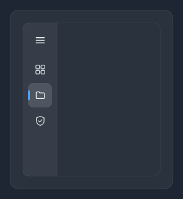

```xml
<nc:HamburgerMenu SelectedIndex="0">
    <nc:HamburgerMenuItem Content="Dashboard">
        <nc:HamburgerMenuItem.Icon><nc:StrokeIcon Data="{StaticResource Nocturne.Icons.Grid}" /></nc:HamburgerMenuItem.Icon>
    </nc:HamburgerMenuItem>
    <nc:HamburgerMenuItem Content="Files" IsExpanded="True">
        <nc:HamburgerMenuItem.Icon><nc:StrokeIcon Data="{StaticResource Nocturne.Icons.Folder}" /></nc:HamburgerMenuItem.Icon>
        <nc:HamburgerMenuItem.Items>
            <nc:HamburgerMenuItem Content="Recent" />
        </nc:HamburgerMenuItem.Items>
    </nc:HamburgerMenuItem>
</nc:HamburgerMenu>
```

### Expander and Accordion

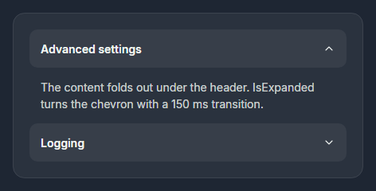

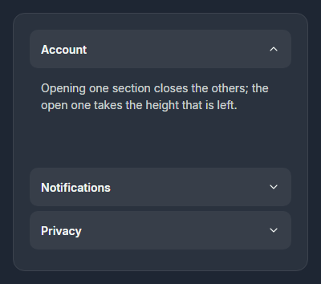

`nc:Accordion` holds `Expander`s: opening one closes the others, and the open one takes the height
that is left.

```xml
<nc:Accordion Height="280">
    <Expander Header="Account" IsExpanded="True">…</Expander>
    <Expander Header="Notifications">…</Expander>
</nc:Accordion>
```

### GroupBox and cards

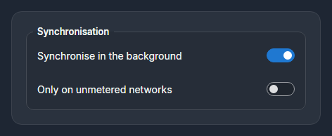

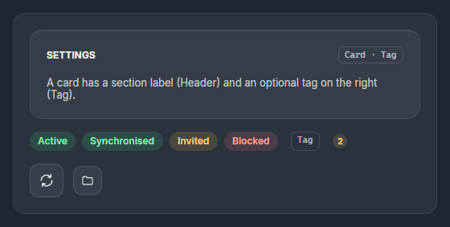

A card is a `HeaderedContentControl` with `Nocturne.Styles.Card`: a section label (`Header`) and an
optional tag on the right (`Tag`). `Nocturne.Styles.Border.Card` is the same surface without a header.
`Nocturne.Styles.Pill` (`.Success`, `.Warning`, `.Error`), `Nocturne.Styles.Tag` and
`Nocturne.Styles.Badge` are themes for a `ContentControl`.

```xml
<HeaderedContentControl Theme="{StaticResource Nocturne.Styles.Card}" Header="SETTINGS" Tag="Optional">…</HeaderedContentControl>
<ContentControl Theme="{StaticResource Nocturne.Styles.Pill.Success}" Content="Synchronised" />
```

### StatusBar and GridSplitter

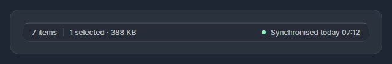

Avalonia has no status bar, so Nocturne adds `nc:StatusBar` with `nc:StatusBarItem`s; a `Separator`
between items draws a short line. The last item fills the rest of the bar: right-align it to put it at
the end.

```xml
<nc:StatusBar>
    <nc:StatusBarItem Content="7 items" />
    <Separator />
    <nc:StatusBarItem Content="1 selected" />
    <nc:StatusBarItem HorizontalAlignment="Right" Content="Synchronised today 07:12" />
</nc:StatusBar>
```


## Menus and tool tips

### Menu and ContextMenu


Menus are popup surfaces with the shortcut (`InputGesture`) on the right. A line icon goes in front
with `nc:ControlHelper.Icon` (or `Icon`); a checkable item shows a tick.

```xml
<MenuItem Header="Copy" InputGesture="Ctrl+C" nc:ControlHelper.Icon="{StaticResource Nocturne.Icons.Copy}" />
```

### The text menu


Text fields get `Nocturne.ContextMenu.Text`: Undo, Cut, Copy, Paste and Select all with icons, enabled
as the field allows.

### ToolTip


## Progress and status

### ProgressBar and ProgressRing


A 6px bar in the accent; `IsIndeterminate` runs a short bar across. `nc:ProgressRing` is a quarter arc
running round a faint track once a second while `IsActive`; size it with `Width` and `Height`, and set
`Foreground` and `Background` on an accent surface.

### BusyIndicator


`nc:BusyIndicator` blurs and dims its content (`BlurRadius`) and shows a small card with a progress
ring and `BusyContent` while `IsBusy`.

```xml
<nc:BusyIndicator IsBusy="{Binding IsUploading}" BusyContent="Uploading 128 files…">…</nc:BusyIndicator>
```

### InfoBar


`nc:InfoBar` is a message strip in the page: `Severity` (Info, Success, Warning, Error), a bold
`Title`, the `Message`, an optional action as its content, and a close button (`IsClosable`) that sets
`IsOpen` to false and raises `Closed`.

```xml
<nc:InfoBar Severity="Error" Title="Could not connect." Message="intranet.local did not answer.">
    <Button Content="Try again" />
</nc:InfoBar>
```

### NocturneDialog


The surface of `nc:NocturneDialog` on its own; [the window](avalonia.md#dialogs) shows it over the
dimmed page.

## Typography and icons

### Text styles


`Nocturne.Styles.TextBlock.Title`, `.Subtitle`, `.Eyebrow`, `.ListTitle`, `.Body`, `.Label`, `.Caption`,
`.Hint`, `.Error` and `.Mono`, set with `Theme` on a `TextBlock`.

### Line icons


The theme's own line icons are geometries (`Nocturne.Icons.*`) drawn with `nc:StrokeIcon`, which
strokes them in its `Foreground`:

```xml
<nc:StrokeIcon Width="18" Height="18" Data="{StaticResource Nocturne.Icons.Refresh}" />
```

### NocturneIcon


`nc:NocturneIcon` draws Material Design Icons by name, filled in its `Foreground`. `{nc:Icon Bell}`
makes one for a `Content` or `Icon`, and `{nc:IconGeometry Bell}` gives the geometry. The set is listed
in `icons/icons.json` and is the same as in WPF.

```xml
<nc:NocturneIcon Kind="Bell" />
<Button Theme="{StaticResource Nocturne.Styles.Button.Icon}" Content="{nc:Icon Printer, Size=18}" />
```
