# Avalonia sample apps

The two [WPF sample apps](samples.md) are in the repository for Avalonia too, with the same pages and
the same fixed sample data, so the two libraries can be compared side by side.

```bash
dotnet run --project samples/Nocturne.Avalonia.Samples.Admin
```

```bash
dotnet run --project samples/Nocturne.Avalonia.Samples.Portal
```

Both take `--snapshot <folder>` and draw each page to a PNG (1280 × 800) on Avalonia's headless
platform; the pictures on this page come from there, and CI draws them on Linux too.

## Admin

A staff administration tool. The main window is a `NocturneWindow` with a
[`HamburgerMenu`](avalonia-controls.md#hamburgermenu) for the pages, a `Badged` notification button and a
settings button in the title bar, and a `StatusBar` at the bottom.

### Dashboard

Accent and plain [`Tile`](avalonia-controls.md#tile)s with the key figures, an
[`InfoBar`](avalonia-controls.md#infobar) with an action button, and two cards: project budgets as
`ProgressBar`s and a list of recent activity.

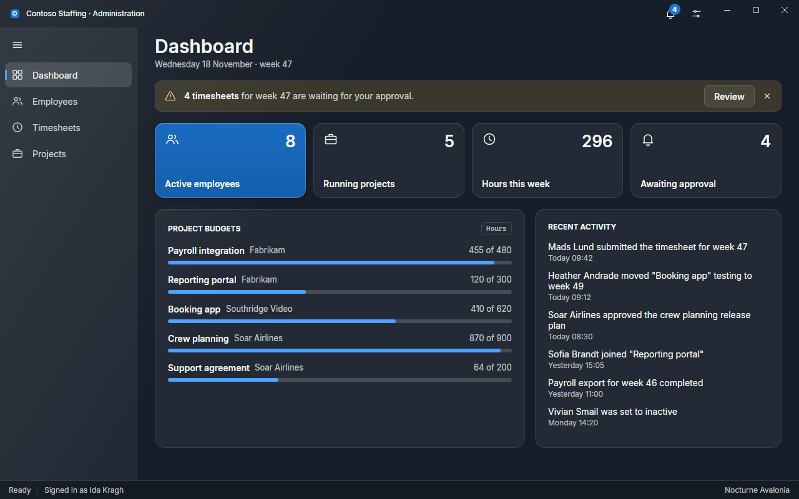

### Employees

A [`NocturneGrid`](avalonia-controls.md#nocturnegrid) with filters in the column headers and a check box
column, searched from the box above it, next to a details form: `TextBox`, `ComboBox`, `CalendarDatePicker`, `NumericUpDown` and a
`ToggleSwitch`.

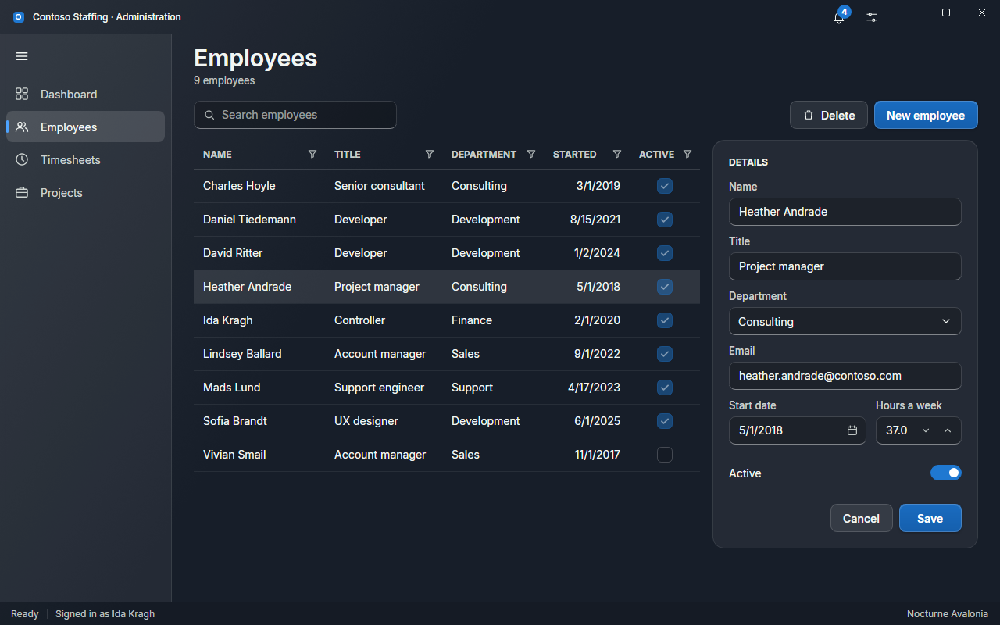

Delete asks first with a [`NocturneDialog`](avalonia.md#dialogs):

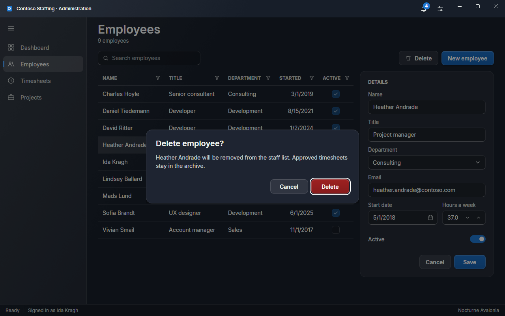

The settings button opens a [`Flyout`](avalonia.md#flyout) with the accent, the backdrop and the account:

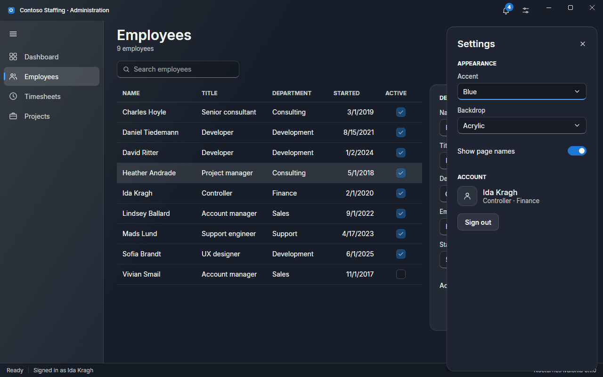

### Timesheets

A `NocturneGrid` grouped by employee (`GroupMemberPath`), with the week's hours, a total and a status
column of pills (`Nocturne.Styles.Pill.Success`, `.Warning`) and tags. Above it a week `ComboBox`, a
`DropDownButton` for export and a primary `SplitButton`; a `ProgressBar` below sums up the week.

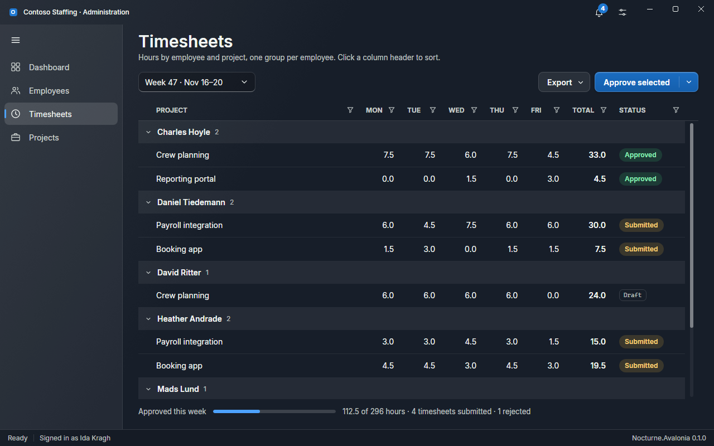

### Projects

A `TreeView` of customers and projects beside the chosen project: a budget card with a `ProgressBar`,
the deadline and a [`Rating`](avalonia-controls.md#rating), the team, and the notes in an `Expander`.

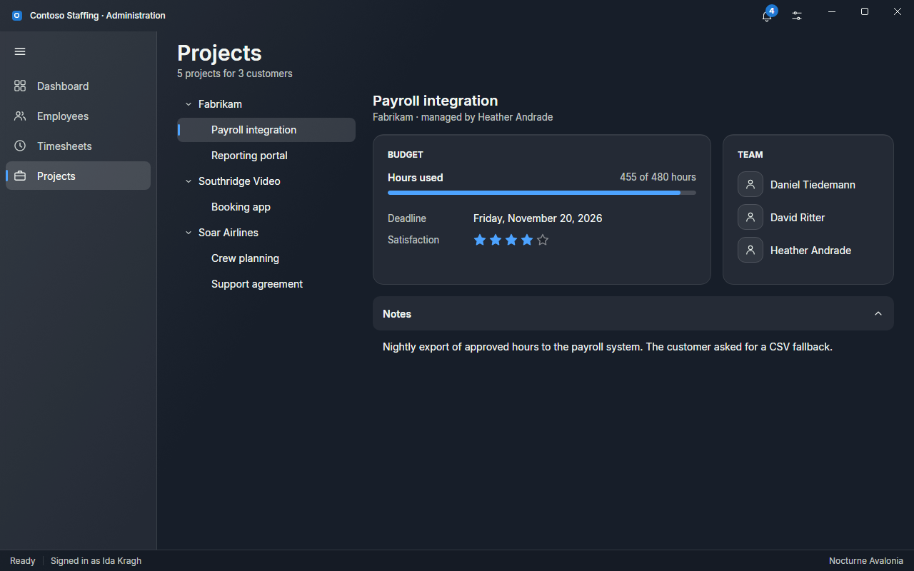

## Portal

A sales portal. The side bar is a `ListBox` with `Nocturne.Styles.ListBox.Navigation`, with a monthly
target card under it; the user's name and a help button sit in the title bar.

### Home

A greeting, an `InfoBar`, four `Tile`s, the latest orders in a `DataGrid` and the top rated products
with their `Rating`.

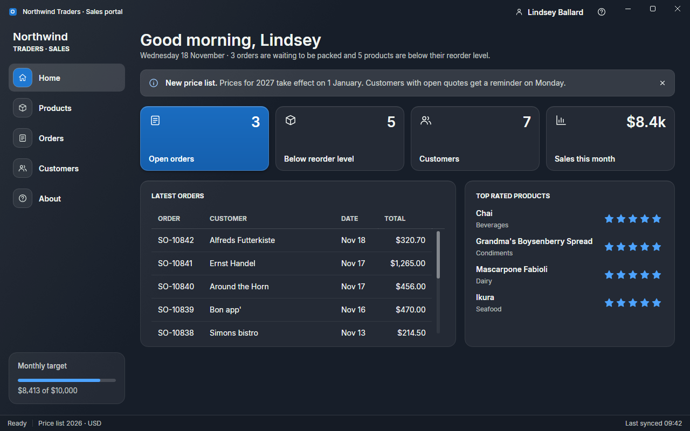

### Products

A searchable product `ListBox` with a category `ComboBox`, and the chosen product: a warning
`InfoBar`, `NumericUpDown`s for price and stock, a `Rating` and a `CheckBox`, the description in an
`Expander`, and a `SplitButton` next to the primary Save button.

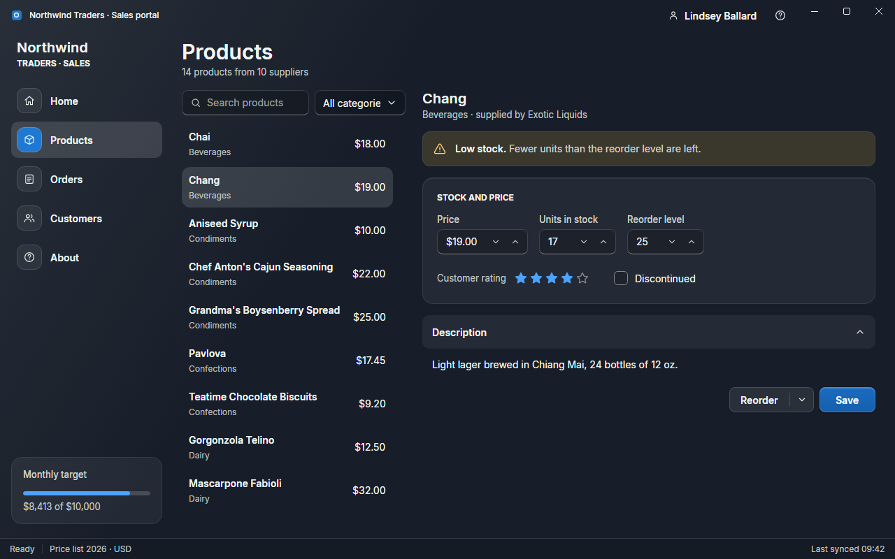

### Orders

Two `CalendarDatePicker`s and an `AutoCompleteBox` for the customer (the grid's search) above a
`NocturneGrid` of orders with
status pills and right-aligned dates and totals, the chosen order's lines in an `Expander` below, and
a `ProgressBar` with the share shipped on time.

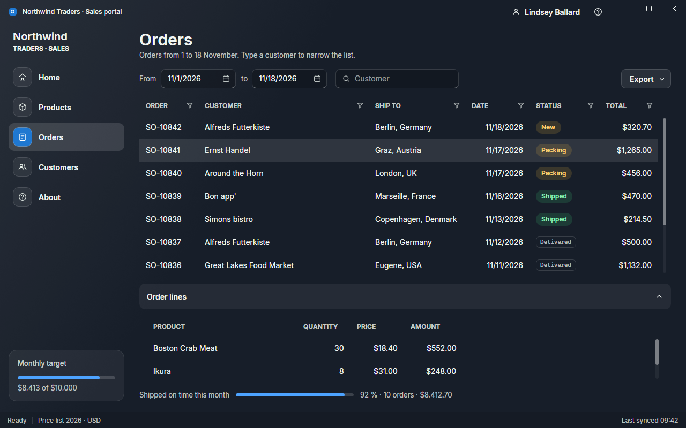

### Customers

An [`Accordion`](avalonia-controls.md#expander-and-accordion) with a `TreeView` of customers by country,
and the chosen customer in a `TabControl`: contact form, orders (`DataGrid`) and notes (multi-line
`TextBox`).

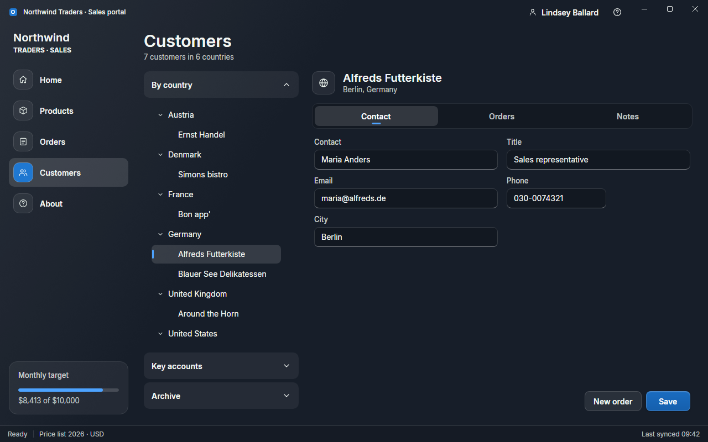

### About

A card with text and a `HyperlinkButton`.

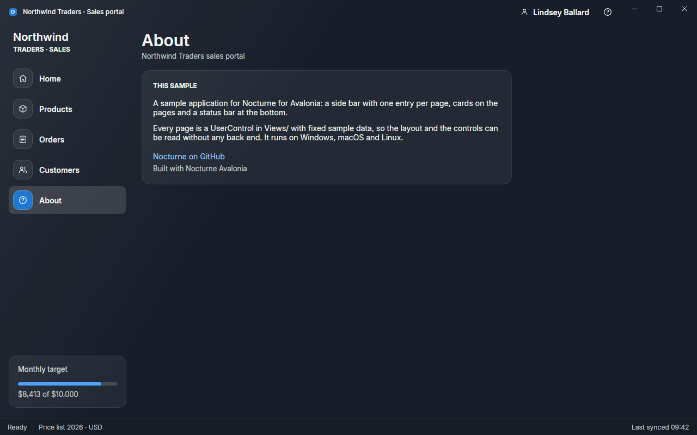
