# Nocturne for Avalonia

Nocturne.Avalonia is the same dark theme for [Avalonia](https://avaloniaui.net/) 12 on .NET 10 and
later, on Windows, macOS and Linux. It stands alone (no Fluent or Simple theme under it): it styles
Avalonia's own controls, and adds the controls a desktop app usually needs where Avalonia has none.
The design values (colours, radii, sizes, transitions, icons) are generated from the WPF library, so
both look alike.

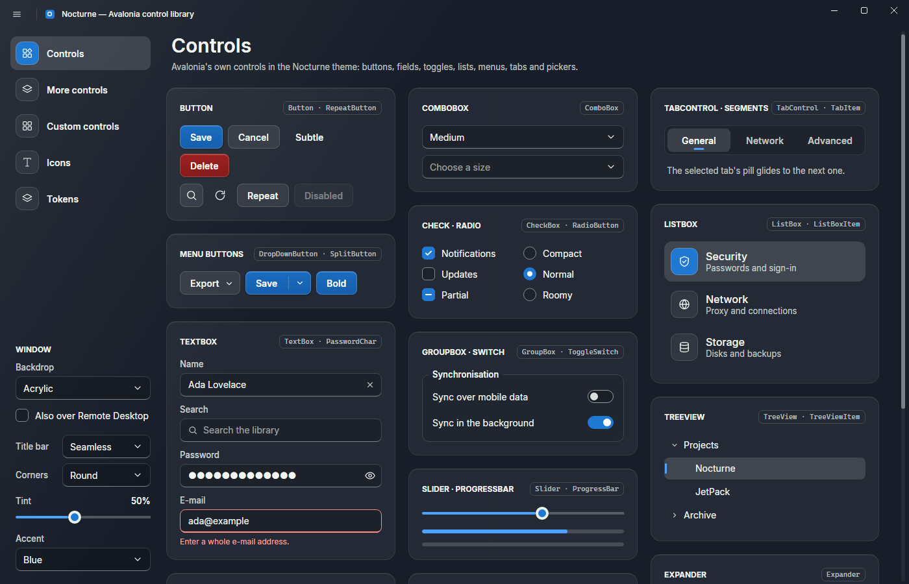

| | |
| --- | --- |
| Package | [Nocturne.Avalonia](https://www.nuget.org/packages/Nocturne.Avalonia) on nuget.org (and on each `avalonia-v*` [GitHub release](https://github.com/Montago/NocturneTheme/releases)) |
| Needs | .NET 10 or later, Avalonia 12. The backdrop needs Windows 11 22H2 with transparency effects on; elsewhere the window paints an opaque ground of the same colour. |
| Namespace | `xmlns:nc="urn:nocturne-avalonia"` |
| Pages | [Controls](avalonia-controls.md), [Sample apps](avalonia-samples.md) |

## Getting started

```bash
dotnet add package Nocturne.Avalonia
```

Add the theme to `App.axaml` in place of the Fluent or Simple theme. It is a dark theme, so ask for
the dark variant too (Avalonia's own resources follow it):

```xml
<Application xmlns="https://github.com/avaloniaui"
             xmlns:x="http://schemas.microsoft.com/winfx/2006/xaml"
             xmlns:nc="urn:nocturne-avalonia"
             x:Class="MyApp.App"
             RequestedThemeVariant="Dark">
    <Application.Styles>
        <nc:NocturneTheme />
    </Application.Styles>
</Application>
```

Make the main window a `NocturneWindow` and put the controls on cards:

```xml
<nc:NocturneWindow xmlns="https://github.com/avaloniaui"
                   xmlns:x="http://schemas.microsoft.com/winfx/2006/xaml"
                   xmlns:nc="urn:nocturne-avalonia"
                   x:Class="MyApp.MainWindow"
                   Title="My app" Width="1100" Height="720">
    <StackPanel Margin="24">
        <TextBlock Theme="{StaticResource Nocturne.Styles.TextBlock.Title}" Text="Settings" />
        <HeaderedContentControl Margin="0,20,0,0" Theme="{StaticResource Nocturne.Styles.Card}" Header="SYNCHRONISATION">
            <StackPanel Spacing="16">
                <ToggleSwitch Content="Synchronise in the background" IsChecked="True" />
                <Button HorizontalAlignment="Left" Theme="{StaticResource Nocturne.Styles.Button.Primary}" Content="Save" />
            </StackPanel>
        </HeaderedContentControl>
    </StackPanel>
</nc:NocturneWindow>
```

```csharp
public partial class MainWindow : Nocturne.Avalonia.Controls.NocturneWindow
{
    public MainWindow() => InitializeComponent();
}
```

Variants are ControlThemes with the same keys as the WPF styles, set with `Theme`:
`Theme="{StaticResource Nocturne.Styles.Button.Primary}"` where WPF has
`Style="{StaticResource Nocturne.Styles.Button.Primary}"`. Brushes, sizes and icons have the WPF keys
too (`{DynamicResource Nocturne.Brushes.Accent}`); the [resource keys](resource-keys.md) page lists
them.

## The window

`NocturneWindow` draws the frame: the backdrop, a dark tint over it and a soft light from the top-left
corner, under a 44px title bar with its own caption buttons. The title bar is drawn into the client
area and marked with Avalonia's window decoration roles, so the platform moves, snaps and maximises
the window from it; on Windows the maximise button opens the snap layouts. macOS keeps its traffic
lights.

| Property | |
| --- | --- |
| `Backdrop` | `Acrylic` (the default), `Mica`, `MicaAlt` (Windows 11) or `None`. Where it is not available (Windows 10, transparency effects off, most Linux desktops) the window paints its opaque ground. |
| `TintOpacity` | How much of the dark tint covers the backdrop (0.5). On Windows the Acrylic backdrop is lighter than the WPF window's (see [How it differs from WPF](#how-it-differs-from-wpf)); about 0.7 matches WPF at 0.5. |
| `UseBackdropInRemoteSession` | Over Remote Desktop the window paints the opaque ground, which draws faster there, unless this is true. |
| `TitleBarStyle` | `Seamless` (the default), `Separated` (a darker strip with a hairline) or `Accent` (a strip tinted with the accent). |
| `CornerStyle` | `Round`, `RoundSmall` or `Square` (Windows 11). |
| `LeftWindowCommands`, `RightWindowCommands` | Commands before the icon and before the caption buttons. |
| `ShowIcon`, `ShowMinButton`, `ShowMaxRestoreButton`, `TitleBarHeight` | The parts of the title bar. |
| `Flyouts` | The panels that slide in over the content (see below). |

```xml
<nc:NocturneWindow Title="My app" TitleBarStyle="Separated">
    <nc:NocturneWindow.RightWindowCommands>
        <Button Theme="{StaticResource Nocturne.Styles.Button.Icon.Subtle}" ToolTip.Tip="Settings" Content="{nc:Icon Cog, Size=16}" />
    </nc:NocturneWindow.RightWindowCommands>
    …
</nc:NocturneWindow>
```

| Separated | Accent |
| --- | --- |
| 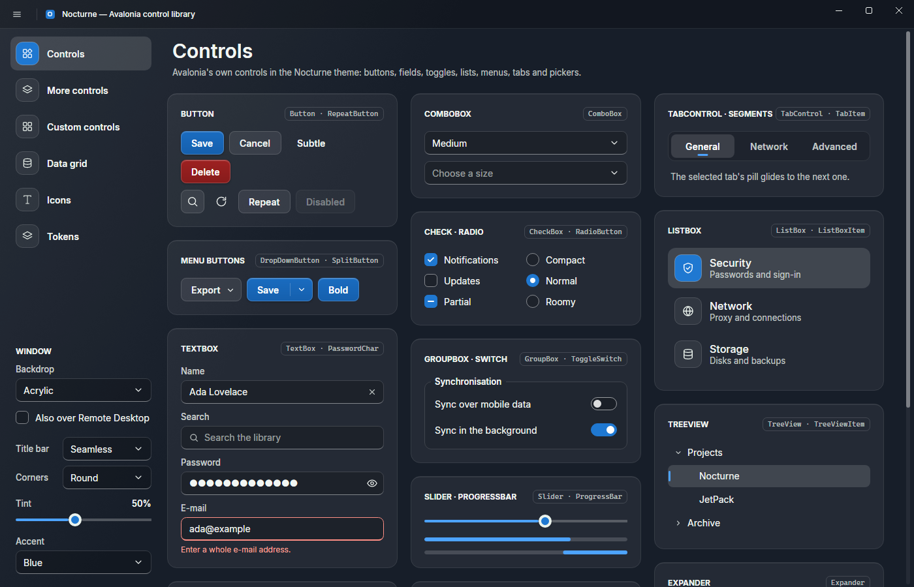 | 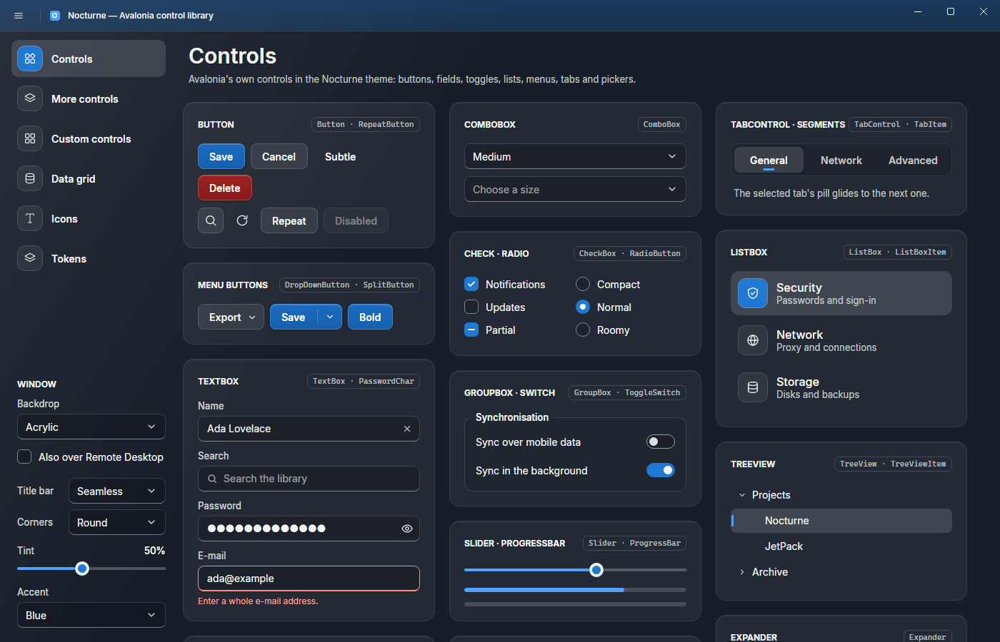 |

### Dialogs

A `NocturneDialog` is shown inside the window, over the dimmed content, and waits until it is closed.
Focus goes back to where it was afterwards; Escape closes it without a choice
(`MessageDialogResult.Canceled`).

```csharp
var result = await window.ShowMessageAsync("Delete employee?",
    "Heather Andrade will be removed from the staff list.", "Delete", "Cancel");
if (result == MessageDialogResult.Affirmative) { … }

// Or with your own content and a red main button
await window.ShowDialogAsync(new NocturneDialog
{
    Title = "Discard changes?",
    Content = new TextBlock { Text = "…", TextWrapping = TextWrapping.Wrap },
    AffirmativeText = "Discard",
    NegativeText = "Keep editing",
    AffirmativeButtonTheme = (ControlTheme)Application.Current!.FindResource("Nocturne.Styles.Button.Danger")!,
});
```

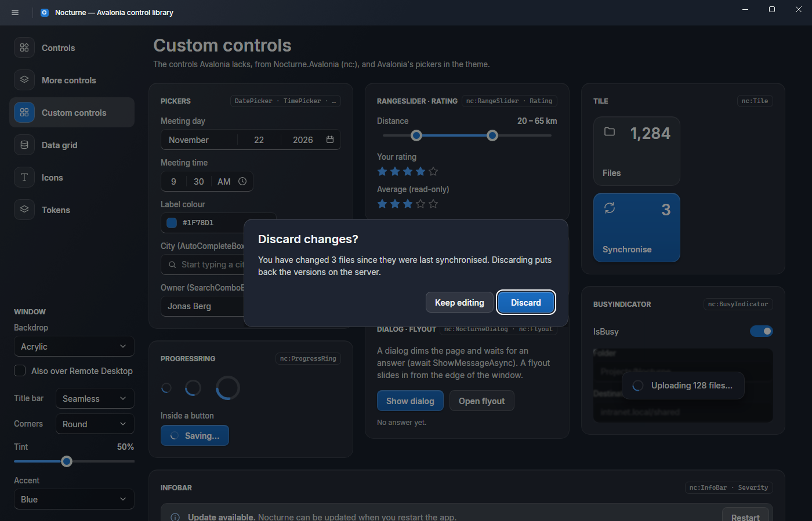

### Flyout

`nc:Flyout` (not Avalonia's popup `Flyout`) is a panel that slides in from an edge of the window
(`Position`: Right by default) and floats over the page. Put flyouts in `NocturneWindow.Flyouts` and
open them with `IsOpen`. It moves keyboard focus to its first field and gives it back when it closes;
Escape or its × closes it (`IsClosable`), and `IsAutoCloseEnabled` closes it after
`AutoCloseInterval` milliseconds.

```xml
<nc:NocturneWindow.Flyouts>
    <Panel>
        <nc:Flyout Name="SettingsFlyout" Header="Display settings" Width="360">
            <StackPanel>
                <ToggleSwitch Content="Show hidden files" IsChecked="True" />
            </StackPanel>
        </nc:Flyout>
    </Panel>
</nc:NocturneWindow.Flyouts>
```

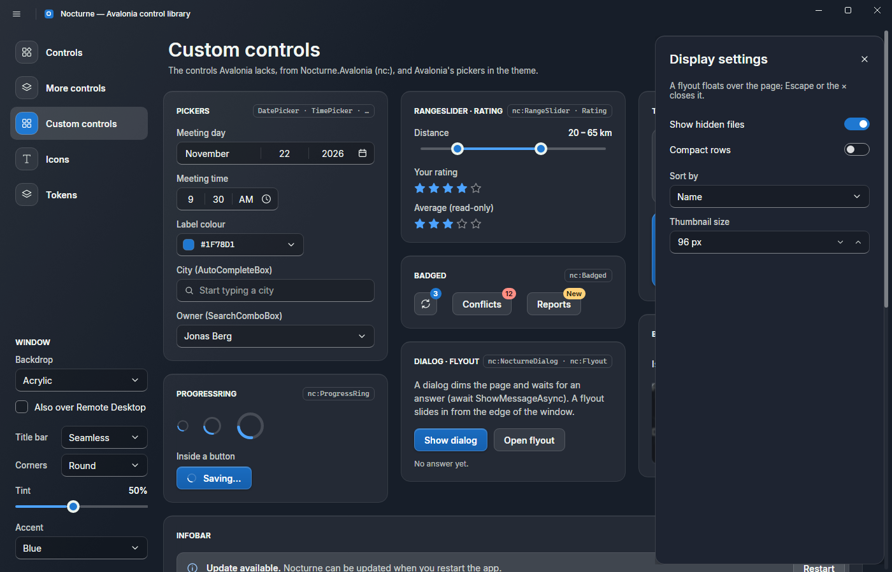

## Accents

Blue is the default. `NocturneTheme.SetAccent` switches the accent brushes, the primary button, the
window's tint and the popup ground at run time; every theme uses them as dynamic resources, so open
windows follow at once.

```csharp
using Nocturne.Avalonia;

NocturneTheme.SetAccent(NocturneAccent.Green);   // Blue, Green, Orange, Yellow, Teal
NocturneTheme.SetAccent(NocturneAccent.System);  // the accent colour of the operating system
```

`System` reads Windows' accent palette (elsewhere the accent colour Avalonia reports), derives the
ground from its hue and follows the system when the user changes it. `NocturneTheme.AccentChanged`
is raised after a switch.

| Green | Orange | Yellow | Teal |
| --- | --- | --- | --- |
| 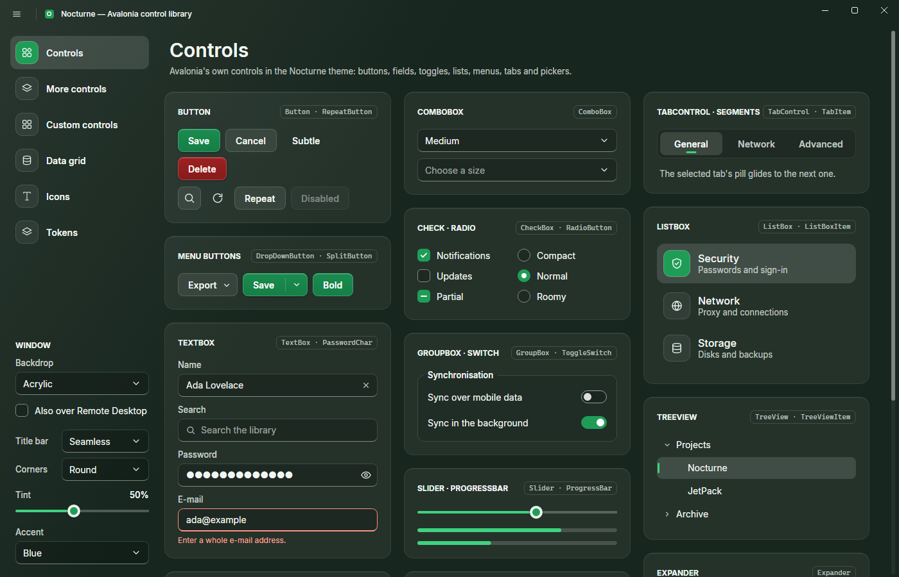 | 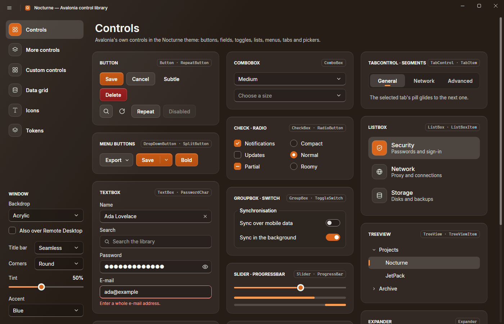 | 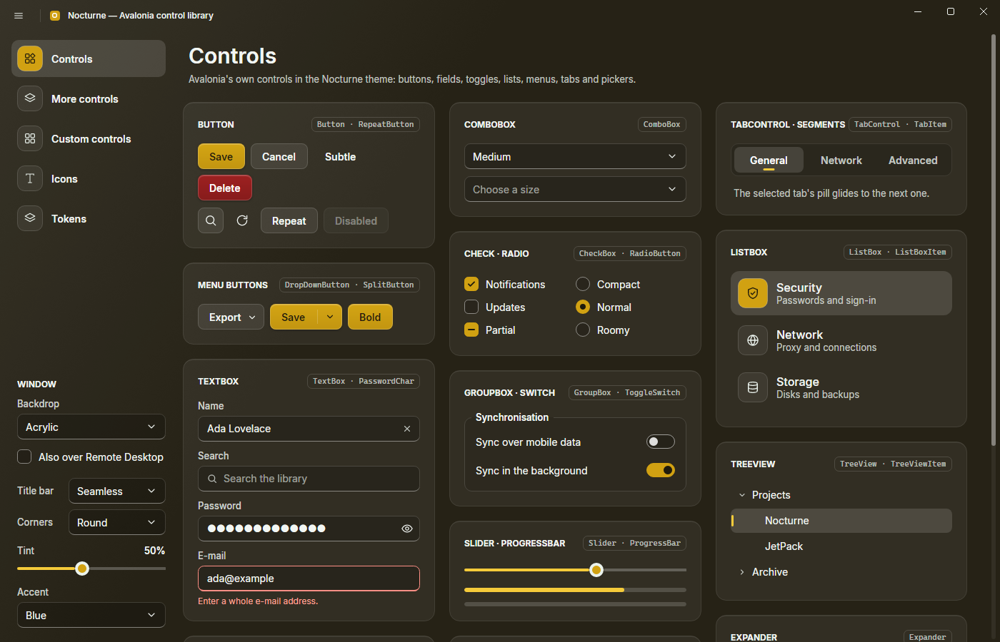 | 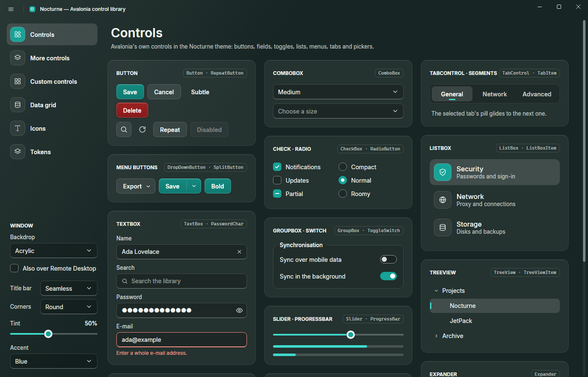 |

## Fonts and resources

The font is Inter, embedded in the package, so the theme looks the same on every platform; the
platform's UI fonts stand behind it for characters Inter lacks. To use another font, override
`Nocturne.Fonts.Family` in the application's resources. The type scale, brushes and the theme's line
icons are the WPF keys:

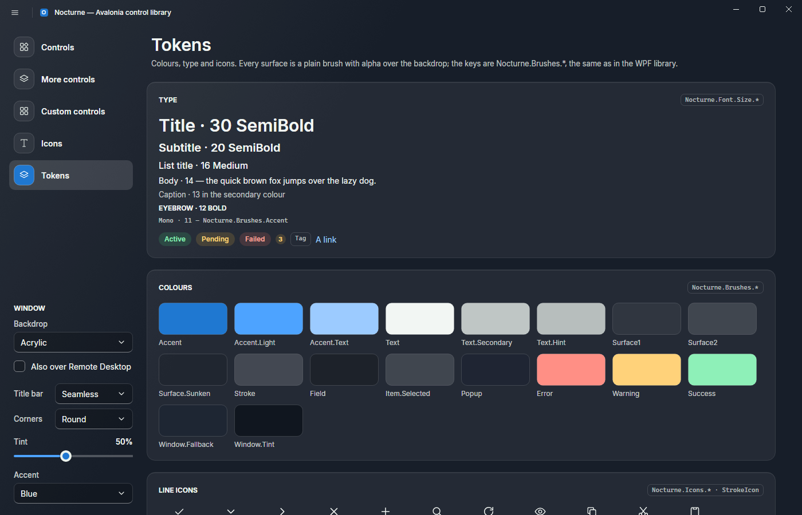

## How it differs from WPF

- Avalonia's own controls are styled where they exist (`NumericUpDown`, `TimePicker`, `DatePicker`,
  `CalendarDatePicker`, `AutoCompleteBox`, `ToggleSwitch`, `DropDownButton`, `SplitButton`), so their
  properties are Avalonia's. Nocturne adds its own classes only for what Avalonia lacks.
- Attached properties cannot be selected on in Avalonia styles, so the switches are style classes:
  `Classes="clearButton"` (or `nc:ControlHelper.ClearButton="True"`), `Classes="hasError"`
  (or `nc:ControlHelper.HasError="True"`), `Classes="revealPasswordButton"` for the eye button.
- `NocturneGrid` builds on Avalonia's `DataGrid` and its `DataGridCollectionView`: groups are the
  DataGrid's own group headers, and the WPF version's tricks for scrolling speed (cell text drawn as glyph
  runs, the preview while the scroll bar thumb is dragged) are not needed or not there.
- The Acrylic backdrop on Windows is Avalonia's own (the desktop blurred and saturated through Windows'
  composition), without the dark layer that Windows adds to the Acrylic the WPF window gets. With the
  same `TintOpacity` the window looks lighter; set it to about 0.7 to match WPF at 0.5. The theme leaves
  that to the app. It also stays translucent while the window is inactive, where Windows paints the
  WPF window's backdrop as a solid colour.
- ToolBar, RichTextBox and ListView/GridView do not exist in Avalonia; `DataGrid` takes the place of a
  ListView with columns.
- Checked on screen on Windows 11; on macOS and Linux it builds and renders headless in CI, but the
  window there has not been checked on a screen yet.

## The demo

`src/Nocturne.Avalonia.Demo` shows every control on six pages, with the window settings in the side
bar. Like the WPF demo it takes `--snapshot <folder>`: it draws the pages, popups and the gallery on
Avalonia's headless platform (no screen needed, the same on Linux) and checks behaviour with the
headless mouse and keyboard. The pictures on these pages come from there.

```bash
dotnet run --project src/Nocturne.Avalonia.Demo
```

| More controls | Custom controls |
| --- | --- |
| 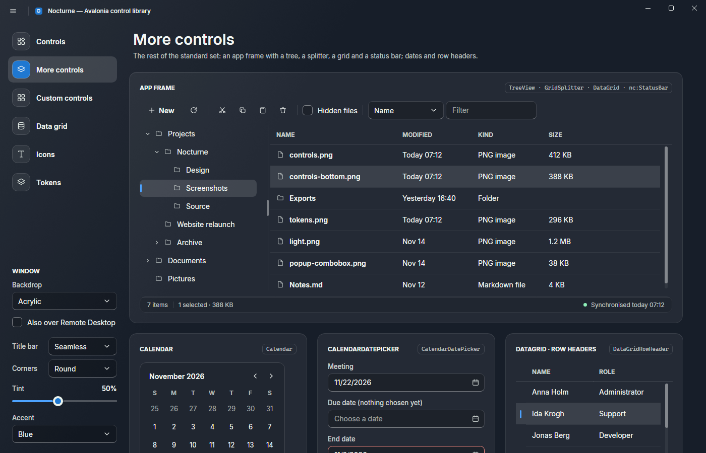 | 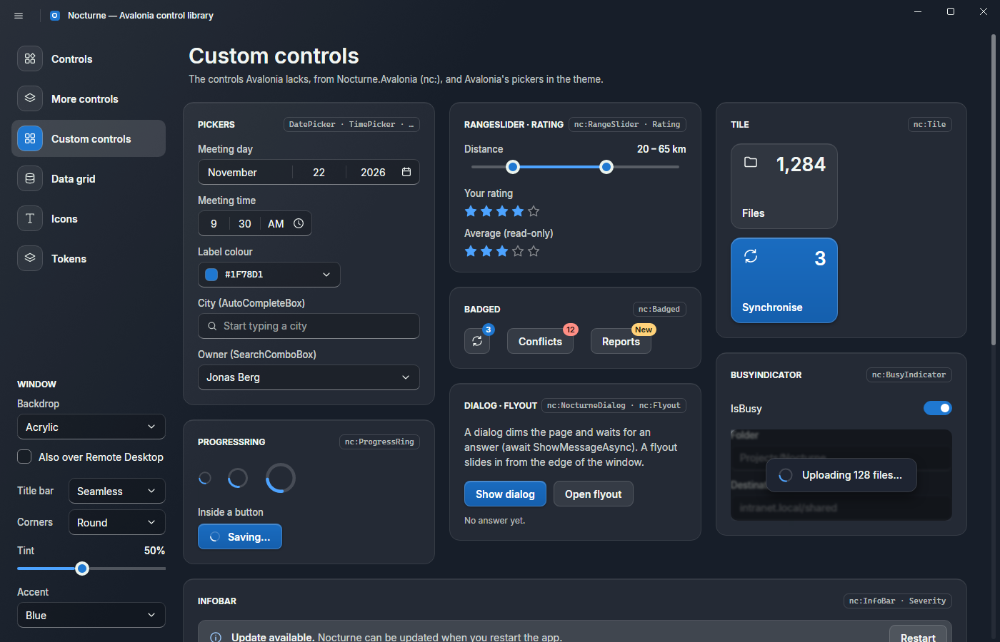 |

| Data grid | Icons |
| --- | --- |
| 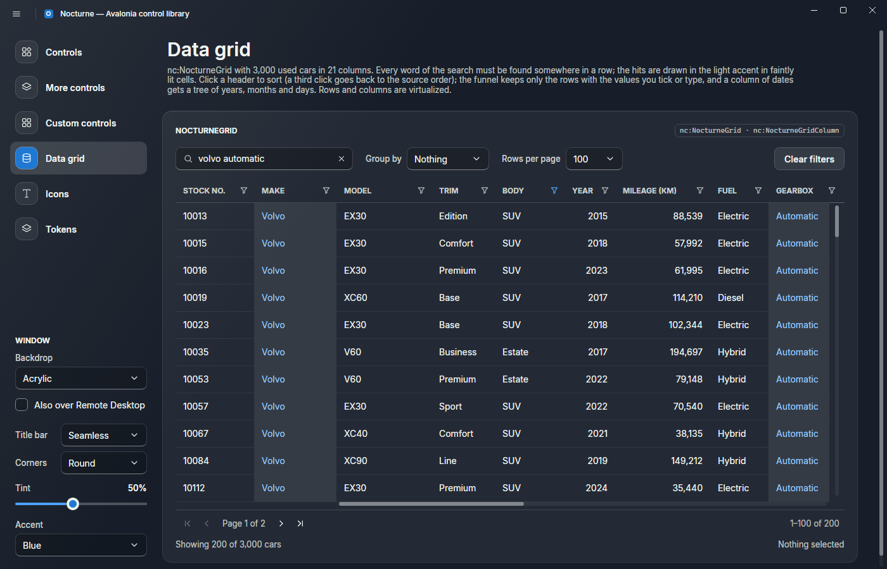 | 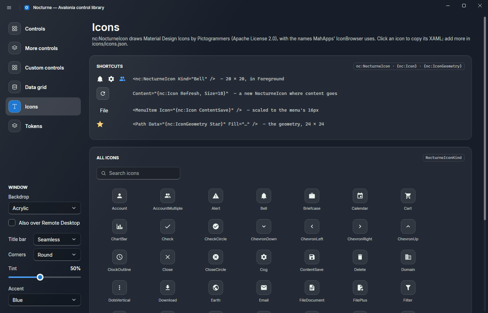 |
