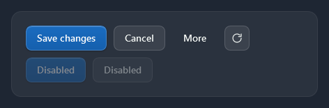
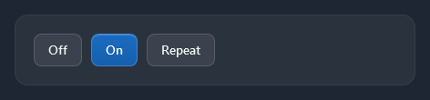
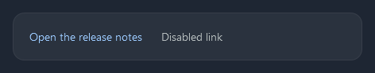
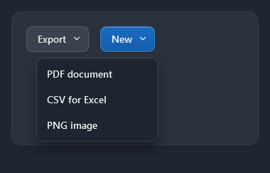
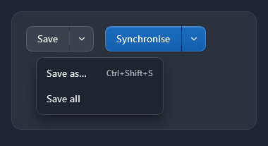
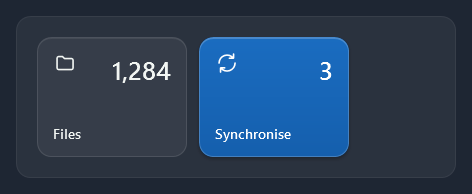
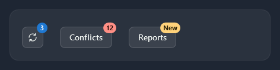

# Buttons

## Button



Every `Button` is a light translucent surface with a 1px border and 8px corners; hover lightens it
(120 ms) and a disabled button fades. The variants are keyed styles:

| Style | Look |
| --- | --- |
| *(implicit)* / `Nocturne.Styles.Button` | Light surface, for most actions |
| `Nocturne.Styles.Button.Primary` | The accent with a light top edge and a small shadow; one per view, for the main action |
| `Nocturne.Styles.Button.Subtle` | No surface until hovered; for less important actions |
| `Nocturne.Styles.Button.Icon` | A 36×36 square for an icon |
| `Nocturne.Styles.Button.Icon.Subtle` | An icon button with no surface until hovered (tool bars, title bar) |

```xml
<Button Style="{StaticResource Nocturne.Styles.Button.Primary}" Content="Save changes" IsDefault="True" />
<Button Content="Cancel" IsCancel="True" />
<Button Style="{StaticResource Nocturne.Styles.Button.Subtle}" Content="More" />
<Button Style="{StaticResource Nocturne.Styles.Button.Icon}" ToolTip="Refresh" AutomationProperties.Name="Refresh">
    <nc:StrokeIcon Width="18" Height="18" Data="{StaticResource Nocturne.Icons.Refresh}" />
</Button>
```

The template reads its colours from [`ControlHelper`](helpers.md#controlhelper), so a button in
another colour is a style with a few setters:

```xml
<Style x:Key="DangerButton" TargetType="Button" BasedOn="{StaticResource Nocturne.Styles.Button}">
    <Setter Property="Foreground" Value="#FF2A0E0B" />
    <Setter Property="Background" Value="{DynamicResource Nocturne.Brushes.Error}" />
    <Setter Property="nc:ControlHelper.HoverBackground" Value="#FFFFA39C" />
    <Setter Property="nc:ControlHelper.PressedBackground" Value="#FFE07A72" />
</Style>
```

## ToggleButton and RepeatButton



A checked `ToggleButton` takes the accent. `RepeatButton` looks like a `Button`.

```xml
<ToggleButton Content="Details" IsChecked="True" />
<RepeatButton Content="Repeat" Delay="400" Interval="80" />
```

For an on/off setting, use the [toggle switch](selection.md#toggle-switch) instead.

## Hyperlink



Links are drawn in the light accent (`Nocturne.Brushes.Accent.Text`), underlined under the mouse.

```xml
<TextBlock><Hyperlink NavigateUri="https://example.com" RequestNavigate="OnNavigate">Open the release notes</Hyperlink></TextBlock>
```

## DropDownButton



`nc:DropDownButton` opens its `Menu` (a `ContextMenu`) under itself; a chevron follows the content.
`Nocturne.Styles.DropDownButton.Primary` is the accent version.

```xml
<nc:DropDownButton Content="Export">
    <nc:DropDownButton.Menu>
        <ContextMenu>
            <MenuItem Header="PDF document" Click="OnExportPdf" />
            <MenuItem Header="CSV for Excel" Click="OnExportCsv" />
        </ContextMenu>
    </nc:DropDownButton.Menu>
</nc:DropDownButton>
```

## SplitButton



`nc:SplitButton` is a button with a chevron part: the left part is an ordinary button (`Click`,
`Command`), the chevron opens `Menu` with the other choices. `Nocturne.Styles.SplitButton.Primary`
is the accent version.

```xml
<nc:SplitButton Content="Save" Click="OnSave">
    <nc:SplitButton.Menu>
        <ContextMenu>
            <MenuItem Header="Save as…" InputGestureText="Ctrl+Shift+S" />
            <MenuItem Header="Save all" />
        </ContextMenu>
    </nc:SplitButton.Menu>
</nc:SplitButton>
```

## Tile



`nc:Tile` is a large button for a dashboard: an icon (the content) at the top left, a `Count` at the
top right and a `Title` at the bottom. `Nocturne.Styles.Tile.Accent` fills it with the accent.

```xml
<nc:Tile Width="150" Title="Files" Count="1,284" Command="{Binding OpenFiles}">
    <nc:StrokeIcon Width="24" Height="24" Data="{StaticResource Nocturne.Icons.Folder}" />
</nc:Tile>
```

## Badged



`nc:Badged` puts a small badge on the top-right corner of its content. The badge is hidden while
`Badge` is null.

```xml
<nc:Badged Badge="{Binding UnreadCount}">
    <Button Style="{StaticResource Nocturne.Styles.Button.Icon}" ToolTip="Messages">
        <nc:StrokeIcon Width="18" Height="18" Data="{StaticResource Nocturne.Icons.Sync}" />
    </Button>
</nc:Badged>
<nc:Badged Badge="12" BadgeBackground="{DynamicResource Nocturne.Brushes.Error}" BadgeForeground="#FF2A0E0B">
    <Button Content="Conflicts" />
</nc:Badged>
```

| Property | |
| --- | --- |
| `Badge` | What the badge shows (a number or a short word) |
| `BadgeBackground` | The badge's fill (the accent by default) |
| `BadgeForeground` | The badge's text colour (the text on the accent by default) |
