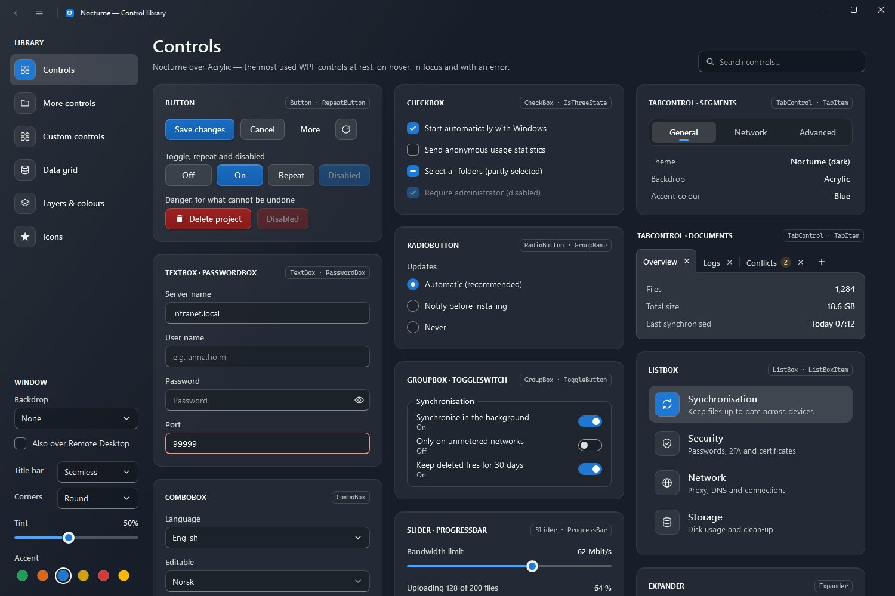

# Nocturne for WPF

Nocturne is a dark theme for WPF on .NET 10 and later. The Windows 11 backdrop (Acrylic by default,
or Mica / Mica Alt) shows through a tinted window with a soft light from the top-left corner, and
cards and controls sit on top as light, translucent surfaces. One resource dictionary styles every
standard control; the package adds the controls a desktop app usually needs on top.

| | |
| --- | --- |
| Package | [Nocturne.Wpf](https://www.nuget.org/packages/Nocturne.Wpf) on nuget.org (and on each [GitHub release](https://github.com/Montago/NocturneTheme/releases)) |
| Needs | .NET 10 or later, Windows 10 or 11. The backdrop needs Windows 11 22H2 with transparency effects on; elsewhere the window paints an opaque ground of the same colour. |
| Namespace | `xmlns:nc="urn:nocturne-wpf"` |
| Start with | [Getting started](getting-started.md) |

## What is in it

- **The window.** [`NocturneWindow`](window.md) draws the backdrop, the tint and the light, its own
  44px title bar (with commands on both sides, and a [separated or accent-tinted strip](window.md#title-bar-styles)
  if you like) and caption buttons, and hosts [dialogs and flyouts](window.md#dialogs).
- **Every standard control**, styled as soon as `Nocturne.xaml` is merged, plus named variants such as
  `Nocturne.Styles.Button.Primary`, `.Danger` or `Nocturne.Styles.TabControl.Document`. Text fields
  get a [right-click menu with icons](navigation.md#the-text-menu), [errors](inputs.md#errors) show in a
  callout under the field, and scroll bars fade out while the mouse is away.
- **Own controls** (`nc:` namespace): `DropDownButton`, `SplitButton`, `Tile`, `Badged`,
  `NumericUpDown`, `TimePicker`, `ColorPicker`, `AutoSuggestBox`, `SearchComboBox`, `RangeSlider`,
  `Rating`, `ProgressRing`, `BusyIndicator`, `InfoBar`, `Accordion`, `HamburgerMenu`, `NocturneDialog`,
  `Flyout` and `NocturneGrid`, a data grid for large lists with search, header filters, grouping and paging.
- **Accents.** Blue by default; `NocturneTheme.SetAccent` switches to green, orange, yellow, red or
  the accent colour chosen in Windows, at run time. See [Theme and accents](theming.md).
- **Building blocks**: cards, tags, pills, badges, icon tiles, a type scale, a small set of line
  icons (`nc:StrokeIcon`) and Material Design Icons (`nc:NocturneIcon`, `{nc:Icon Bell}`). See
  [Typography and surfaces](typography.md).

## The pages

| Page | What it covers |
| --- | --- |
| [Getting started](getting-started.md) | Install, merge the dictionary, the first window |
| [Theme and accents](theming.md) | Backdrop, tint, light, accents, overriding brushes, the font |
| [Controls](controls.md) | One page per group of controls, each with a picture and XAML |
| [Sample apps](samples.md) | Two applications built with the theme, page by page |
| [Reference](reference.md) | [Resource keys](resource-keys.md) and [helpers](helpers.md) (attached properties, template parts) |

The pictures come from the demo app in `src/Nocturne.Wpf.Demo` (`--snapshot`); the one under each
control's heading is rendered from its gallery, with drop-downs and menus open where the control has
one. They show the opaque fallback ground, as a snapshot cannot see the Windows backdrop.

## License

MIT, except the Material Design Icons that `NocturneIcon` draws (Apache License 2.0, by
Pictogrammers; see `NOTICE.md`). The rest, including the line icons, is drawn for Nocturne; the font
is Segoe UI, which comes with Windows. The package's licence is `MIT AND Apache-2.0`.
