# Text and input

Fields are dark, slightly sunken strips with a lighter bottom edge. In focus the bottom edge turns
into an accent line; with an error the border turns red.

## TextBox and Label

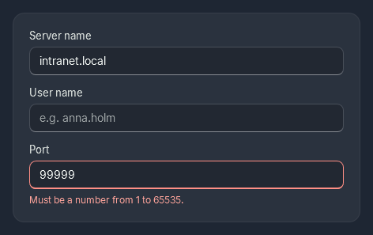

`Label` is the small text above a field; with `Target` its access key (`_Server`) moves focus to the
field. `ControlHelper.Placeholder` shows a hint while the box is empty.

```xml
<Label Content="_Server name" Target="{Binding ElementName=ServerBox}" />
<TextBox x:Name="ServerBox" Text="{Binding ServerName}" />

<Label Content="_User name" Target="{Binding ElementName=UserBox}" />
<TextBox x:Name="UserBox" nc:ControlHelper.Placeholder="e.g. anna.holm" />
```

### Errors

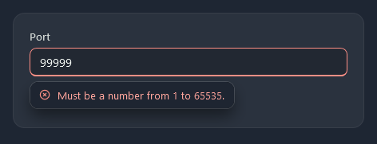

A validation error on the binding draws the field's red frame, and a small callout under the field
shows the first error message while the field has focus or the mouse is over it. It floats over the
layout, so nothing moves when an error comes or goes:

```xml
<TextBox Text="{Binding Port, ValidatesOnDataErrors=True, UpdateSourceTrigger=PropertyChanged}" />
```

`ControlHelper.HasError` shows the red frame without a binding error; put the message under the field
yourself with `Nocturne.Styles.TextBlock.Error`:

```xml
<TextBox Text="{Binding Port}" nc:ControlHelper.HasError="{Binding PortIsInvalid}" />
<TextBlock Style="{StaticResource Nocturne.Styles.TextBlock.Error}" Text="Must be a number from 1 to 65535." />
```

Both work the same on `PasswordBox`, `ComboBox`, `DatePicker`, `NumericUpDown` and the pickers. To
leave the callout out, set `Validation.ErrorTemplate` to `{DynamicResource Nocturne.Templates.NoErrorAdorner}`.

## Search box and clear button

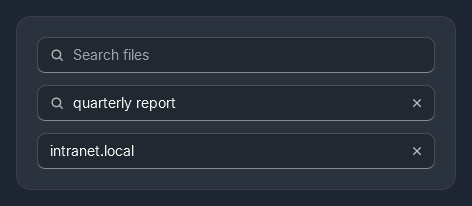

`Nocturne.Styles.TextBox.Search` puts a magnifier before the text. `ControlHelper.ClearButton`
adds an × that shows while there is text and empties the box (any `TextBox`).

```xml
<TextBox Style="{StaticResource Nocturne.Styles.TextBox.Search}" Text="{Binding Query, UpdateSourceTrigger=PropertyChanged}"
         nc:ControlHelper.Placeholder="Search files" nc:ControlHelper.ClearButton="True" />
```

## Multi-line text

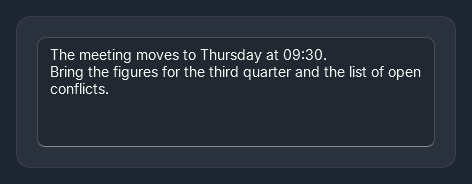

`Nocturne.Styles.TextBox.MultiLine` wraps, accepts Return and scrolls; give it a height.

```xml
<TextBox Style="{StaticResource Nocturne.Styles.TextBox.MultiLine}" Height="110" Text="{Binding Notes}" />
```

## PasswordBox

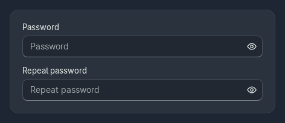

`PasswordBox` takes `ControlHelper.Placeholder` too. `PasswordBoxHelper.CanReveal` adds an eye button
that shows the password as text while it is on.

```xml
<PasswordBox nc:PasswordBoxHelper.CanReveal="True" nc:ControlHelper.Placeholder="Password" />
```

## RichTextBox

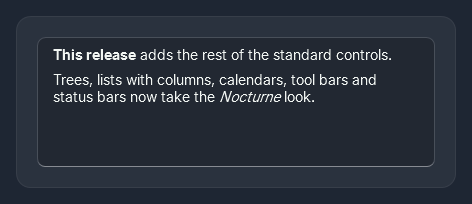

`RichTextBox` is a field like `TextBox`; its `FlowDocument` gets the theme font (a `FlowDocument`
does not inherit the box's font by itself).

```xml
<RichTextBox Height="150">
    <FlowDocument>
        <Paragraph><Bold>This release</Bold> adds the rest of the standard controls.</Paragraph>
    </FlowDocument>
</RichTextBox>
```

## ComboBox

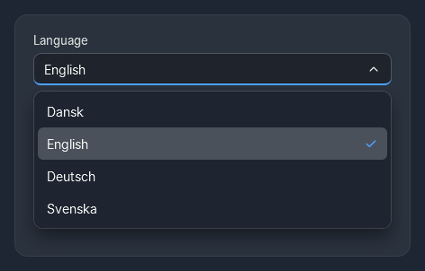

The drop-down is a dark popup with a shadow; the selected item has a light fill and a check mark.

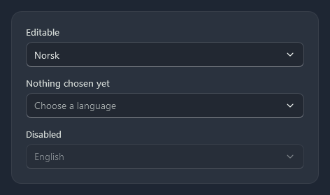

`IsEditable="True"` turns the field into a text box; `ControlHelper.Placeholder` shows while nothing
is chosen.

```xml
<ComboBox ItemsSource="{Binding Languages}" SelectedItem="{Binding Language}" />
<ComboBox IsEditable="True" ItemsSource="{Binding Languages}" Text="{Binding LanguageText}" />
<ComboBox ItemsSource="{Binding Languages}" nc:ControlHelper.Placeholder="Choose a language" />
```

To type into a long list and filter it, use [`SearchComboBox`](#searchcombobox).

## NumericUpDown

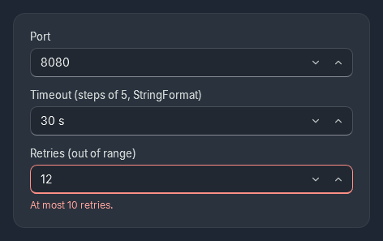

`nc:NumericUpDown` is a number field with down and up buttons; the arrow keys and the mouse wheel step
it too. Typed text is parsed when focus leaves or on Return.

```xml
<nc:NumericUpDown Minimum="1" Maximum="65535" Value="{Binding Port}" />
<nc:NumericUpDown Minimum="0" Maximum="300" Interval="5" Value="{Binding Timeout}" StringFormat="0 's'" />
```

| Property | |
| --- | --- |
| `Value` | The number (`double?`; empty is null), two-way by default |
| `Minimum`, `Maximum` | The range; values outside are clamped |
| `Interval` | The step of the buttons, arrow keys and wheel (1) |
| `StringFormat` | How the value is shown, e.g. `N1` or `0 'ms'` (`G`) |
| `IsReadOnly` | No typing and no stepping |
| `HideUpDownButtons` | Leaves out the buttons |
| `ValueChanged` | Raised when `Value` changes |

## DatePicker

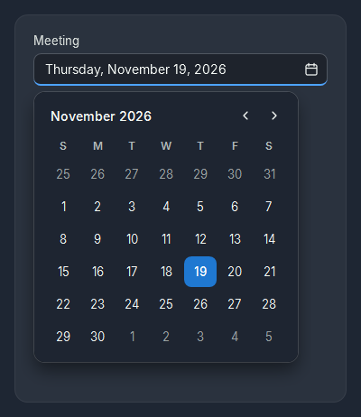

The calendar opens under the field. Today has a ring (`IsTodayHighlighted`), the selected day the accent.

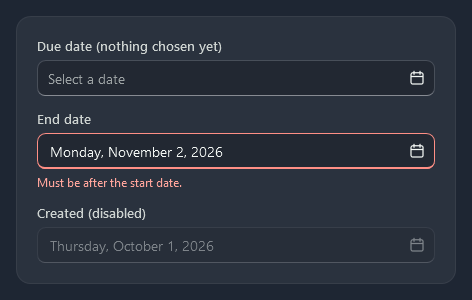

```xml
<DatePicker SelectedDate="{Binding Meeting}" />
<DatePicker SelectedDate="{Binding EndDate}" nc:ControlHelper.HasError="{Binding EndIsBeforeStart}" />
```

## TimePicker

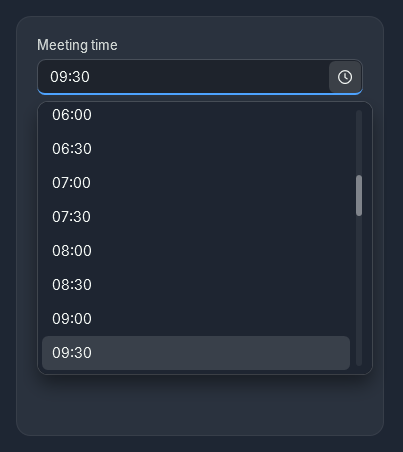

`nc:TimePicker` is a time field that opens a list of times `MinuteStep` minutes apart; the time can
also be typed (`9` or `9:30`, taken on Return or when focus leaves).

```xml
<nc:TimePicker SelectedTime="{Binding MeetingTime}" MinuteStep="30" />
```

| Property | |
| --- | --- |
| `SelectedTime` | The time (`TimeSpan?`), two-way by default |
| `MinuteStep` | Minutes between the times in the list (15) |
| `IsDropDownOpen` | Opens the list |

## ColorPicker

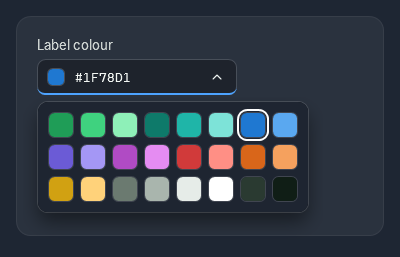

`nc:ColorPicker` shows the colour and its hex code and opens a grid of swatches.

```xml
<nc:ColorPicker Width="200" SelectedColor="{Binding LabelColour}" />
```

| Property | |
| --- | --- |
| `SelectedColor` | The colour, two-way by default |
| `Palette` | The swatches (any list of `Color`); `ColorPicker.DefaultPalette` (24 colours) by default |
| `IsDropDownOpen` | Opens the palette |

## AutoSuggestBox

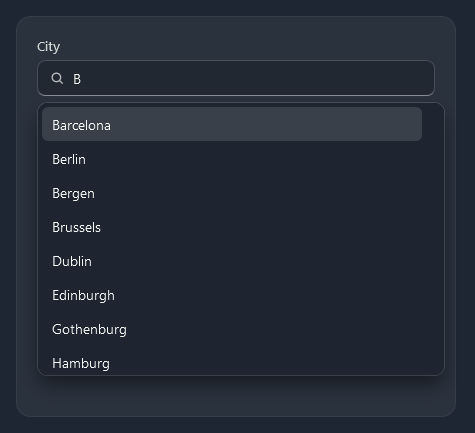

`nc:AutoSuggestBox` is a text box that suggests entries from `ItemsSource` that contain the typed
text. Up and Down move through them, Return or a click takes one and raises `SuggestionChosen`.
`ControlHelper.Icon` puts an icon before the text.

```xml
<nc:AutoSuggestBox ItemsSource="{Binding Cities}" Text="{Binding City}" nc:ControlHelper.Placeholder="Start typing a city"
                   nc:ControlHelper.Icon="{StaticResource Nocturne.Icons.Search}" SuggestionChosen="OnCityChosen" />
```

| Member | |
| --- | --- |
| `Text` | The text in the box, two-way by default |
| `ItemsSource` | The entries to suggest from (matched with `ToString()`) |
| `MaxSuggestions` | How many suggestions show at most (8) |
| `SuggestionChosen` | Raised when a suggestion is taken |

## SearchComboBox

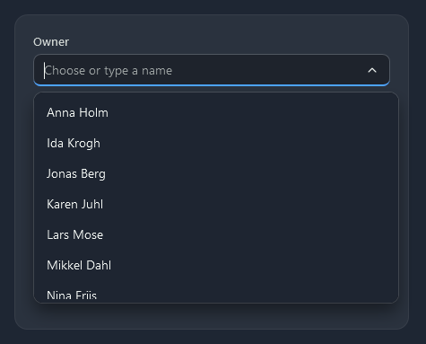

`nc:SearchComboBox` opens and picks like a `ComboBox`, but it can be typed into: the list filters to
the items that match and the first match is completed. The list is virtualized, so thousands of items
stay fast.

```xml
<nc:SearchComboBox ItemsSource="{Binding People}" DisplayMemberPath="Name" SelectedItem="{Binding Owner}"
                   nc:ControlHelper.Placeholder="Choose or type a name" />
```

| Property | |
| --- | --- |
| `ItemsSource`, `SelectedItem` | The items and the chosen one |
| `SelectedValuePath`, `SelectedValue` | A member of the chosen item, as on `ComboBox` |
| `DisplayMemberPath`, `ItemTemplate` | The text shown and matched, and an optional template for the list |
| `FilterMode` | `Contains` (every typed word appears somewhere, the default) or `StartsWith` |
| `IsFilteringEnabled` | False keeps every item in the list and only highlights and completes (true) |
| `IsAutoCompleteEnabled` | Fills in the rest of the first match, selected so the next key replaces it (true) |
| `OpenOnFocus` | Opens the list when the box gets focus (true) |
| `MaxDropDownHeight` | Height of the list (260) |
| `NoMatchesText` | Shown when nothing matches ("No matches") |
