# Lists and data

## ListBox

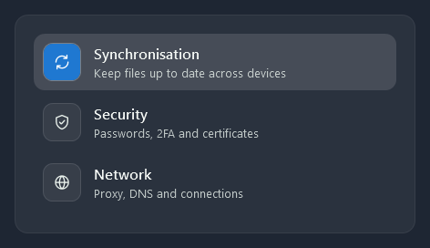

Items are rounded rows that light up under the mouse; the selected one gets a light fill. Lists have
no border of their own: they sit on a card.

```xml
<ListBox SelectedIndex="0">
    <ListBoxItem>
        <StackPanel Orientation="Horizontal">
            <ContentControl Style="{StaticResource Nocturne.Styles.IconTile}">
                <nc:StrokeIcon Data="{StaticResource Nocturne.Icons.Sync}" />
            </ContentControl>
            <StackPanel Margin="14,0,0,0" VerticalAlignment="Center">
                <TextBlock Style="{StaticResource Nocturne.Styles.TextBlock.ListTitle}" Text="Synchronisation" />
                <TextBlock Style="{StaticResource Nocturne.Styles.TextBlock.Caption}" Text="Keep files up to date across devices" />
            </StackPanel>
        </StackPanel>
    </ListBoxItem>
</ListBox>
```

### Side navigation

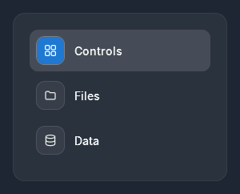

`Nocturne.Styles.ListBox.Navigation` is a list for the side bar of a window: an icon tile and a
label per item, and the selected item's icon tile fills with the accent.

```xml
<ListBox Style="{StaticResource Nocturne.Styles.ListBox.Navigation}" SelectedIndex="0">
    <ListBoxItem>
        <StackPanel Orientation="Horizontal">
            <ContentControl Style="{StaticResource Nocturne.Styles.IconTile.Small}">
                <nc:StrokeIcon Width="18" Height="18" Data="{StaticResource Nocturne.Icons.Grid}" />
            </ContentControl>
            <TextBlock Margin="12,0,0,0" VerticalAlignment="Center" Text="Controls" />
        </StackPanel>
    </ListBoxItem>
</ListBox>
```

For a navigation pane that folds to its icons and has groups, use [`HamburgerMenu`](navigation.md#hamburgermenu).

## ListView with GridView

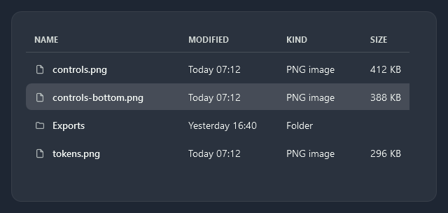

A `ListView` with a `GridView` gets small semibold column headers with a line under them, and rows
like the `ListBox`.

```xml
<ListView ItemsSource="{Binding Files}">
    <ListView.View>
        <GridView>
            <GridViewColumn Header="NAME" Width="220" DisplayMemberBinding="{Binding Name}" />
            <GridViewColumn Header="MODIFIED" Width="140" DisplayMemberBinding="{Binding Modified}" />
            <GridViewColumn Header="SIZE" Width="80" DisplayMemberBinding="{Binding Size}" />
        </GridView>
    </ListView.View>
</ListView>
```

## TreeView

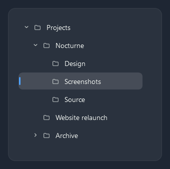

Each level is indented; a chevron opens and closes a branch, and the selected item has a short accent
bar on the left.

```xml
<TreeView ItemsSource="{Binding Folders}">
    <TreeView.ItemTemplate>
        <HierarchicalDataTemplate ItemsSource="{Binding Children}">
            <TextBlock Text="{Binding Name}" />
        </HierarchicalDataTemplate>
    </TreeView.ItemTemplate>
</TreeView>
```

## DataGrid

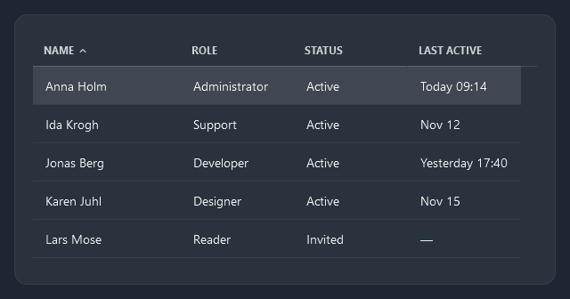

The standard `DataGrid` gets the column headers of the `ListView`, quiet row lines and the selected
row's light fill. Sorting shows a small chevron in the header.

```xml
<DataGrid ItemsSource="{Binding People}" AutoGenerateColumns="False" IsReadOnly="True">
    <DataGrid.Columns>
        <DataGridTextColumn Header="NAME" Width="*" Binding="{Binding Name}" />
        <DataGridTextColumn Header="ROLE" Width="*" Binding="{Binding Role}" />
    </DataGrid.Columns>
</DataGrid>
```

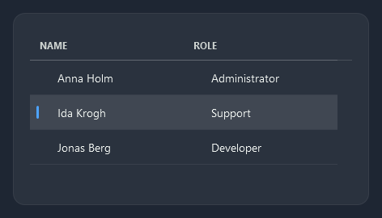

With `HeadersVisibility="All"` the rows get a row header, which marks the selected row with an accent bar.

## NocturneGrid

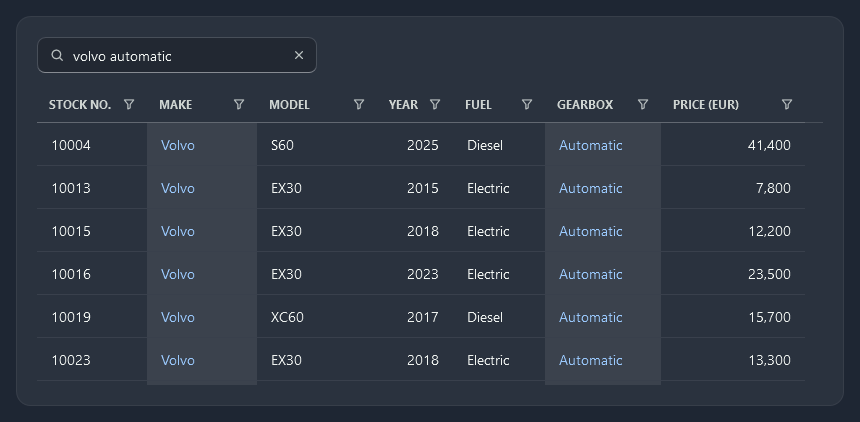

`nc:NocturneGrid` is a `DataGrid` for large lists. Rows and columns are virtualized and the rows are
recycled, and the text of `NocturneGridColumn` cells is drawn straight from the font, so tens of
thousands of rows scroll smoothly. It scrolls by row (a wheel turn moves three rows). While the scroll
bar thumb is dragged, the rows in view show the rows at the thumb and the grid moves there when the
thumb is released, so a fast drag keeps up.

- **Search**: `SearchText` filters the rows to those that contain every word somewhere (in the
  searchable columns); quotes keep a phrase together. The hits are drawn in the light accent in faintly
  lit cells.
- **Filters**: every column header has a funnel. Its filter lists the column's values with their counts
  to tick, or takes typed values: `*` matches any text (`vol*`), and numbers and dates take ranges
  (`>50000`, `<=2019`, `2020-01-01..2020-06-30`). A column of dates gets a tree of years, months and days.
- **Sorting**: a click on a header sorts up, then down, then back to the original order.
- **Grouping**: `GroupMemberPath` groups the rows under header rows that fold up.
- **Paging**: `PageSize` shows one page at a time with a pager under the rows.

```xml
<TextBox x:Name="Search" Style="{StaticResource Nocturne.Styles.TextBox.Search}" nc:ControlHelper.ClearButton="True" />
<nc:NocturneGrid ItemsSource="{Binding Cars}" SearchText="{Binding Text, ElementName=Search}" Filtered="OnFiltered">
    <nc:NocturneGrid.Columns>
        <nc:NocturneGridColumn Width="130" Header="MAKE" Binding="{Binding Make}" />
        <nc:NocturneGridColumn Width="150" Header="MODEL" Binding="{Binding Model}" />
        <nc:NocturneGridColumn Width="76" Header="YEAR" Binding="{Binding Year}" TextAlignment="Right" />
        <nc:NocturneGridColumn Width="136" Header="PRICE (EUR)" Binding="{Binding Price, StringFormat=N0}" IsSearchable="False" TextAlignment="Right" />
        <nc:NocturneGridCheckBoxColumn Width="88" Header="SOLD" Binding="{Binding IsSold}" />
    </nc:NocturneGrid.Columns>
</nc:NocturneGrid>
```

### Header filters

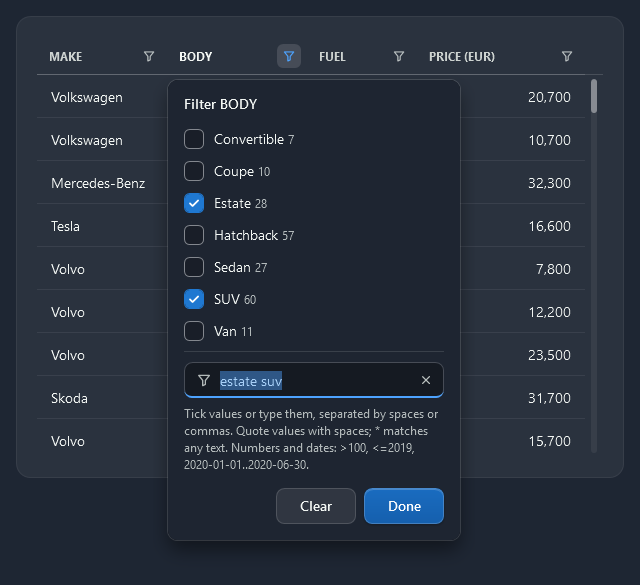

A column with at most `FilterListLimit` different values lists them to tick; with more, the values
are typed. A column's filter can be set from XAML or code with `FilterText` (`FilterDates` for dates).
`NocturneGrid.ClearFilterCommand` clears one column's filter (the column as parameter) or, without
a parameter, the search and every filter.

```xml
<nc:NocturneGridColumn Header="BODY" Binding="{Binding Body}" FilterText="estate suv" />
<Button Content="Clear filters" Command="{x:Static nc:NocturneGrid.ClearFilterCommand}" CommandTarget="{Binding ElementName=Cars}" />
```

### Groups

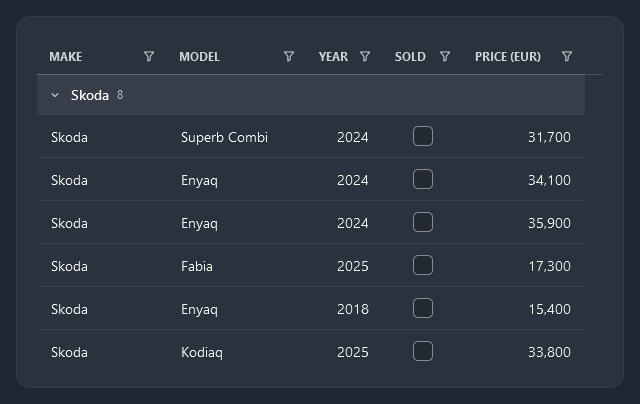

```xml
<nc:NocturneGrid ItemsSource="{Binding Cars}" GroupMemberPath="Make">
```

### Pages

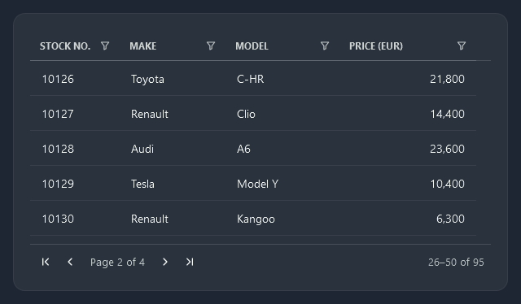

```xml
<nc:NocturneGrid ItemsSource="{Binding Cars}" PageSize="25">
```

### Members

| Property | |
| --- | --- |
| `SearchText` | Words that must all be found in a row; quotes keep a phrase together |
| `SearchDelay` | Pause after the last change before the rows are filtered (zero filters at once) |
| `FilterListLimit` | A filter lists the values to tick when the column has at most this many |
| `GroupMemberPath` | Member the rows are grouped by; empty for none |
| `PageSize`, `PageIndex` | Rows per page (0 shows every row) and the page shown, from 0 |
| `PageCount`, `PageNumber`, `PageFirstRow`, `PageLastRow`, `IsPaging` | Read-only, for your own pager text |
| `FilteredItemCount`, `TotalItemCount`, `IsFiltered` | Read-only counts, for a status line |
| `HighlightForeground`, `HighlightBrush`, `HighlightCellBackground` | Colours of the search hits |
| `EnableLightweightTextRendering` | Draws cell text as glyph runs (true); columns with an `ElementStyle` keep a `TextBlock` |

| Method or event | |
| --- | --- |
| `Filtered` | Raised after the rows have been filtered; `Count` and `TotalCount` in the event data |
| `SelectedItemChanged` | Raised when `SelectedItem` changes (not by combo boxes inside cells, unlike `SelectionChanged`) |
| `ApplyFilters()` | Filters now instead of after `SearchDelay`, and re-reads changed values |
| `ClearFilters()` | Clears the search and every column filter |
| `GetVisibleItems()` | The rows left after the search and filters, in the order shown |

Columns are `nc:NocturneGridColumn` (text; `TextAlignment` instead of an `ElementStyle`) and
`nc:NocturneGridCheckBoxColumn` (`TrueText` and `FalseText` name the values in the filter, the search
and when copying; its search is off by default). Both take
`IsSearchable`, `IsFilterable`, `FilterMemberPath` and `FilterText`; other `DataGrid` columns work
too, and are searched through `NocturneGrid.FilterMemberPath` or their `SortMemberPath`.

## Calendar

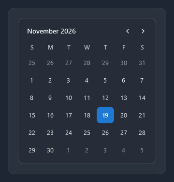

Month and year at the top left with arrows on the right; today has a ring and the selected day the
accent. A click on the month shows the months of the year, and again the years.

```xml
<Calendar SelectedDate="{Binding Meeting}" />
```

## ScrollViewer

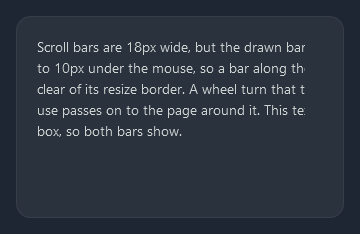

Scroll bars are thin 6px lines that widen to 10px under the mouse. Their hit area is 18px, so a bar
along the window edge stays clear of the resize border. They fade out while the mouse is away and
come back when it is over the scroll viewer or the content scrolls; their room stays, so the content
does not move ([`ScrollViewerHelper.AutoHide`](helpers.md#scrollviewerhelper)). The pictures on these
pages show no bars for that reason. The theme's `ScrollViewer` passes a wheel turn
it cannot use (a list scrolled to its end, or with nothing to scroll) on to the scroll viewer around
it, so a list inside a scrolling page does not stop the page ([`ScrollViewerHelper`](helpers.md#scrollviewerhelper)).

```xml
<ScrollViewer HorizontalScrollBarVisibility="Auto">
    ...
</ScrollViewer>
```
