# Navigation and layout

## TabControl

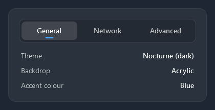

The implicit `TabControl` is a segmented control: the tab headers share one sunken strip, the
selected one is a raised segment with a short accent line under its text, and the page sits below.
When another tab is chosen, the segment glides over to it (320 ms) and the line runs ahead and
stretches before it settles; `nc:TabSelectionIndicator` in the template draws both.

```xml
<TabControl>
    <TabItem Header="General">...</TabItem>
    <TabItem Header="Network">...</TabItem>
    <TabItem Header="Advanced">...</TabItem>
</TabControl>
```

### Document tabs

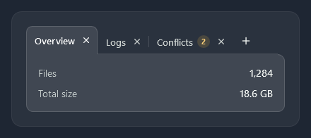

`Nocturne.Styles.TabControl.Document` is a row of tabs for open documents: the selected tab joins the
panel under it, thin lines divide the others, and [`TabHelper`](helpers.md#tabhelper) adds close
buttons, badges and a "+" button.

```xml
<TabControl Style="{StaticResource Nocturne.Styles.TabControl.Document}" ItemsSource="{Binding Documents}"
            nc:TabHelper.ShowCloseButton="True" nc:TabHelper.ShowAddButton="True">
    <TabControl.CommandBindings>
        <CommandBinding Command="{x:Static nc:TabHelper.AddTabCommand}" Executed="OnAddTab" />
    </TabControl.CommandBindings>
</TabControl>
```

The × runs `TabHelper.CloseTabCommand`, which raises `TabHelper.TabClosing` (set `Cancel` to keep the
tab) and then removes the tab, or its item from `ItemsSource` when that is a writable list.
`TabHelper.Badge` on a `TabItem` shows a small amber count after its header.

## HamburgerMenu

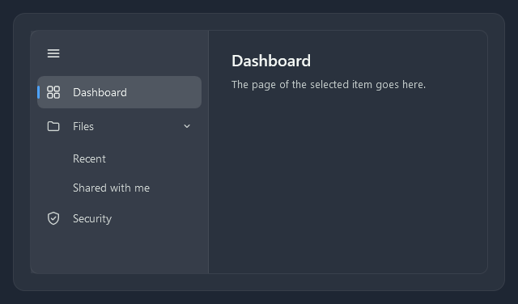

`nc:HamburgerMenu` is a navigation pane on the left and a content area on the right. Items are
`nc:HamburgerMenuItem`s with an `Icon`; an item with sub-items is a group that opens and closes (two
levels). The selected item gets a light fill and a short accent bar.

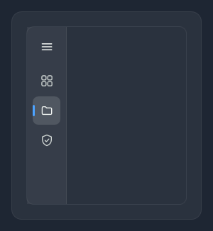

The ☰ button folds the pane to its icons (`IsPaneOpen`); a group then shows the selection of its
sub-items.

```xml
<nc:HamburgerMenu SelectedIndex="0" Content="{Binding SelectedItem.Tag, RelativeSource={RelativeSource Self}}">
    <nc:HamburgerMenuItem Content="Dashboard" Tag="{StaticResource DashboardPage}">
        <nc:HamburgerMenuItem.Icon><nc:StrokeIcon Data="{StaticResource Nocturne.Icons.Grid}" /></nc:HamburgerMenuItem.Icon>
    </nc:HamburgerMenuItem>
    <nc:HamburgerMenuItem Content="Files" IsExpanded="True">
        <nc:HamburgerMenuItem.Icon><nc:StrokeIcon Data="{StaticResource Nocturne.Icons.Folder}" /></nc:HamburgerMenuItem.Icon>
        <nc:HamburgerMenuItem.Items>
            <nc:HamburgerMenuItem Content="Recent" />
            <nc:HamburgerMenuItem Content="Shared with me" />
        </nc:HamburgerMenuItem.Items>
    </nc:HamburgerMenuItem>
</nc:HamburgerMenu>
```

| `HamburgerMenu` | |
| --- | --- |
| `Content`, `ContentTemplate` | What the content area shows; usually bound to the selected item |
| `IsPaneOpen` | False shows only the icons (true) |
| `PaneWidth`, `CompactPaneWidth` | Width of the open pane (170) and of the icon column (40) |
| `SelectedItem` | The selected page, on either level (a group itself is never selected) |

| `HamburgerMenuItem` | |
| --- | --- |
| `Icon` | The icon, usually an `nc:StrokeIcon` or `{nc:Icon …}` ([NocturneIcon](typography.md#nocturneicon)) |
| `Items` | Sub-items: they make the item a group. Sub-items show no icon |
| `IsExpanded` | Whether a group shows its sub-items; selecting a sub-item opens its group |

## Expander

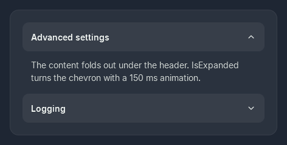

A 48px header with a chevron that turns in 150 ms; the content folds out under it.

```xml
<Expander Header="Advanced settings" IsExpanded="True">
    <TextBlock TextWrapping="Wrap" Text="..." />
</Expander>
```

## Accordion

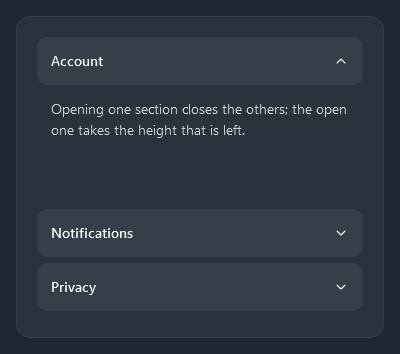

`nc:Accordion` is a stack of expanders where opening one closes the others; the open one takes the
height that is left. Give it a height.

```xml
<nc:Accordion Height="330">
    <Expander Header="Account" IsExpanded="True">...</Expander>
    <Expander Header="Notifications">...</Expander>
    <Expander Header="Privacy">...</Expander>
</nc:Accordion>
```

## GroupBox

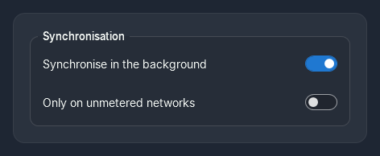

A thin rounded frame with the header set into its top edge.

```xml
<GroupBox Header="Synchronisation">
    <StackPanel>...</StackPanel>
</GroupBox>
```

For a section of a page, a [card](typography.md#cards) is usually the better choice.

## Menu

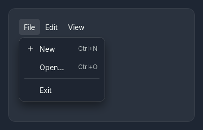

The menu bar's items are flat until hovered; submenus open in the dark popup. `ControlHelper.Icon`
puts a line icon before a menu item (or `Icon="{nc:Icon ContentSave}"` a [Material Design
icon](typography.md#nocturneicon), scaled to 16px), and `InputGestureText` shows its shortcut on the right.

```xml
<Menu>
    <MenuItem Header="_File">
        <MenuItem Header="_New" InputGestureText="Ctrl+N" nc:ControlHelper.Icon="{StaticResource Nocturne.Icons.Plus}" />
        <MenuItem Header="_Open…" InputGestureText="Ctrl+O" />
        <Separator />
        <MenuItem Header="E_xit" />
    </MenuItem>
</Menu>
```

## ContextMenu

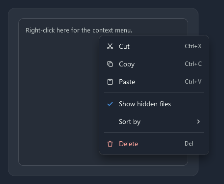

The same items as the menu: icons, shortcuts, check marks for `IsCheckable` items and submenus.

```xml
<Border.ContextMenu>
    <ContextMenu>
        <MenuItem Header="Cut" InputGestureText="Ctrl+X" nc:ControlHelper.Icon="{StaticResource Nocturne.Icons.Cut}" />
        <MenuItem Header="Show hidden files" IsCheckable="True" IsChecked="True" />
        <Separator />
        <MenuItem Header="Delete" InputGestureText="Del" Foreground="{DynamicResource Nocturne.Brushes.Error.Text}"
                  nc:ControlHelper.Icon="{StaticResource Nocturne.Icons.Delete}" />
    </ContextMenu>
</Border.ContextMenu>
```

### The text menu

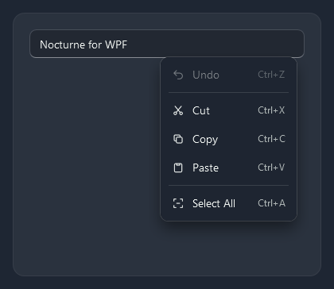

Text fields (`TextBox`, `RichTextBox`, the editable `ComboBox`, `NumericUpDown`, `DatePicker`) get
`Nocturne.ContextMenu.Text` instead of Windows' plain menu: Undo, Cut, Copy, Paste and Select all with
the theme's line icons and their shortcuts. The commands work on the field the menu was opened on, so
Cut and Copy are dimmed while nothing is selected. A read-only field shows only Copy and Select all,
and a `PasswordBox` gets `Nocturne.ContextMenu.Password` with Paste only. A field with
`SpellCheck.IsEnabled` keeps WPF's own menu, which lists the spelling suggestions.

To add an item, give the field a menu of your own (every field needs its own instance) with
[`ContextMenuHelper.TargetsPlacement`](helpers.md#contextmenuhelper), and the commands go to the field:

```xml
<TextBox>
    <TextBox.ContextMenu>
        <ContextMenu nc:ContextMenuHelper.TargetsPlacement="True">
            <MenuItem Command="ApplicationCommands.Copy" nc:ControlHelper.Icon="{StaticResource Nocturne.Icons.Copy}" />
            <MenuItem Header="Copy as link" Click="OnCopyLink" />
        </ContextMenu>
    </TextBox.ContextMenu>
</TextBox>
```

## ToolBar

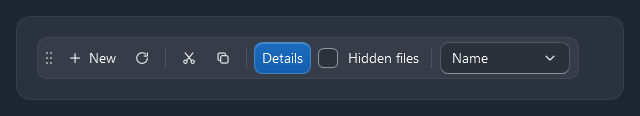

A rounded strip with a dotted grip; buttons in it are flat until hovered, and items that do not fit go
into the overflow menu behind a chevron. Buttons, toggle buttons, check boxes, combo boxes and text
boxes in a tool bar get tool bar versions of their styles.

```xml
<ToolBarTray>
    <ToolBar>
        <Button ToolTip="Refresh"><nc:StrokeIcon Width="16" Height="16" Data="{StaticResource Nocturne.Icons.Refresh}" /></Button>
        <Separator />
        <ToggleButton Content="Details" IsChecked="True" />
        <ComboBox Width="130" SelectedIndex="0">...</ComboBox>
    </ToolBar>
</ToolBarTray>
```

## StatusBar

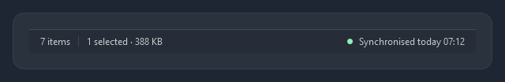

```xml
<StatusBar>
    <StatusBarItem Content="7 items" />
    <Separator />
    <StatusBarItem Content="1 selected · 388 KB" />
    <StatusBarItem HorizontalAlignment="Right" Content="Synchronised today 07:12" />
</StatusBar>
```

## GridSplitter

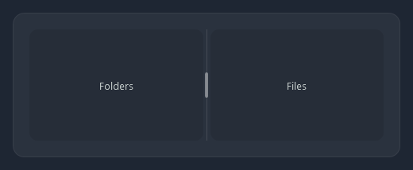

A thin line with a small grip in the middle that lights up under the mouse; the preview while dragging
is the same line.

```xml
<GridSplitter Grid.Column="1" HorizontalAlignment="Stretch" />
```

## ToolTip

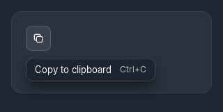

Tool tips use the popup ground with a small shadow.

```xml
<Button Style="{StaticResource Nocturne.Styles.Button.Icon}" ToolTip="Copy to clipboard">...</Button>
```

A tool tip can hold any content, for example its shortcut in `Nocturne.Brushes.Shortcut`:

```xml
<Button.ToolTip>
    <StackPanel Orientation="Horizontal">
        <TextBlock Text="Copy to clipboard" />
        <TextBlock Margin="12,0,0,0" Foreground="{DynamicResource Nocturne.Brushes.Shortcut}" Text="Ctrl+C" />
    </StackPanel>
</Button.ToolTip>
```
