# Sample apps

The repository has two small applications built with Nocturne, to show the controls working together
in the kind of window they are made for. Both are in the solution under `samples/`, use fixed sample
data (`SampleData.cs`) and have one `UserControl` per page in `Views/`.

```bash
dotnet run --project samples/Nocturne.Wpf.Samples.Admin
```

```bash
dotnet run --project samples/Nocturne.Wpf.Samples.Portal
```

Like the demo, both take `--snapshot <folder>` and render each page to a PNG (1280 × 800, off
screen); the pictures on this page come from there.

## Admin

A staff administration tool. The main window is a `NocturneWindow` with a
[`HamburgerMenu`](navigation.md) for the pages, a `Badged` notification button and a settings button
in the title bar, and a `StatusBar` at the bottom.

### Dashboard

Accent and plain [`Tile`](buttons.md)s with the key figures, an [`InfoBar`](status.md) with an action
button, and two cards: project budgets as `ProgressBar`s and a list of recent activity.

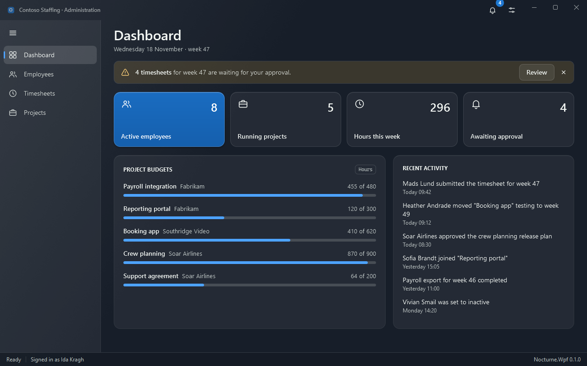

### Employees

A [`NocturneGrid`](lists.md) with filters in the column headers and a check box column next to a
details form: `TextBox`, `ComboBox`, `DatePicker`, [`NumericUpDown`](inputs.md) and a toggle switch.
The search box uses `Nocturne.Styles.TextBox.Search`; the tool bar has a primary button.

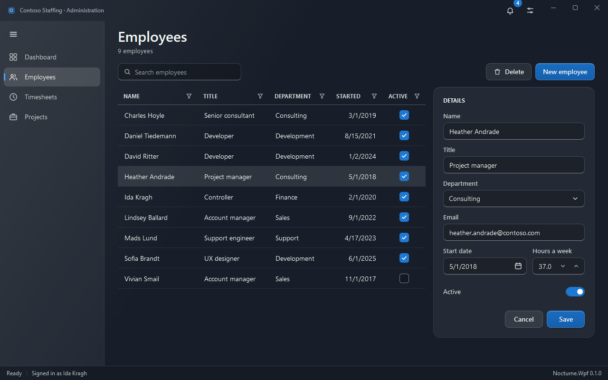

Delete asks first with a [`NocturneDialog`](window.md#dialogs):

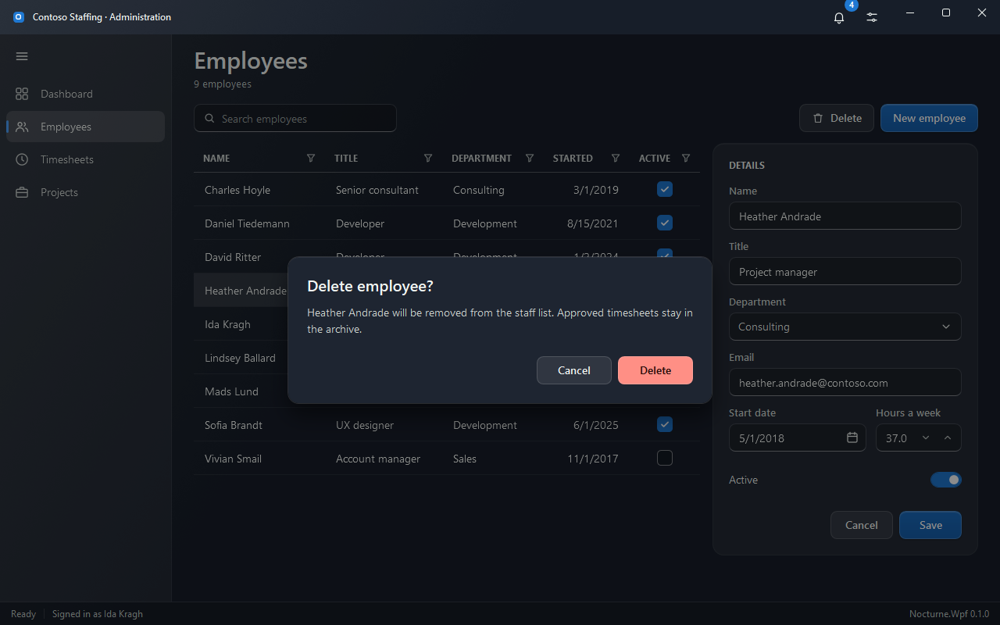

The settings button opens a [`Flyout`](window.md#flyout) with the accent, the backdrop and the account:

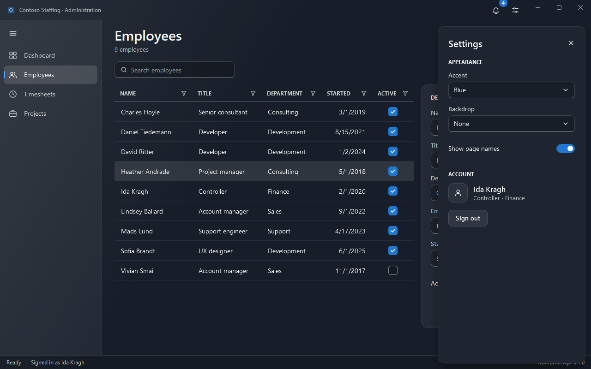

### Timesheets

A `NocturneGrid` grouped by employee, with the week's hours, a total and a status column of
`Nocturne.Styles.Tag`s (filtered from its header). Above it a week `ComboBox`, a
[`DropDownButton`](buttons.md) for export and a primary [`SplitButton`](buttons.md); a `ProgressBar`
below sums up the week.

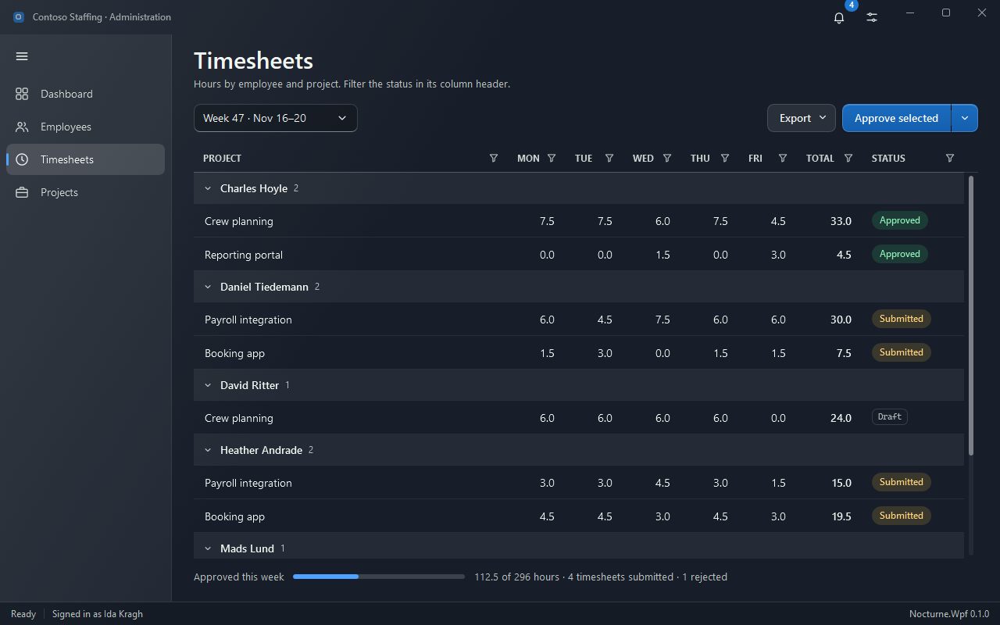

### Projects

A `TreeView` of customers and projects beside the chosen project: a budget card with a `ProgressBar`,
the deadline and a [`Rating`](selection.md), the team, and the notes in an `Expander`.

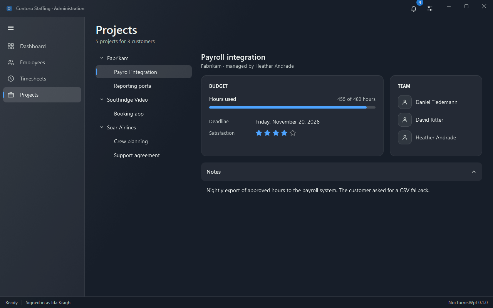

## Portal

A sales portal. The side bar is a `ListBox` with `Nocturne.Styles.ListBox.Navigation`, with a monthly
target card under it; the user's name and a help button sit in the title bar.

### Home

A greeting, an `InfoBar`, four `Tile`s, the latest orders in a `ListView` and the top rated products
with their `Rating`.

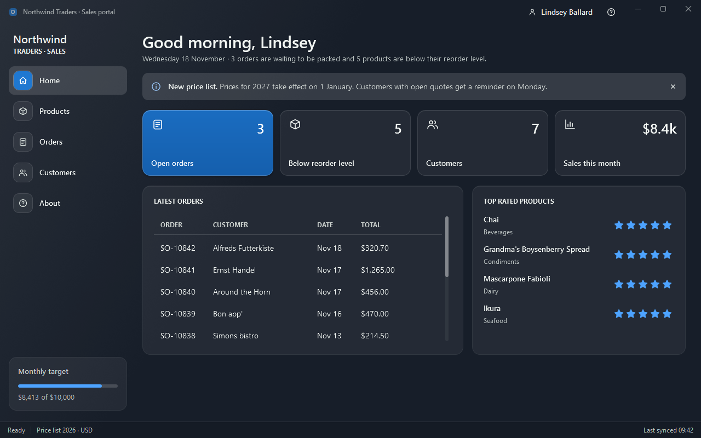

### Products

A searchable product `ListBox` with a category `ComboBox`, and the chosen product: a warning
`InfoBar`, `NumericUpDown`s for price and stock, a `Rating` and a `CheckBox`, the description in an
`Expander`, and a `SplitButton` next to the primary Save button.

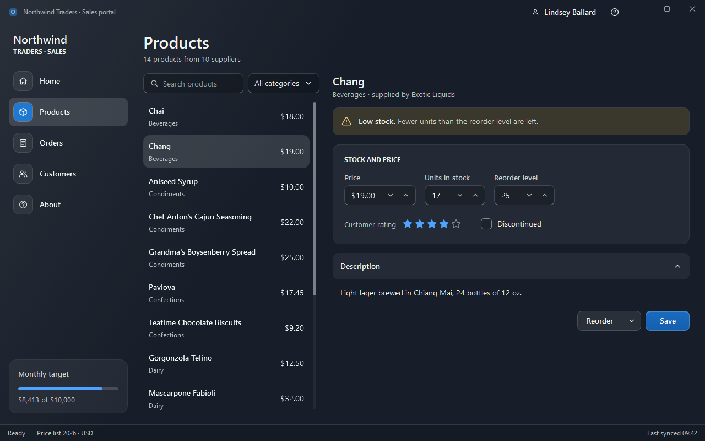

### Orders

Two `DatePicker`s and an [`AutoSuggestBox`](inputs.md) for the customer above a `NocturneGrid` with
filtered status and country columns, and the chosen order's lines in an `Expander` below.

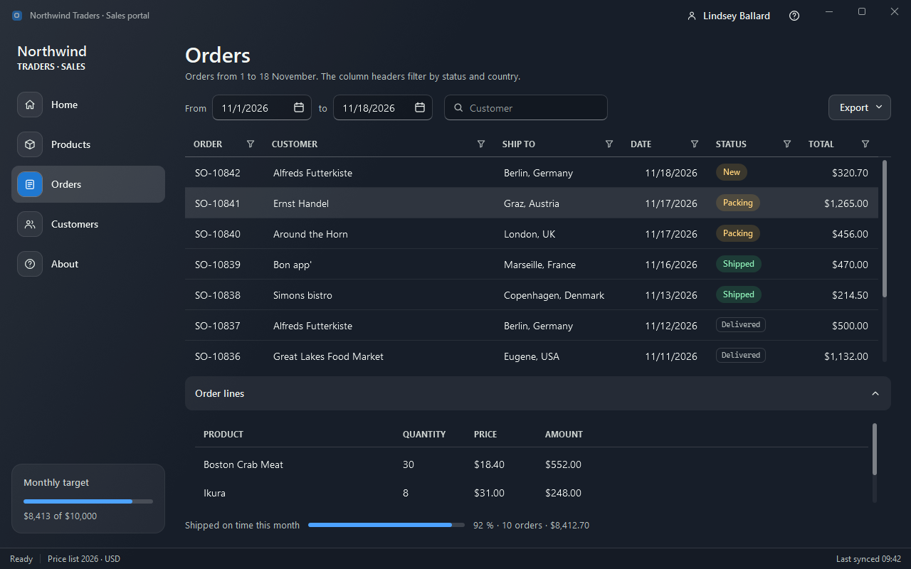

### Customers

An [`Accordion`](navigation.md) with a `TreeView` of customers by country, and the chosen customer in
a `TabControl`: contact form, orders (`ListView`) and notes (multi-line `TextBox`).

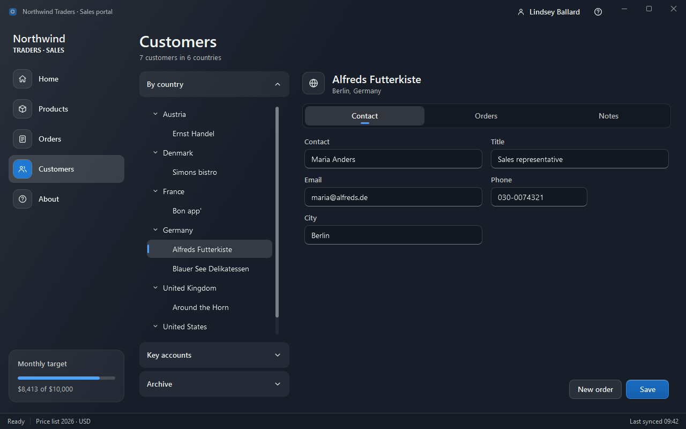

### About

A card with text and a `Hyperlink`.

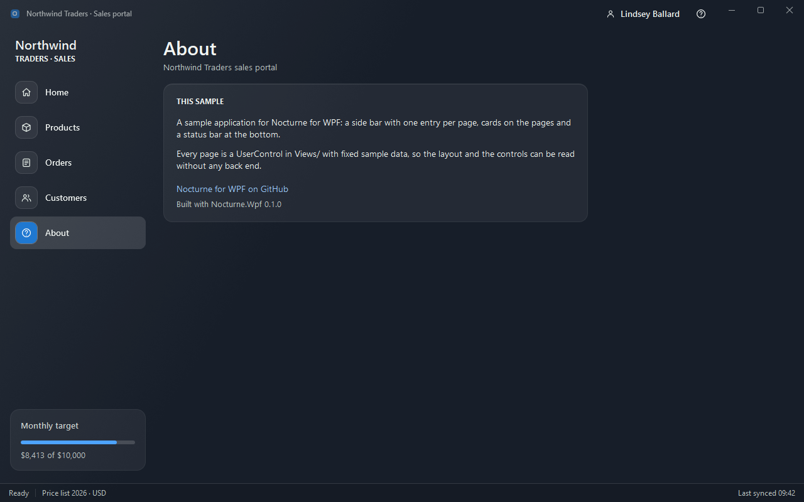
