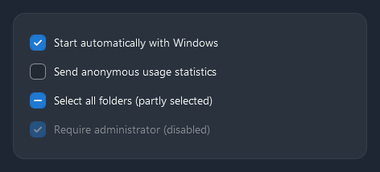
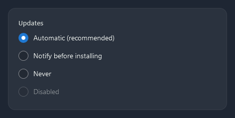
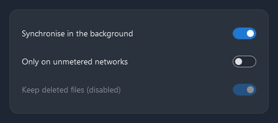
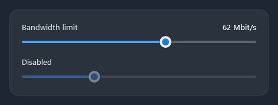
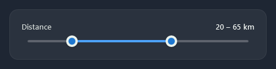
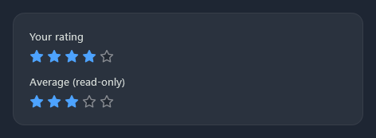

# Selection

## CheckBox



A checked box takes the accent with a check mark; `IsThreeState` adds the partly checked state
(`IsChecked="{x:Null}"`), drawn as a dash.

```xml
<CheckBox Content="Start automatically with Windows" IsChecked="{Binding StartWithWindows}" />
<CheckBox Content="Select all folders" IsThreeState="True" IsChecked="{x:Null}" />
```

## RadioButton



```xml
<TextBlock Style="{StaticResource Nocturne.Styles.TextBlock.Label}" Text="Updates" />
<RadioButton GroupName="Updates" Content="Automatic (recommended)" IsChecked="True" />
<RadioButton GroupName="Updates" Content="Notify before installing" />
<RadioButton GroupName="Updates" Content="Never" />
```

## Toggle switch



`Nocturne.Styles.ToggleSwitch` turns a `CheckBox` into a switch: the label on the left, the switch on
the right, and the knob slides in 150 ms. Use it for settings that take effect at once.

```xml
<CheckBox Style="{StaticResource Nocturne.Styles.ToggleSwitch}" Content="Synchronise in the background"
          IsChecked="{Binding SyncInBackground}" />
```

The content can be any element, for example a label with its state under it:

```xml
<CheckBox Style="{StaticResource Nocturne.Styles.ToggleSwitch}" IsChecked="{Binding Metered}">
    <StackPanel>
        <TextBlock Text="Only on unmetered networks" />
        <TextBlock Style="{StaticResource Nocturne.Styles.TextBlock.Hint}" Text="Off" />
    </StackPanel>
</CheckBox>
```

## Slider



The track fills with the accent up to a round thumb.

```xml
<Slider Minimum="0" Maximum="100" Value="{Binding Bandwidth}" SmallChange="1" LargeChange="10" />
```

## RangeSlider



`nc:RangeSlider` has two thumbs for a lower and an upper value; the part between them is filled.
Drag a thumb or use the arrow keys on the focused one.

```xml
<nc:RangeSlider Minimum="0" Maximum="100" LowerValue="{Binding MinDistance}" UpperValue="{Binding MaxDistance}" SmallChange="5" />
```

| Property | |
| --- | --- |
| `Minimum`, `Maximum` | The range (0 to 100) |
| `LowerValue`, `UpperValue` | The two values, two-way by default; the lower never passes the upper |
| `SmallChange` | The step of the arrow keys |

## Rating



`nc:Rating` is a row of stars; click a star (or use the arrow keys) to set the value.

```xml
<nc:Rating Value="{Binding Stars}" />
<nc:Rating Value="3" IsReadOnly="True" Focusable="False" />
```

| Property | |
| --- | --- |
| `Value` | The number of filled stars, two-way by default |
| `Maximum` | The number of stars (5) |
| `IsReadOnly` | Shows the value without taking clicks |
