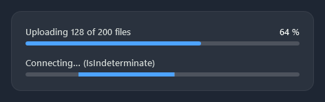
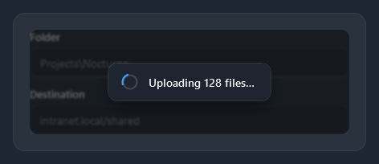
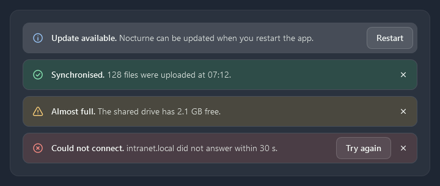

# Progress and status

## ProgressBar



A thin track that fills with the accent. `IsIndeterminate` sends a short accent bar along it, for work
of unknown length.

```xml
<ProgressBar Value="{Binding Uploaded}" Maximum="{Binding Total}" />
<ProgressBar IsIndeterminate="True" />
```

## ProgressRing


`nc:ProgressRing` is a spinning ring for work of unknown length; it is hidden while `IsActive` is
false. A quarter arc runs round a faint track once a second. It takes its size from `Width` and
`Height` (32 by default) and its colours from `Foreground` (the light accent) and `Background` (the
track), so it also fits inside a button.

```xml
<nc:ProgressRing IsActive="{Binding IsLoading}" />
<Button Style="{StaticResource Nocturne.Styles.Button.Primary}">
    <StackPanel Orientation="Horizontal">
        <nc:ProgressRing Width="16" Height="16" Margin="0,0,10,0" Foreground="{DynamicResource Nocturne.Brushes.Text.OnAccent}" Background="#33FFFFFF" />
        <TextBlock Text="Saving…" />
    </StackPanel>
</Button>
```

## BusyIndicator



`nc:BusyIndicator` blurs and dims its content while `IsBusy` is true and shows a small card with a
progress ring and `BusyContent` over it.

```xml
<nc:BusyIndicator IsBusy="{Binding IsUploading}" BusyContent="Uploading 128 files…">
    <StackPanel>...</StackPanel>
</nc:BusyIndicator>
```

| Property | |
| --- | --- |
| `IsBusy` | Shows the busy card over the content |
| `BusyContent` | Text or content on the card |
| `BlurRadius` | Blur of the content while busy (4); 0 turns the blur off |

## InfoBar



`nc:InfoBar` is a message bar across the page: an icon and a tint for its `Severity`, a bold `Title`,
the `Message`, an optional action (the content) and a close button.

```xml
<nc:InfoBar Severity="Warning" Title="Almost full." Message="The shared drive has 2.1 GB free." />
<nc:InfoBar Severity="Error" Title="Could not connect." Message="intranet.local did not answer within 30 s.">
    <Button Content="Try again" Command="{Binding Reconnect}" />
</nc:InfoBar>
```

| Property | |
| --- | --- |
| `Severity` | `Info` (default), `Success`, `Warning` or `Error` |
| `Title`, `Message` | The bold title and the text after it |
| `Content` | An action on the right, usually a button |
| `IsOpen` | The bar is collapsed while false; the close button sets it |
| `IsClosable` | Shows the close button (true) |
| `Closed` | Raised when the close button closes the bar |
