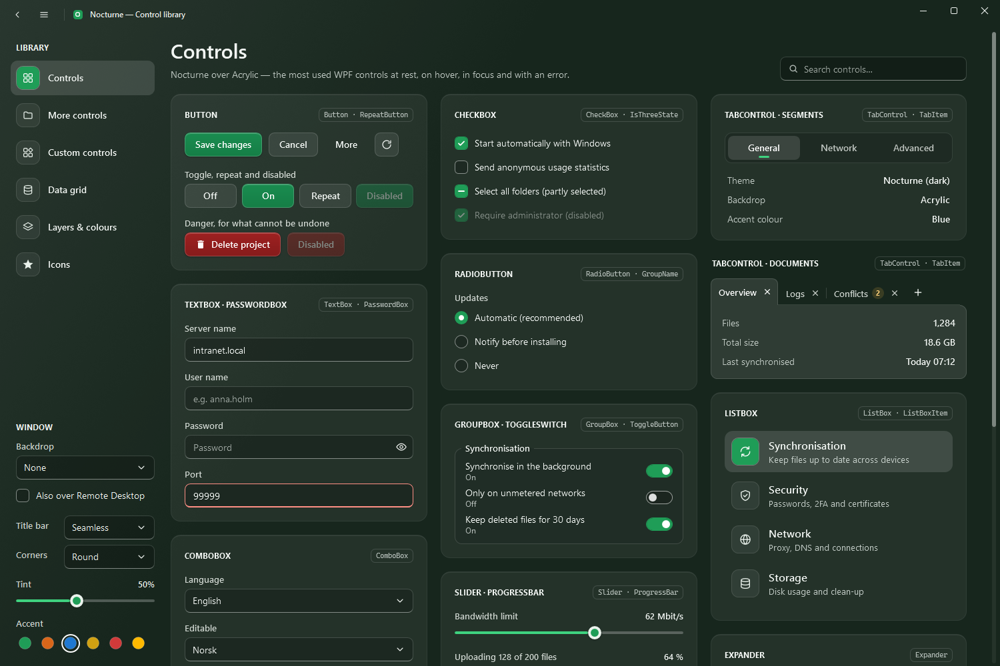
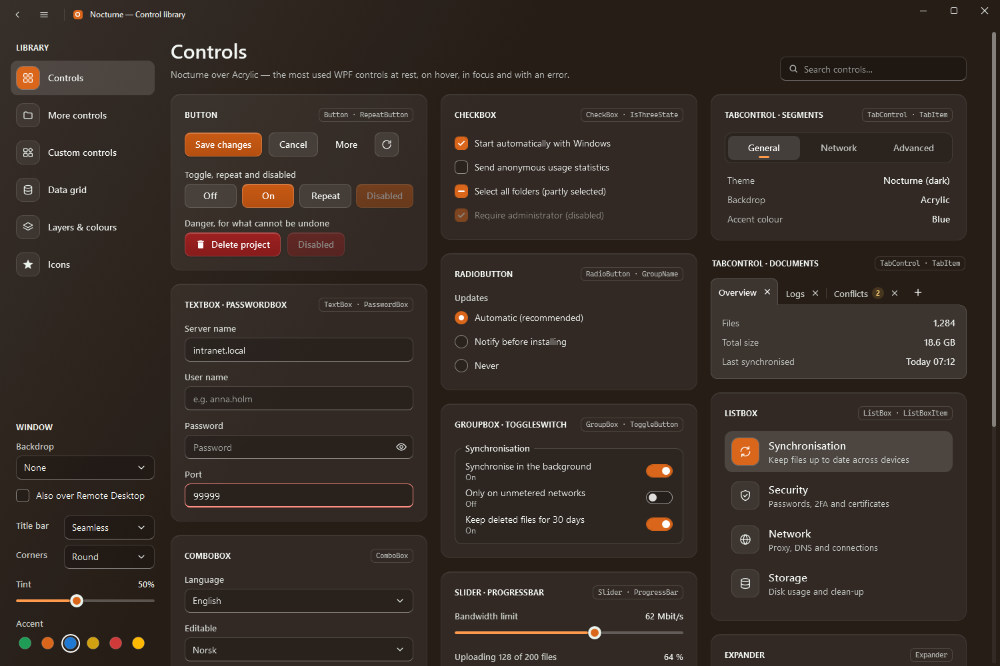
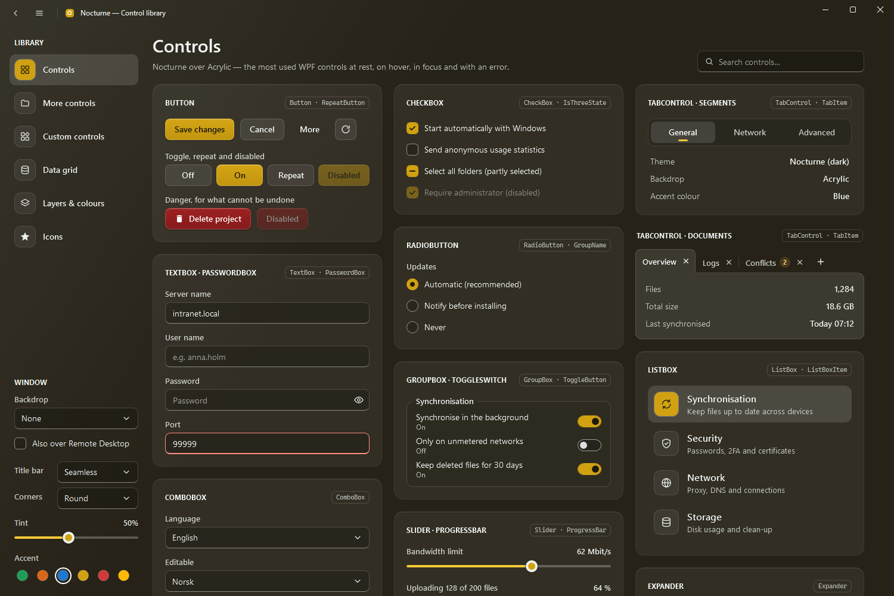
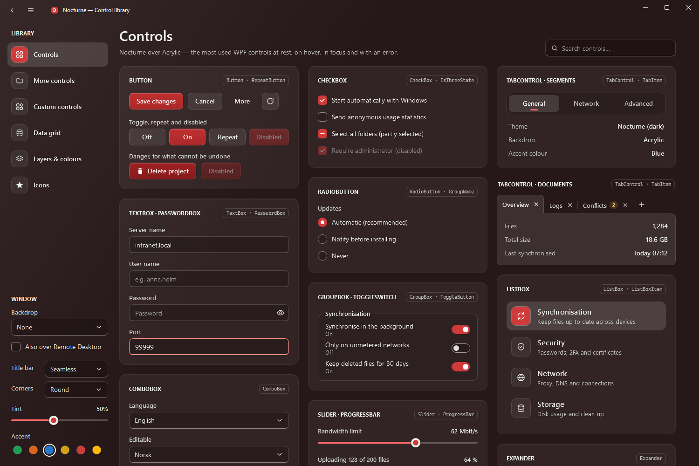

# Theme and accents

## The layers of a window

A `NocturneWindow` is built in layers, from the bottom up:

1. **The backdrop**: the Windows 11 material behind the window (`Backdrop`): `Acrylic` (the
   default), `Mica`, `MicaAlt` or `None`.
2. **The tint**: `Nocturne.Brushes.Window.Tint`, a dark shade of the accent's hue (a dark blue by
   default), over the backdrop at `TintOpacity`
   (0.5 by default). Higher values make the window darker and calmer; lower values let more of the
   desktop through.
3. **The light**: a soft white light from the top-left corner, 8 % at the corner and gone at 38 % of
   the diagonal. It is drawn dithered, pixel by pixel, so it has no visible steps (a plain gradient
   that faint shows diagonal bands, worst over Remote Desktop), and it is redrawn 150 ms after a resize.
4. **The surfaces**: cards (`Nocturne.Brushes.Surface1`), fields, buttons and lists are
   `SolidColorBrush`es with alpha. There is no blur inside the window.

```xml
<nc:NocturneWindow Backdrop="Mica" TintOpacity="0.65" ... />
```

The backdrop needs Windows 11 22H2 or later with transparency effects on (Settings, Personalisation,
Colours). Without it, or with `Backdrop="None"`, the window paints `Nocturne.Brushes.Window.Fallback`,
an opaque ground of the same colour as tint over backdrop, and `IsBackdropActive` is false. The window
switches between the two by itself when the user turns transparency effects on or off.

Over Remote Desktop the window paints the opaque ground too: WPF draws in software in a remote
session, and a see-through window is slow there. It follows the session when it moves between the
local screen and Remote Desktop while the app runs. Set `UseBackdropInRemoteSession="True"` to keep
the backdrop anyway.

## Accents



The accent is blue. `NocturneTheme.SetAccent` switches it at run time: the accent brushes,
the text on the accent, the primary button, the popup ground, the window's tint and fallback
ground and the `Accent` title bar all take the new hue. Every style uses `DynamicResource`, so open windows follow at once.

```csharp
using Nocturne.Wpf.Controls;

NocturneTheme.SetAccent(NocturneAccent.Blue);
```

| `NocturneAccent` | |
| --- | --- |
| `Green` | Meadow green, the colour of the original design |
| `Orange` | |
| `Blue` | The default |
| `Yellow` | Gold; text on it is dark, as white on yellow is hard to read |
| `Red` | |
| `System` | The accent colour chosen in Windows (Settings, Personalisation, Colours), followed while the app runs; blue where Windows has none |







`System` reads the seven shades Windows derives from the user's colour, takes the window's tint from
its hue and picks white or dark text on the accent by its brightness. A `NocturneWindow` listens for
Windows' colour changes, so the app follows when the user picks another colour.

| Member | |
| --- | --- |
| `SetAccent(accent, resources = null)` | Writes the brushes into `resources`, by default `Application.Current.Resources` (where they override the ones in `Nocturne.xaml`) |
| `Accent` | The accent last set |
| `AccentChanged` | Raised after the brushes have been replaced (also when the Windows accent changes under `System`) |
| `GetSystemAccent()` | The Windows accent colour, or `null` where Windows has none |
| `SystemAccentChanged` | Raised when the Windows accent changes, whichever accent the app uses |

If you add brushes of your own in the accent colour, reference `Nocturne.Brushes.Accent`,
`Nocturne.Brushes.Accent.Light` or `Nocturne.Brushes.Accent.Text` with `DynamicResource`, and they
follow too.

## Overriding a colour

Every colour is a resource key ([Resource keys](resource-keys.md)). Redefine one in `App.xaml`, after
the merged dictionary, to change it app-wide:

```xml
<Application.Resources>
    <ResourceDictionary>
        <ResourceDictionary.MergedDictionaries>
            <ResourceDictionary Source="pack://application:,,,/Nocturne.Wpf;component/Styles/Nocturne.xaml" />
        </ResourceDictionary.MergedDictionaries>
        <SolidColorBrush x:Key="Nocturne.Brushes.Error" Color="#FFFF6F66" />
    </ResourceDictionary>
</Application.Resources>
```

The accent brushes are the exception: `SetAccent` rewrites them, so pick an accent instead.

## Font

The theme uses Segoe UI, and Cascadia Mono (or Consolas) for monospaced text; both come with
Windows, so nothing is bundled. To use another font, redefine `Nocturne.Fonts.Family` (and `Nocturne.Fonts.Family.Mono`
for the monospaced text):

```xml
<FontFamily x:Key="Nocturne.Fonts.Family">Inter, Segoe UI</FontFamily>
```

The type scale (`Nocturne.Font.Size.*`) and the text styles are on [Typography and surfaces](typography.md).

## Focus

Keyboard focus shows as a 2px white ring a little outside the control (`Nocturne.Styles.FocusVisual`,
in `Nocturne.Brushes.Focus`), only when focus came from the keyboard. Templates that cannot use a `FocusVisualStyle` (a tree item would ring
its whole subtree) draw their own ring with [`FocusHelper`](helpers.md#focushelper).
