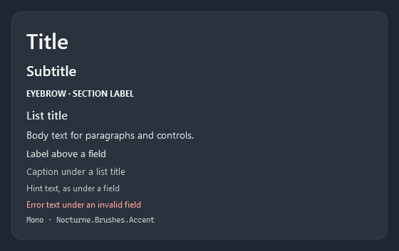
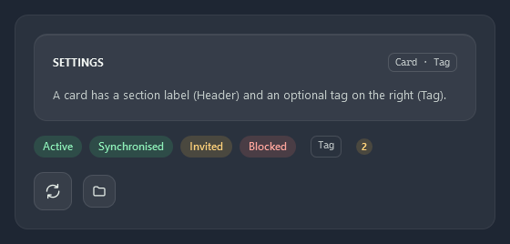
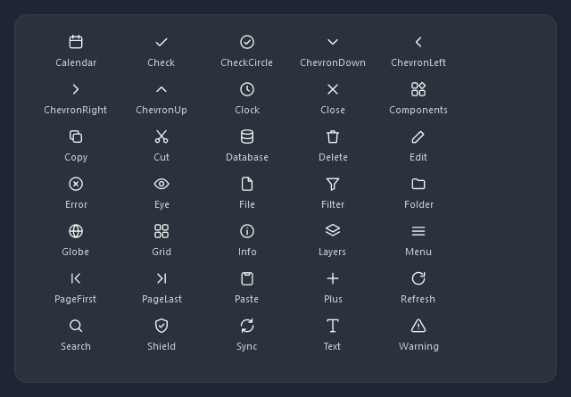

# Typography and surfaces

## Text styles



The type is Segoe UI at 14px for body text and controls. The text styles are keyed `TextBlock` styles;
the sizes are resources, so a whole app can scale them.

| Style | Size / weight | For |
| --- | --- | --- |
| `Nocturne.Styles.TextBlock.Title` | 30 / SemiBold | Page titles |
| `Nocturne.Styles.TextBlock.Subtitle` | 20 / SemiBold | Sections, dialog titles |
| `Nocturne.Styles.TextBlock.Eyebrow` | 12 / Bold | Section labels above a group, written in capitals (as on cards) |
| `Nocturne.Styles.TextBlock.ListTitle` | 16 / Medium | The first line of a list item |
| `Nocturne.Styles.TextBlock.Body` | 14 | Paragraphs |
| `Nocturne.Styles.TextBlock.Label` | 13 / Medium | Labels above fields |
| `Nocturne.Styles.TextBlock.Caption` | 13, secondary colour | The second line of a list item, descriptions |
| `Nocturne.Styles.TextBlock.Hint` | 12, hint colour | Help text under a field |
| `Nocturne.Styles.TextBlock.Error` | 12, red | The message under an invalid field |
| `Nocturne.Styles.TextBlock.Mono` | 11, monospaced | Codes, keys, values |

| Size key | |
| --- | --- |
| `Nocturne.Font.Size.Title` | 30 |
| `Nocturne.Font.Size.Subtitle` | 20 |
| `Nocturne.Font.Size.ListTitle` | 16 |
| `Nocturne.Font.Size.Default` | 14 |
| `Nocturne.Font.Size.Caption` | 13 |
| `Nocturne.Font.Size.Small` | 12 |
| `Nocturne.Font.Size.Tag` | 11 |

The text colours are `Nocturne.Brushes.Text` (primary), `.Secondary`, `.Label`, `.Hint` and
`.Placeholder`. To use another font, see [Theme and accents](theming.md#font).

## Cards



A card is the surface a group of controls sits on: `Nocturne.Brushes.Surface1` with a 1px border,
14px corners and 20px padding. `Nocturne.Styles.Card` is a `HeaderedContentControl` with a section
label (`Header`) and an optional tag on the right (`Tag`); `Nocturne.Styles.Border.Card` is the same
surface as a plain `Border`.

```xml
<HeaderedContentControl Style="{StaticResource Nocturne.Styles.Card}" Header="SYNCHRONISATION" Tag="Beta">
    <StackPanel>...</StackPanel>
</HeaderedContentControl>

<Border Style="{StaticResource Nocturne.Styles.Border.Card}">...</Border>
```

## Tags, pills and badges

All three are `ContentControl` styles.

| Style | |
| --- | --- |
| `Nocturne.Styles.Tag` | A small outlined label in monospaced text, as on the cards |
| `Nocturne.Styles.Pill` | A rounded status label, green (`.Success` is the same); `.Warning` amber and `.Error` red |
| `Nocturne.Styles.Badge` | A small round count in amber, as on the document tabs |

```xml
<ContentControl Style="{StaticResource Nocturne.Styles.Pill.Warning}" Content="Invited" />
<ContentControl Style="{StaticResource Nocturne.Styles.Tag}" Content="ListBox · ListBoxItem" />
```

## Icon tiles

`Nocturne.Styles.IconTile` (42×42) and `Nocturne.Styles.IconTile.Small` (36×36) put an icon on a
small rounded surface, as in lists and the side navigation. In a selected `ListBoxItem` the tile fills
with the accent.

```xml
<ContentControl Style="{StaticResource Nocturne.Styles.IconTile}">
    <nc:StrokeIcon Data="{StaticResource Nocturne.Icons.Shield}" />
</ContentControl>
```

## Icons



`nc:StrokeIcon` draws a line icon on a 24×24 grid with round ends, in its `Foreground`. The theme's
icons are the `Nocturne.Icons.*` geometries above (drawn for Nocturne, MIT); any path data in 24×24
units works too.

```xml
<nc:StrokeIcon Width="20" Height="20" Data="{StaticResource Nocturne.Icons.Folder}" />
<nc:StrokeIcon Width="16" Height="16" StrokeThickness="2" Data="M5,12 L19,12" />
```

| Property | |
| --- | --- |
| `Data` | The outline in 24×24 units |
| `StrokeThickness` | Line width in 24×24 units; it scales with the icon |
| `Foreground` | The colour (inherited, so an icon in a button takes the button's text colour) |

Templates with room for an icon read [`ControlHelper.Icon`](helpers.md#controlhelper) (menu items,
`AutoSuggestBox`), so they take the same geometries.
