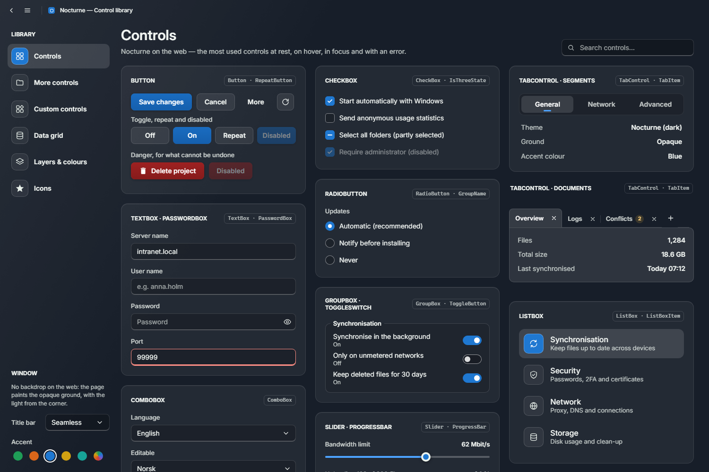

# Nocturne for the web

Nocturne for the web is the Nocturne look in HTML and CSS, for admin portals and other business sites.
It is a Razor class library, published as the [Nocturne.Web](https://www.nuget.org/packages/Nocturne.Web)
package, with a tag helper for every control of the WPF demo, named after the control
(`<nc-combo-box>`, `<nc-tab-control>`, `<nc-date-picker>` …). The CSS and JavaScript do not depend on
.NET: any site can link them and write the markup itself.

| | |
| --- | --- |
| Package | [Nocturne.Web](https://www.nuget.org/packages/Nocturne.Web) on nuget.org (and on each `web-v*` [GitHub release](https://github.com/Montago/NocturneTheme/releases)) |
| Needs | ASP.NET Core on .NET 10 or later for the tag helpers; a current Edge, Chrome, Firefox or Safari (the controls use `popover`, `<dialog>`, `:has()` and cascade layers) |
| Start with | [Getting started](web/getting-started.md) |

Unlike the WPF window, the page has **no transparency to the desktop**: the ground is the colour the
WPF window shows over a dark desktop (its fallback ground mixed with the tint), and popups are solid.
Hover, card and selection surfaces keep their translucency over that ground.

## Start here

- [Getting started](web/getting-started.md): install, the tag helpers, the window frame, forms, Tailwind.
- [Theme and accents](web/theming.md): accents, the light, the CSS custom properties, overriding colours, the font.
- [Demo and samples](web/samples.md): the web demo, its gallery page and the MVC sample site.

## Controls

| Page | Controls |
| --- | --- |
| [Window and dialogs](web/window.md) | the window frame (`body.nc-window`), title bar styles, window commands, the light, `nc-flyout`, dialogs, `Nocturne.showDialog` |
| [Buttons](web/buttons.md) | `nc-button` and its variants, `nc-toggle-button`, `nc-repeat-button`, `nc-hyperlink`, `nc-drop-down-button`, `nc-split-button`, `nc-tile`, `nc-badged` |
| [Text and input](web/inputs.md) | `nc-text-box`, `nc-password-box`, `nc-label`, errors, `nc-combo-box`, `nc-numeric-up-down`, `nc-date-picker`, `nc-time-picker`, `nc-color-picker`, `nc-auto-suggest-box`, `nc-search-combo-box` |
| [Selection](web/selection.md) | `nc-check-box`, `nc-radio-button`, `nc-toggle-switch`, `nc-slider`, `nc-range-slider`, `nc-rating` |
| [Lists and data](web/lists.md) | `nc-list-box`, `nc-list-view`, `nc-tree-view`, `nc-data-grid`, `nc-nocturne-grid`, `nc-calendar`, `nc-scroll-viewer` |
| [Navigation and layout](web/navigation.md) | `nc-tab-control` (segments and document tabs), `nc-hamburger-menu`, `nc-expander`, `nc-accordion`, `nc-group-box`, `nc-menu`, `nc-context-menu`, `nc-tool-bar`, `nc-status-bar`, `nc-grid-splitter`, tool tips |
| [Progress and status](web/status.md) | `nc-progress-bar`, `nc-progress-ring`, `nc-busy-indicator`, `nc-info-bar` |
| [Typography and surfaces](web/typography.md) | text styles, `nc-card`, `nc-tag`, `nc-pill`, `nc-badge`, `nc-icon-tile`, `nc-stroke-icon`, `nc-icon` |

## Reference

- [Reference](web/reference.md): the files in the package, the attributes every tag helper takes, the
  data attributes, the `window.Nocturne` API, the events, and NocturneGrid's server mode.

## What is in the package

| Part | File | Contents |
| --- | --- | --- |
| Components | `wwwroot/css/nocturne.css` | The controls as CSS classes in cascade layers, in one file |
| Tokens | `wwwroot/css/nocturne.tokens.css` | The colours, fonts and sizes of Nocturne.Wpf as CSS custom properties (already part of `nocturne.css`) |
| Tailwind | `wwwroot/css/nocturne.tailwind.css` | The tokens as Tailwind v4 theme variables (`text-nc-secondary`, `bg-nc-surface` …) |
| Behaviour | `wwwroot/js/nocturne.js` | Drop-downs, calendar and pickers, sliders, menus, tabs, flyouts, dialogs, tool tips, error callouts, NocturneGrid, accents and the light; no dependencies |
| Tag helpers | `TagHelpers/*.cs` | `<nc-*>` elements with the WPF property names |
| Server | `NocturneGridServer` | Answers a NocturneGrid in server mode from rows in memory |
| Icons | `wwwroot/img/icons.svg` | The NocturneIcon set (Material Design Icons) and the line icons as an SVG sprite |
| Font | `wwwroot/fonts/InterVariable*.woff2` | Inter, the theme's font (SIL Open Font License 1.1) |

The web theme follows the WPF library: class names follow the WPF controls and style keys
(`ComboBox` → `.nc-combo-box`, `Nocturne.Styles.Button.Primary` → `.nc-button--primary`), tag helper
attributes are the WPF property names in kebab case (`IsEnabled` → `is-enabled`), and the colours are
generated from the same XAML dictionaries, so a desktop app and its web portal look the same.

## Limitations

- NocturneGrid draws every row of the page shown, so it suits up to a few thousand rows in the page;
  for more, use its paging or its server mode.
- Scroll bars get the Nocturne look in Chromium browsers (Edge, Chrome); Firefox gets the colours only.
- The pickers show dates in the browser's culture unless the page names one (`culture`,
  `data-nc-culture`); the tag helpers format numbers in the request's culture.
- `nocturne.tailwind.css` has been tried with the Tailwind browser build only (the MVC sample uses it).
