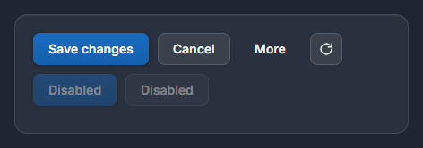
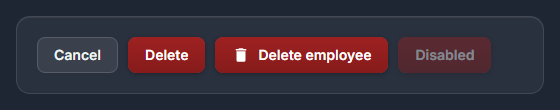
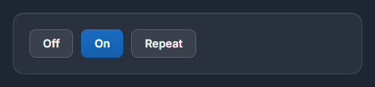
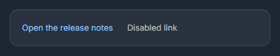
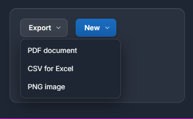
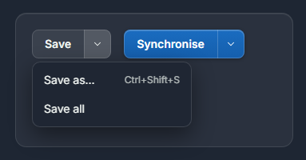
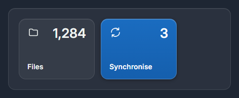
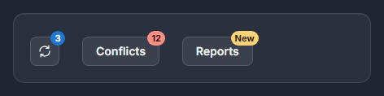

# Buttons

## Button



`nc-button` is a light translucent surface with a 1px border and 8px corners; hover lightens it
(120 ms) and a disabled button fades. With `href` it is a link that looks like a button.

```cshtml
<nc-button button-style="Primary" content="Save changes" type="submit" />
<nc-button content="Cancel" />
<nc-button button-style="Subtle" content="More" />
<nc-button button-style="Icon" stroke-icon="Refresh" aria-label="Refresh" tool-tip="Refresh" />
<nc-button button-style="Primary" icon="Plus" href="/employees/new">New employee</nc-button>
```

```html
<button type="submit" class="nc-button nc-button--primary">Save changes</button>
<button type="button" class="nc-button">Cancel</button>
<button type="button" class="nc-button nc-button--subtle">More</button>
<button type="button" class="nc-button nc-button--icon" aria-label="Refresh" data-nc-tool-tip="Refresh">
  <svg class="nc-stroke-icon" aria-hidden="true"><use href="/_content/Nocturne.Web/img/icons.svg#stroke-refresh"></use></svg>
</button>
<a href="/employees/new" class="nc-button nc-button--primary">
  <svg class="nc-icon" aria-hidden="true"><use href="/_content/Nocturne.Web/img/icons.svg#plus"></use></svg>New employee
</a>
```

| Attribute | Default | Description |
| --- | --- | --- |
| `button-style` | `Default` | the variant, below |
| `content` | | the text; without it the element's content is used (markup, icons) |
| `icon` | | a [Material Design icon](typography.md#nocturneicon) before the content (`NocturneIconKind`) |
| `stroke-icon` | | one of the theme's [line icons](typography.md#line-icons) before the content (`Refresh`) |
| `type` | `button` | `button`, `submit` or `reset` |
| `href` | | makes it a link that looks like a button (a disabled one stays a `<button>`) |

### Variants

| `button-style` | Class | Look |
| --- | --- | --- |
| `Default` | `.nc-button` | Light surface, for most actions |
| `Primary` | `.nc-button--primary` | The accent with a light top edge and a small shadow; one per view, for the main action |
| `Danger` | `.nc-button--danger` | A deep red, darker than the error colour, for actions that cannot be undone |
| `Subtle` | `.nc-button--subtle` | No surface until hovered; for less important actions |
| `Icon` | `.nc-button--icon` | A 36×36 square for an icon |
| `IconSubtle` | `.nc-button--icon.nc-button--subtle` | An icon button with no surface until hovered (tool bars, title bar) |

### Danger



`button-style="Danger"` is for deleting and other actions that cannot be undone, usually next to a
Cancel button or as the main button of a [confirmation dialog](window.md#dialogs)
(`affirmativeStyle: 'danger'`). Its red stays the same in every accent.

```cshtml
<nc-button content="Cancel" />
<nc-button button-style="Danger" icon="Delete" content="Delete employee" />
```

## ToggleButton and RepeatButton



`nc-toggle-button` stays pressed (`aria-pressed="true"`) and takes the accent while it is; `nocturne.js`
flips it on click and raises `nc-change` with `true` or `false`. `nc-repeat-button` looks like a button
and clicks once when pressed, then every 33 ms after 0.4 s while it is held. Both take the attributes
of `nc-button`. For an on/off setting, use the [toggle switch](selection.md#toggle-switch) instead.

```cshtml
<nc-toggle-button content="Details" is-checked="true" />
<nc-repeat-button content="Repeat" />
```

```html
<button type="button" class="nc-button" aria-pressed="true" data-nc-toggle="">Details</button>
<button type="button" class="nc-button" data-nc-repeat="">Repeat</button>
```

| Attribute | Default | Description |
| --- | --- | --- |
| `is-checked` | `false` | `nc-toggle-button` only: starts pressed |

## Hyperlink



`nc-hyperlink` is a link in the light accent (`--nc-accent-text`), underlined under the mouse. A
disabled link fades and loses its address.

```cshtml
<nc-hyperlink href="/release-notes">Open the release notes</nc-hyperlink>
<nc-hyperlink is-enabled="false">Disabled link</nc-hyperlink>
```

```html
<a class="nc-hyperlink" href="/release-notes">Open the release notes</a>
<a class="nc-hyperlink" aria-disabled="true">Disabled link</a>
```

## DropDownButton



`nc-drop-down-button` opens a menu under itself; a chevron follows the content. Its children are
[`nc-menu-item`](navigation.md#menu)s (and `nc-separator`s). `button-style="Primary"` is the accent
version.

```cshtml
<nc-drop-down-button content="Export">
    <nc-menu-item header="PDF document" href="/export/pdf" />
    <nc-menu-item header="CSV for Excel" href="/export/csv" />
    <nc-menu-item header="PNG image" id="ExportPng" />
</nc-drop-down-button>
```

```html
<span class="nc-drop-down-button">
  <button type="button" class="nc-button" popovertarget="nc-menu-af8774b7-menu" aria-haspopup="menu">Export<i class="nc-caret" aria-hidden="true"></i></button>
  <div class="nc-context-menu" popover id="nc-menu-af8774b7-menu" role="menu">
    <a href="/export/pdf" class="nc-menu-item" role="menuitem"><span class="nc-menu-item__icon"></span><span class="nc-menu-item__header">PDF document</span></a>
    …
  </div>
</span>
```

| Attribute | Default | Description |
| --- | --- | --- |
| `content` | | the text |
| `button-style` | `Default` | `Default` or `Primary` |
| `icon` / `stroke-icon` | | an icon before the text |
| `id` | | the element's id; the menu gets `<id>-menu` |

The menu is a [popover](https://developer.mozilla.org/docs/Web/API/Popover_API), so it opens and
closes without the script too; the script places it under the button and adds the keyboard.

## SplitButton



`nc-split-button` is a button with a chevron part: the left part is an ordinary button (handle its
`click`), the chevron opens the menu with the other choices. It takes the attributes of
`nc-drop-down-button`.

```cshtml
<nc-split-button id="Save" content="Save">
    <nc-menu-item header="Save as…" input-gesture-text="Ctrl+Shift+S" />
    <nc-menu-item header="Save all" />
</nc-split-button>
```

```html
<div class="nc-split-button" id="Save">
  <button type="button" class="nc-split-button__main">Save</button>
  <button type="button" class="nc-split-button__arrow" popovertarget="Save-menu" aria-haspopup="menu" aria-label="More options" tabindex="-1"><i class="nc-caret" aria-hidden="true"></i></button>
  <div class="nc-context-menu" popover id="Save-menu" role="menu">…</div>
</div>
```

```js
document.querySelector('#Save .nc-split-button__main').addEventListener('click', save);
```

## Tile



`nc-tile` is a large button for a dashboard: an icon at the top left, a `count` at the top right and a
`title` at the bottom. `tile-style="Accent"` fills it with the accent. With `href` it is a link.

```cshtml
<nc-tile title="Files" count="1,284" stroke-icon="Folder" href="/files" style="width:150px" />
<nc-tile title="Synchronise" count="3" stroke-icon="Sync" tile-style="Accent" style="width:150px" />
```

```html
<a href="/files" class="nc-tile" style="width:150px">
  <span class="nc-tile__content"><svg class="nc-stroke-icon" aria-hidden="true">…</svg></span>
  <span class="nc-tile__count">1,284</span>
  <span class="nc-tile__title">Files</span>
</a>
```

| Attribute | Default | Description |
| --- | --- | --- |
| `title` | | the text at the bottom |
| `count` | | the number at the top right |
| `tile-style` | `Default` | `Default` (the card surface) or `Accent` |
| `icon` / `stroke-icon` | | the icon at the top left; the element's content goes there too |
| `href` | | makes it a link; without it a `<button>` |

## Badged



`nc-badged` puts a small badge on the top-right corner of its content. Without `badge` there is none.

```cshtml
<nc-badged badge="3"><nc-button button-style="Icon" stroke-icon="Sync" aria-label="Messages" /></nc-badged>
<nc-badged badge="12" badge-background="var(--nc-error)" badge-foreground="#2A0E0B"><nc-button content="Conflicts" /></nc-badged>
```

```html
<span class="nc-badged">
  <button type="button" class="nc-button nc-button--icon" aria-label="Messages">…</button>
  <span class="nc-badged__badge">3</span>
</span>
```

| Attribute | Default | Description |
| --- | --- | --- |
| `badge` | | what the badge shows (a number or a short word) |
| `badge-background` | the accent | the badge's fill, as a CSS colour |
| `badge-foreground` | the text on the accent | the badge's text colour |

Change the badge from script by setting the text of `.nc-badged__badge`.

The [WPF page](../buttons.md) describes the same buttons for the desktop.
