# Text and input

## TextBox

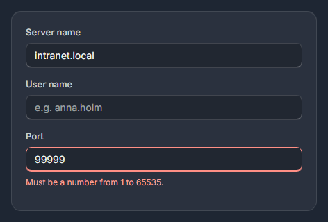

`nc-text-box` is a 36px field on a sunken surface with a slightly lighter bottom edge; focus draws the
accent along the bottom. `placeholder` is the hint shown while it is empty.

```cshtml
<nc-label content="Server name" target="Server" />
<nc-text-box id="Server" name="Server" text="intranet.local" />
<nc-label content="User name" target="User" />
<nc-text-box id="User" asp-for="UserName" placeholder="e.g. anna.holm" />
```

```html
<label class="nc-label" for="Server">Server name</label>
<input class="nc-text-box" id="Server" name="Server" type="text" value="intranet.local" />
```

| Attribute | Default | Description |
| --- | --- | --- |
| `asp-for` | | binds a model property (name, id, value and validation attributes) |
| `text` / `name` / `id` | | the value, name and id without `asp-for` |
| `placeholder` | | the hint while the box is empty (`ControlHelper.Placeholder`) |
| `clear-button` | `false` | an × that empties the box, shown while it has text (`ControlHelper.ClearButton`) |
| `text-box-style` | `Default` | `Default`, `Search` (a magnifier on the left) or `MultiLine` (a `<textarea>`) |
| `type` | `text` | the input type: `text`, `email`, `search`, `tel` … |
| `is-read-only` | `false` | |

With a clear button or the search look, the tag helper wraps the input in a `div.nc-text-box-host`
that holds the buttons; your `style` goes on that host, everything else on the input.

### Search box and clear button

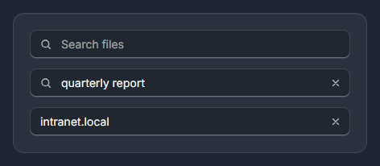

```cshtml
<nc-text-box text-box-style="Search" placeholder="Search files" />
<nc-text-box text-box-style="Search" text="quarterly report" clear-button="true" placeholder="Search files" />
<nc-text-box text="intranet.local" clear-button="true" />
```

```html
<div class="nc-text-box-host nc-text-box-host--search">
  <input class="nc-text-box" placeholder="Search files" type="text" value="quarterly report" />
  <button type="button" class="nc-text-box-host__button nc-text-box-host__clear" data-nc-clear aria-label="Clear" title="Clear" tabindex="-1"></button>
</div>
```

The clear button empties the box, raises `input` and `change` on it and puts the focus back.

### Multi-line

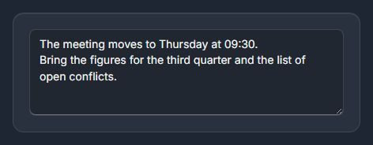

```cshtml
<nc-text-box text-box-style="MultiLine" name="Notes" text="@Model.Notes" style="height:110px" />
```

### Errors

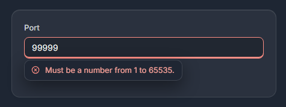

A field with `aria-invalid="true"` (or ASP.NET Core's `input-validation-error`) gets a red frame and
bottom line. `validation-error="…"` on a tag helper sets that and puts the message in
`data-nc-error`; `nocturne.js` then shows it in a callout under the field while the field has the focus
or the mouse, as WPF's `Nocturne.Templates.ValidationError` does. Every field tag helper takes it.

```cshtml
<nc-text-box text="99999" validation-error="Must be a number from 1 to 65535." />
```

```html
<input class="nc-text-box" aria-invalid="true" data-nc-error="Must be a number from 1 to 65535." type="text" value="99999" />
```

For a message that always shows, put a `p.nc-text-block--error` under the field (the
[text box](#textbox) picture shows one), or `span.nc-validation-message` with `asp-validation-for`.

## PasswordBox

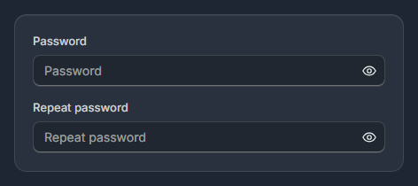

`nc-password-box` is a text box for passwords. `can-reveal="true"` adds an eye that shows the password
while it is pressed in (`PasswordBoxHelper.CanReveal`). It takes the attributes of `nc-text-box`, with
`password` for the value.

```cshtml
<nc-password-box asp-for="Password" placeholder="Password" can-reveal="true" />
```

```html
<div class="nc-text-box-host">
  <input class="nc-text-box" placeholder="Password" type="password" />
  <button type="button" class="nc-text-box-host__button nc-text-box-host__reveal" data-nc-reveal aria-pressed="false" aria-label="Show password" title="Show password" tabindex="-1"></button>
</div>
```

## RichTextBox

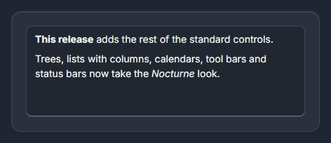

There is no tag helper; an editable element with the classes `nc-text-box nc-rich-text-box` gets the
look of the WPF `RichTextBox`, with paragraphs spaced as in a `FlowDocument`.

```html
<div class="nc-text-box nc-rich-text-box" contenteditable="true" role="textbox" aria-multiline="true" aria-label="Release notes" style="height:130px">
  <p><b>This release</b> adds the rest of the standard controls.</p>
</div>
```

## Label

`nc-label` is the label above a field (`Nocturne.Styles.TextBlock.Label`, 13px medium). `target` is the
field's id.

```cshtml
<nc-label content="Port" target="Port" />
```

```html
<label class="nc-label" for="Port">Port</label>
```

## ComboBox

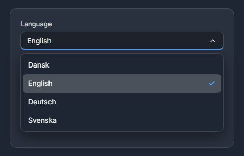

`nc-combo-box` is a `<select class="nc-combo-box">`: the field with a chevron. `nocturne.js` replaces the
browser's list with the Nocturne one (the popup surface, the chosen item marked with the accent), and
it opens on a click, Alt+Down, F4, Space or Enter.

```cshtml
<nc-combo-box name="Language" selected-index="1">
    <nc-combo-box-item content="Dansk" value="da" />
    <nc-combo-box-item content="English" value="en" />
    <nc-combo-box-item content="Norsk" value="nb" />
</nc-combo-box>

<nc-combo-box asp-for="Department" asp-items="Model.Departments" placeholder="Choose a department" />
```

```html
<select class="nc-combo-box" name="Language">
  <option value="da">Dansk</option>
  <option value="en" selected>English</option>
  <option value="nb">Norsk</option>
</select>
```

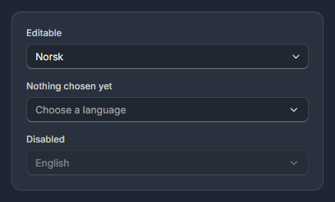

| Attribute | Default | Description |
| --- | --- | --- |
| `asp-for` / `asp-items` | | binds a model property and its `SelectListItem`s, as `<select asp-for>` |
| `selected-index` | `-1` | the item chosen at the start |
| `placeholder` | | shown while nothing is chosen |
| `is-editable` | `false` | a text box with the items as suggestions (`IsEditable`); `text` is its text |
| `name` / `id` | | |

`nc-combo-box-item` takes `content`, `value` and `is-enabled`. The combo box raises `change` and
`nc-change` with the chosen value.

## NumericUpDown

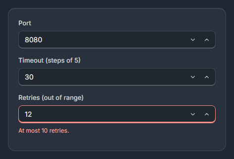

`nc-numeric-up-down` is a number box (`type="number"`) with the Nocturne spin buttons on the right. The
buttons (which repeat while held) and the arrow keys step by `interval`, inside `minimum` and `maximum`.

```cshtml
<nc-numeric-up-down asp-for="Port" minimum="1" maximum="65535" />
<nc-numeric-up-down name="Timeout" value="30" minimum="0" maximum="300" interval="5" />
```

```html
<div class="nc-numeric-up-down">
  <input class="nc-text-box" max="65535" min="1" step="1" type="number" value="8080" />
  <span class="nc-numeric-up-down__spin">
    <button type="button" data-nc-step="-1" tabindex="-1" aria-label="Decrease">…</button>
    <button type="button" data-nc-step="1" tabindex="-1" aria-label="Increase">…</button>
  </span>
</div>
```

| Attribute | Default | Description |
| --- | --- | --- |
| `asp-for` | | binds a number property |
| `value` / `name` | | without `asp-for` |
| `minimum` / `maximum` | | the range |
| `interval` | `1` | the step |
| `string-format` | | a .NET format for the value (`N1`) |
| `placeholder` | | the hint while it is empty |
| `hide-up-down-buttons` | `false` | leaves the spin buttons out |
| `is-read-only` | `false` | read-only, without spin buttons |

## DatePicker

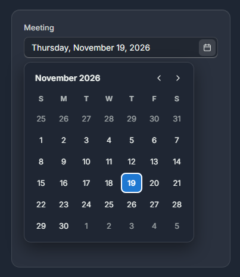

`nc-date-picker` is a text box with a calendar button; the button (or Alt+Down, F4) opens the
[calendar](lists.md#calendar) under it. A typed date is read in the culture's order of day, month and
year. With `name`, a hidden input posts the date as `yyyy-MM-dd`.

```cshtml
<nc-date-picker name="Meeting" selected-date="Model.Meeting" />
<nc-date-picker name="Due" culture="da-DK" date-format="d. MMMM yyyy" />
```

```html
<div class="nc-date-picker" data-selected-date="2026-11-19">
  <input class="nc-text-box" value="11/19/2026" placeholder="Select a date">
  <button type="button" class="nc-text-box-button nc-text-box-button--calendar" tabindex="-1" aria-label="Show calendar"></button>
  <input type="hidden" name="Meeting" value="2026-11-19">
</div>
```

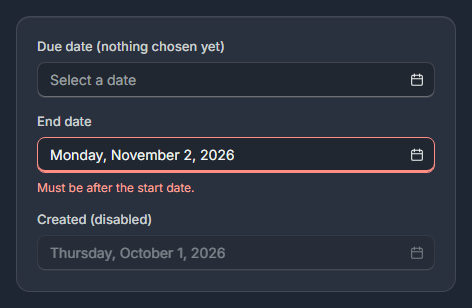

| Attribute | Default | Description |
| --- | --- | --- |
| `selected-date` | | the date (`DateTime?`) |
| `placeholder` | `Select a date` | shown while there is no date |
| `name` | | posts the date as `yyyy-MM-dd` |
| `culture` | the browser's | the culture of the text and the calendar (`da-DK`) |
| `first-day-of-week` | the culture's | `Monday`, `Sunday` … |
| `date-format` | the short date | a .NET custom date format (`dd-MM-yyyy`, `d. MMMM yyyy`) |
| `is-today-highlighted` | `true` | the ring around today in the calendar |

`data-nc-culture`, `data-nc-first-day-of-week` and `data-nc-date-format` on a container set them for
every picker and calendar inside it. The picker raises `nc-change` with the `Date` (or `null`).
`Nocturne.formatDate(date, culture, format)` and `Nocturne.parseDate(text, culture, format)` use the
same rules.

## TimePicker

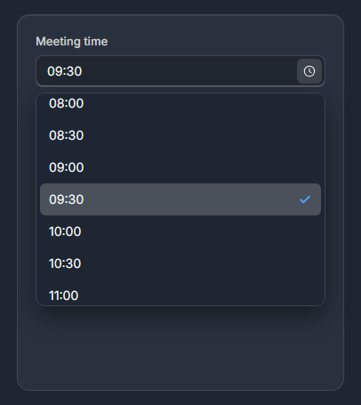

`nc-time-picker` is a text box with a clock button that opens a list of times, `minute-step` apart; the
time can be typed too. It raises `nc-change` with the time as `HH:mm`.

```cshtml
<nc-time-picker name="Start" selected-time="new TimeSpan(9, 30, 0)" minute-step="30" />
```

```html
<div class="nc-time-picker" data-nc-minute-step="30">
  <input class="nc-text-box" value="09:30" name="Start">
  <button type="button" class="nc-text-box-button nc-text-box-button--clock" tabindex="-1" aria-label="Choose a time"></button>
</div>
```

| Attribute | Default | Description |
| --- | --- | --- |
| `selected-time` | | the time (`TimeSpan?`) |
| `minute-step` | `15` | the minutes between the times in the list |
| `placeholder` / `name` | | |

## ColorPicker

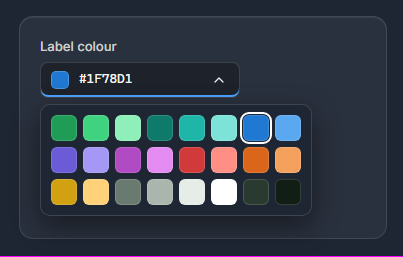

`nc-color-picker` is a button with a swatch and the colour's hex value; it opens a palette of the
theme's 24 colours. It raises `change` and `nc-change` with the colour.

```cshtml
<nc-color-picker id="LabelColour" selected-color="#1F78D1" style="width:200px" />
<nc-color-picker selected-color="#D9661A" palette="new[] { "#1F78D1", "#1F9D57", "#D9661A" }" />
```

```html
<button type="button" class="nc-color-picker" id="LabelColour" data-selected-color="#1F78D1" aria-haspopup="dialog" style="width:200px">
  <span class="nc-color-picker__swatch"></span><span class="nc-color-picker__text"></span><span class="nc-color-picker__chevron" aria-hidden="true"></span>
</button>
```

| Attribute | Default | Description |
| --- | --- | --- |
| `selected-color` | `#1F78D1` | the colour |
| `palette` | the theme's 24 | the colours to choose from |
| `id` | | |

## AutoSuggestBox

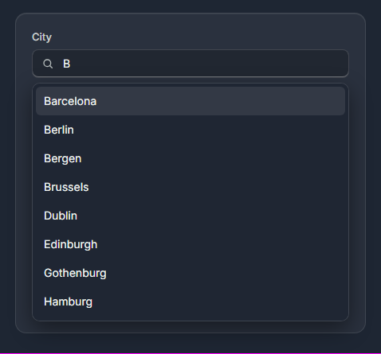

`nc-auto-suggest-box` is a text box that lists the items containing what you type; a click or Enter
takes one. The items go into the page as JSON.

```cshtml
<nc-auto-suggest-box items="Model.Cities" name="City" placeholder="Start typing a city" />
```

```html
<div class="nc-auto-suggest-box">
  <input class="nc-text-box" type="search" autocomplete="off" value="" placeholder="Start typing a city" name="City">
  <script type="application/json">["Aarhus","Bergen","Berlin", …]</script>
</div>
```

| Attribute | Default | Description |
| --- | --- | --- |
| `items` | | the suggestions (`IEnumerable<string>`) |
| `text` / `placeholder` / `name` | | |

It raises `nc-change` with the suggestion taken.

## SearchComboBox

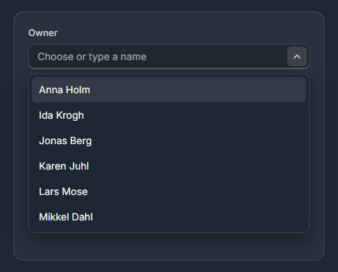

`nc-search-combo-box` is a combo box you type into to filter a long list: every word you type must be
found in an item (or, with `filter-mode="StartsWith"`, the item starts with the text). The items go into
the page as JSON; with `name`, a hidden input posts the selected value.

```cshtml
<nc-search-combo-box items="Model.People" display-member-path="Name" selected-value-path="Id"
                     selected-value="1042" name="OwnerId" placeholder="Choose or type a name" />
```

```html
<div class="nc-search-combo-box" data-nc-display-member="Name" data-nc-value-member="Id" data-nc-selected-value="1042">
  <input class="nc-text-box" autocomplete="off" role="combobox" placeholder="Choose or type a name">
  <button type="button" class="nc-text-box-button nc-text-box-button--drop-down" tabindex="-1" aria-label="Open"></button>
  <input type="hidden" name="OwnerId">
  <script type="application/json">[{"Id":1042,"Name":"Anna Holm", …}, …]</script>
</div>
```

| Attribute | Default | Description |
| --- | --- | --- |
| `items` | | the items: strings, or objects |
| `display-member-path` | | the property to show and search |
| `selected-value-path` | | the property that is the value |
| `selected-value` / `selected-item` | | the item chosen at the start (by value, or the item itself for strings) |
| `filter-mode` | `Contains` | `Contains` (every word, in any order) or `StartsWith` |
| `placeholder` / `name` / `id` | | |

It raises `nc-change` with `{ selectedItem, selectedValue }`. Every item serialised into the page is
visible in its source, so pass view models with only the properties the page may show.

The [WPF page](../inputs.md) describes the same controls for the desktop.
