# Lists and data

## ListBox

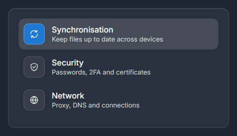

`nc-list-box` lists its items with single selection: a click or the arrow keys select, and the selected
item gets the selection surface (and its icon tile the accent). An item with `stroke-icon` or `icon`
gets an icon tile; `description` adds a second, smaller line.

```cshtml
<nc-list-box name="Section" selected-index="0">
    <nc-list-box-item content="Synchronisation" description="Keep files up to date across devices" stroke-icon="Sync" value="sync" />
    <nc-list-box-item content="Security" description="Passwords, 2FA and certificates" stroke-icon="Shield" value="security" />
    <nc-list-box-item content="Network" description="Proxy, DNS and connections" stroke-icon="Globe" value="network" />
</nc-list-box>
```

```html
<div class="nc-list-box" role="listbox" tabindex="0" data-nc-name="Section">
  <div class="nc-list-box-item" role="option" aria-selected="true" data-value="sync">
    <span class="nc-icon-tile" aria-hidden="true"><svg class="nc-stroke-icon" aria-hidden="true">…</svg></span>
    <span class="nc-list-box-item__text">
      <span class="nc-list-box-item__title">Synchronisation</span>
      <span class="nc-list-box-item__description">Keep files up to date across devices</span>
    </span>
  </div>
  …
  <input type="hidden" name="Section" value="sync">
</div>
```

| Attribute | Default | Description |
| --- | --- | --- |
| `selected-index` | `-1` | the item selected at the start |
| `list-box-style` | `Default` | `Default` or `Navigation` (below) |
| `name` | | posts the selected item's value (or its text) |

`nc-list-box-item` takes `content` (or the element's content), `description`, `value`, `icon`,
`stroke-icon`, `href` (the item is a link) and `is-enabled`. The list raises `nc-change` with the
selected item element.

### Navigation

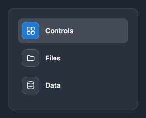

`list-box-style="Navigation"` is `Nocturne.Styles.ListBox.Navigation`: a side menu whose items are a
small icon tile and a label. Give the items `href` to make them links.

```cshtml
<nc-list-box list-box-style="Navigation" selected-index="0">
    <nc-list-box-item content="Controls" stroke-icon="Grid" href="/controls" />
    <nc-list-box-item content="Files" stroke-icon="Folder" href="/files" />
    <nc-list-box-item content="Data" stroke-icon="Database" href="/data" />
</nc-list-box>
```

## ListView

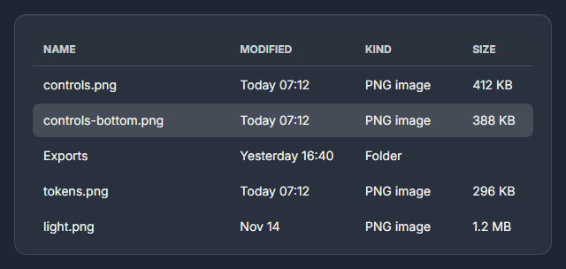

`nc-list-view` is a `ListView` with a `GridView`: a table of the `items` with a header row, without the
grid lines of a data grid. It takes the attributes of [`nc-data-grid`](#datagrid); its columns are
`nc-grid-view-column`s.

```cshtml
<nc-list-view items="Model.Files" selected-index="1" style="height:230px">
    <nc-grid-view-column header="Name" binding="Name" width="220" />
    <nc-grid-view-column header="Modified" binding="Modified" width="140" />
    <nc-grid-view-column header="Size" binding="Size" width="80" horizontal-alignment="Right" />
</nc-list-view>
```

```html
<div class="nc-list-view" style="height:230px" tabindex="0">
  <table data-nc-selection="single">
    <thead><tr><th style="width:220px">Name</th>…</tr></thead>
    <tbody><tr aria-selected="false"><td>controls.png</td>…</tr>…</tbody>
  </table>
</div>
```

## TreeView

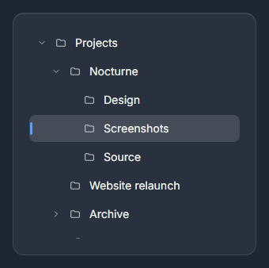

`nc-tree-view` is a tree of nested `nc-tree-view-item`s. An item with children is a `<details>`, so it
folds without the script too. With the script it works as WPF's TreeView: a click on the chevron folds
an item without selecting it, a click on its text selects it and a double-click folds it. The Up and
Down keys move the selection over the items that show; Right opens the selected item (or moves to its
first child) and Left folds it shut (or moves to its parent).

```cshtml
<nc-tree-view name="Folder">
    <nc-tree-view-item header="Projects" stroke-icon="Folder" is-expanded="true">
        <nc-tree-view-item header="Nocturne" stroke-icon="Folder" is-selected="true" value="projects/nocturne" />
        <nc-tree-view-item header="Website" stroke-icon="Folder" />
    </nc-tree-view-item>
    <nc-tree-view-item header="Archive" stroke-icon="Folder" />
</nc-tree-view>
```

```html
<ul class="nc-tree-view" role="tree" data-nc-name="Folder">
  <li><details open><summary><span class="nc-tree-view__item" role="treeitem" aria-selected="false"><svg class="nc-stroke-icon" aria-hidden="true">…</svg>Projects</span></summary>
    <ul role="group">
      <li><span class="nc-tree-view__item" role="treeitem" aria-selected="true" data-value="projects/nocturne">…Nocturne</span></li>
      …
    </ul></details></li>
</ul>
```

| Attribute | Default | Description |
| --- | --- | --- |
| `header` | | the item's text |
| `is-expanded` | `false` | an item with children starts open |
| `is-selected` | `false` | |
| `value` | | `data-value`, for your script |
| `icon` / `stroke-icon` | | an icon before the header |

`nc-tree-view` takes `name`. It raises `nc-change` with the selected item element.

## DataGrid

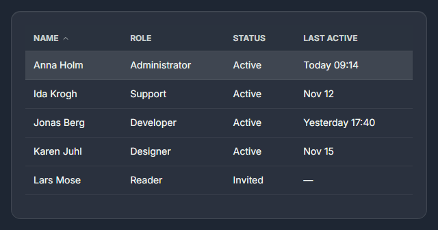

`nc-data-grid` is a read-only table of the `items`, one `nc-data-grid-text-column` per column, with a
sticky header. A click on a header sorts by that column (again: the other way; Shift adds a column), the
edge of a header resizes its column (a double-click there fits it to its content), and a click selects
a row.

```cshtml
<nc-data-grid items="Model.People" selected-index="0" height="262">
    <nc-data-grid-text-column header="Name" binding="Name" sort-direction="Ascending" />
    <nc-data-grid-text-column header="Role" binding="Role" />
    <nc-data-grid-text-column header="Hours" binding="Hours" string-format="N1" width="80" horizontal-alignment="Right" />
</nc-data-grid>
```

```html
<div class="nc-data-grid-host" style="height:262px;">
  <table class="nc-data-grid" data-nc-selection="single">
    <thead><tr><th aria-sort="ascending">Name</th><th>Role</th><th style="width:80px">Hours</th></tr></thead>
    <tbody>
      <tr aria-selected="true"><td>Anna Holm</td><td>Designer</td><td class="nc-data-grid__number" data-sort-value="37.5">37.5</td></tr>
      …
    </tbody>
  </table>
</div>
```

| Attribute | Default | Description |
| --- | --- | --- |
| `items` | | the rows (any `IEnumerable`) |
| `selected-index` | `-1` | the row selected at the start |
| `height` | | the height in pixels; the rows scroll under the header |
| `selection-mode` | `Single` | `Single` or `None` |
| `can-user-sort-columns` | `true` | `false`: the headers do not sort (sort on the server and show it with `sort-direction`) |
| `can-user-resize-columns` | `true` | |
| `row-headers` | `false` | a row header before each row (`HeadersVisibility="All"`) |

| Column attribute | Default | Description |
| --- | --- | --- |
| `header` | | the header text |
| `binding` | | the property of each item to show |
| `width` | | pixels, or `*` for the rest |
| `string-format` | | a .NET format (`N1`, `d`) |
| `horizontal-alignment` | | `Right` for numbers |
| `sort-direction` | | `Ascending` or `Descending`: the arrow in the header (the order the rows come in) |
| `sort-member-path` | | the property to sort by when it is not the binding |
| `can-user-sort` / `can-user-resize` | `true` | per column |

Numbers, dates and enums sort by their value (`data-sort-value`), not their text. A row with
`data-href` opens that address when clicked. The grid raises `nc-sorting` (cancelable, with
`{ column, header, direction }`) before it sorts and `nc-sorted` after.

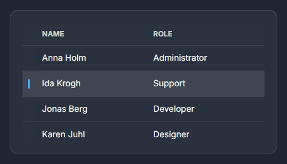

## NocturneGrid

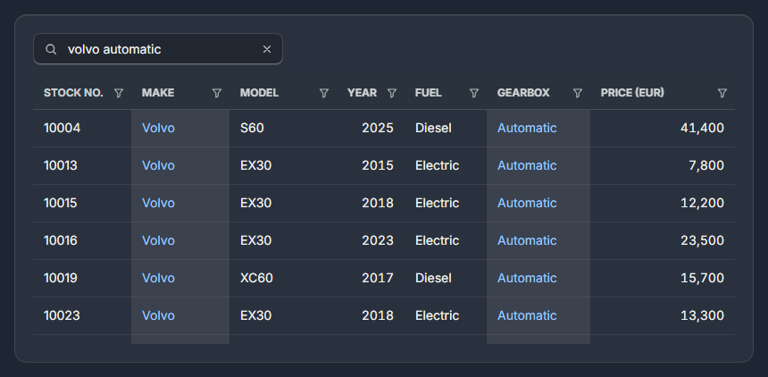

`nc-nocturne-grid` is the data grid for lists of up to a few thousand rows, as `nc:NocturneGrid` in WPF.
The tag helper writes the rows into the page as JSON (each cell as it is shown, plus its value for
numbers, dates and check boxes), and `nocturne.js` draws the rows of the page shown:

- **Search**: every word must be found somewhere in the row (in any searchable column); quotes keep a
  phrase together. The hits are drawn in the light accent in faintly lit cells. `search-box` names a
  text box whose text is the search, as a binding to it would be in WPF.
- **Header filters**: the funnel in each header keeps only the rows with the values you tick or type.
  A column with few values lists them to tick; a column of dates gets a tree of years, months and
  days; typed values can be ranges (`>50000`, `<=2019`, `2020-01-01..2020-06-30`) and wildcards
  (`vol*`).
- **Sorting**: a header click sorts ascending, then descending, then back to the source order; Shift
  adds a column.
- **Groups** (`group-member-path`): the rows under headers that fold, with the count of each group.
- **Paging** (`page-size`): a pager under the rows.

```cshtml
<nc-text-box id="CarSearch" text-box-style="Search" clear-button="true" placeholder="Search" />
<nc-nocturne-grid id="Cars" items="Model.Cars" search-box="CarSearch" page-size="100" frozen-column-count="1" height="560">
    <nc-nocturne-grid-column header="Stock no." binding="StockNo" width="110" />
    <nc-nocturne-grid-column header="Make" binding="Make" width="130" />
    <nc-nocturne-grid-column header="Year" binding="Year" width="76" text-alignment="Right" />
    <nc-nocturne-grid-check-box-column header="Sold" binding="IsSold" width="80" />
    <nc-nocturne-grid-column header="Price (EUR)" binding="Price" string-format="N0" width="*" is-searchable="false" text-alignment="Right" />
</nc-nocturne-grid>
```

| Filter in a header | Grouped by make | Paged |
| --- | --- | --- |
| 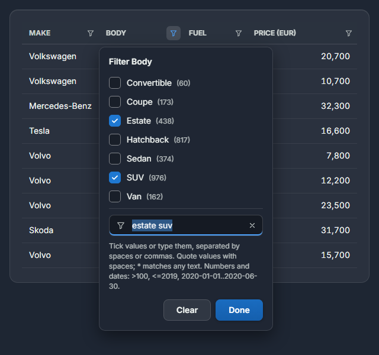 | 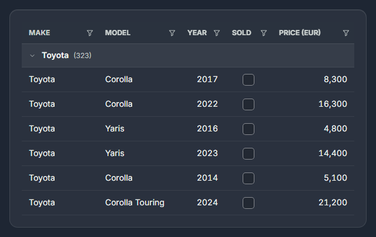 | 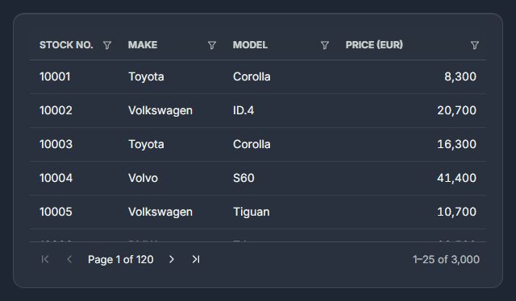 |

| Attribute | Default | Description |
| --- | --- | --- |
| `items` | | the rows (any `IEnumerable`) |
| `items-source-url` | | server mode, [below](#server-mode) |
| `search-text` | | the search at the start |
| `search-box` | | the id of a text box whose text is the search |
| `search-delay` | `300` | ms after the last change to the search or a filter before the rows are filtered; `0` at once |
| `filter-list-limit` | `20` | a header filter lists the values to tick when there are at most this many |
| `group-member-path` | | the binding of the column the rows are grouped by |
| `page-size` | `0` | rows per page; `0` shows every row |
| `page-index` | `0` | the page shown, from 0 |
| `selected-index` | `-1` | |
| `selection-mode` | `Single` | `Single`, `Extended` (Ctrl and Shift) or `None` |
| `frozen-column-count` | `0` | columns on the left that stay in view when the others scroll sideways |
| `height` | | pixels; without it the grid fills the height its parent gives it |
| `can-user-sort-columns` / `can-user-resize-columns` | `true` | |
| `highlight-foreground` | the light accent | the colour of the search hits; `none` keeps the cell's colour |
| `highlight-cell-background` | a faint light | the ground of a cell with hits; `none` for none |

| Column attribute | Default | Description |
| --- | --- | --- |
| `header` / `binding` | | the header text and the property (a dotted path reads nested properties) |
| `width` | | pixels, or `*` for the rest |
| `string-format` | | a .NET format (`N0`, `d`) or a composite one (`{0} hp`) |
| `text-alignment` | `Left` | `Left`, `Right` (numbers) or `Center` |
| `sort-direction` | | the order the rows start in |
| `can-user-sort` / `can-user-resize` | `true` | |
| `is-searchable` | `true` | whether the search looks in this column |
| `is-filterable` | `true` | whether the header has a filter |
| `filter-text` | | the filter at the start: values separated by spaces or commas, quotes, `*`, ranges |
| `filter-dates` | | for a column of dates: the days to keep (`IEnumerable<DateTime?>`; null for rows without a date) |

`nc-nocturne-grid-check-box-column` draws a check box, and its filter and search read the values as
`true-text` and `false-text` (`Yes` and `No`); it is not searchable unless `is-searchable="true"`.

### From script

`Nocturne.nocturneGrid('Cars')` gives the grid's API:

```js
const grid = Nocturne.nocturneGrid('Cars');
grid.searchText = 'volvo automatic';
grid.setFilterText('Make', 'volvo saab');
grid.groupMemberPath = 'Make';
grid.pageSize = 50;
grid.items = await (await fetch('/api/cars')).json();   // new rows (objects with the bindings)
grid.selectedItem;                                       // the row's object
grid.getVisibleItems();                                  // the rows left after the search and filters
grid.clearFilters();
```

| Member | |
| --- | --- |
| `items` | the rows; set it to show new ones |
| `searchText`, `groupMemberPath`, `pageSize`, `pageIndex`, `selectionMode` | as the attributes |
| `sorts` | the sort, as `[{ binding, direction: 'ascending' \| 'descending' }]` |
| `selectedItem`, `selectedItems`, `selectedIndex` (set only) | the selection |
| `columns` | `[{ header, binding, type }]` |
| `pageCount`, `isPaging`, `isGrouped`, `isFiltered`, `filteredItemCount`, `totalItemCount` | read only |
| `getFilterText(column)`, `setFilterText(column, text)`, `setFilterDates(column, dates)`, `clearFilters(column?)` | the header filters (a column by binding or index) |
| `applyFilters()` | filters now instead of after `search-delay` |
| `refresh()` | reads the rows again |
| `expandAllGroups()`, `collapseAllGroups()` | |
| `itemsSource` | server mode: a URL or a function |

The grid raises `nc-filtered` (`{ count, totalCount }`), `nc-page-changed` (`{ pageIndex, pageCount }`),
`nc-selected-item-changed` (`{ oldValue, newValue }`), `nc-sorting` (cancelable) and `nc-sorted`.

### Server mode

With `items-source-url`, the rows stay on the server. For each page the grid posts what it shows (the
page, page size, search, filters, sort, groups and its columns' bindings and formats: a
`NocturneGridRequest`) and draws the page the server answers with (a `NocturneGridResponse`). A header
filter asks for its column's values the same way. While a page is on its way the grid is `aria-busy`;
if the request fails it raises `nc-load-failed` (`{ error }`).

`NocturneGridServer.Query` answers from rows in memory, with the same rules for the search, filters,
sorting, groups and pages as the grid in the browser:

```csharp
app.MapPost("/api/cars", (NocturneGridRequest request) =>
    NocturneGridServer.Query(CarData.Cars, request));
```

```cshtml
<nc-nocturne-grid items-source-url="/api/cars" page-size="100" height="560">
    <nc-nocturne-grid-column header="Make" binding="Make" width="130" />
    …
</nc-nocturne-grid>
```

The grid names the columns it shows, so the server reads only bindings you allow: the ones you pass
after the request (`Query(cars, request, "Make", "Model", "Price")`), or else the public properties of
the item type. Pass view models rather than entities with properties the page must not see. For a
database, write the endpoint yourself from the request and send back the same response.

## Calendar

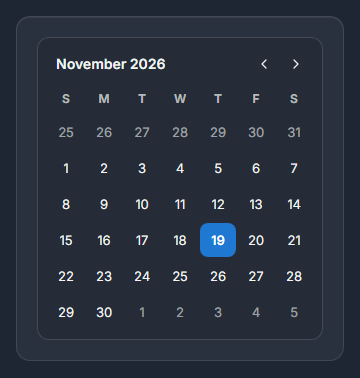

`nc-calendar` is the month view, with the year and decade views behind its header. Month and day
names follow the browser's culture unless `culture` (or `data-nc-culture` on a container) names one.
It raises `nc-change` with the chosen `Date`.

```cshtml
<nc-calendar selected-date="Model.Meeting" culture="da-DK" />
```

```html
<div class="nc-calendar" data-selected-date="2026-11-19" data-nc-culture="da-DK"></div>
```

| Attribute | Default | Description |
| --- | --- | --- |
| `selected-date` | | the chosen day |
| `display-date` | the selected date or today | the month shown |
| `culture` | the browser's | |
| `first-day-of-week` | the culture's | |
| `is-today-highlighted` | `true` | the ring around today |

## ScrollViewer

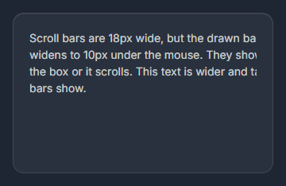

`nc-scroll-viewer` is a scrolling box with the Nocturne bars: 18px wide, but drawn as a thin 6px line
that widens to 10px under the mouse, shown while the mouse is over the box or it scrolls. Every
scrolling element in the theme (lists, grids, the window content) has them. Chromium browsers draw the
shape; Firefox takes the colours only.

```cshtml
<nc-scroll-viewer horizontal-scroll-bar-visibility="Auto" style="height:160px">…</nc-scroll-viewer>
```

```html
<div class="nc-scroll-viewer" style="overflow-x:auto;overflow-y:auto;height:160px" tabindex="-1">…</div>
```

| Attribute | Default | Description |
| --- | --- | --- |
| `horizontal-scroll-bar-visibility` | `Disabled` | `Auto`, `Visible`, `Hidden` or `Disabled` |
| `vertical-scroll-bar-visibility` | `Auto` | |

The [WPF page](../lists.md) describes the same controls for the desktop.
