# Navigation and layout

## TabControl

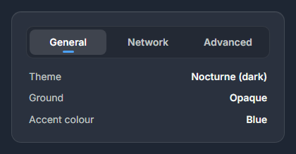

`nc-tab-control` is the segmented control of the WPF theme: the tabs share a sunken strip, and the
selected one has a light pill and a short accent stripe that glide to a new tab. A click or the arrow
keys switch the pages (`nocturne.js`); without the script the first page shows.

```cshtml
<nc-tab-control selected-index="0">
    <nc-tab-item header="General" name="general">…</nc-tab-item>
    <nc-tab-item header="Network" name="network">…</nc-tab-item>
    <nc-tab-item header="Advanced" is-enabled="false" />
    <nc-tab-control-tag><nc-tag>3 tabs</nc-tag></nc-tab-control-tag>
</nc-tab-control>
```

```html
<div id="nc-tabs-1a2b3c4d" class="nc-tab-control">
  <div class="nc-tab-control__header">
    <div class="nc-tab-control__strip" role="tablist">
      <span class="nc-tab-control__indicator" aria-hidden="true"></span>
      <button type="button" class="nc-tab-item" role="tab" id="nc-tabs-1a2b3c4d-tab-general" aria-controls="nc-tabs-1a2b3c4d-panel-general" aria-selected="true" tabindex="0" data-name="general"><span class="nc-tab-item__header">General</span></button>
      …
    </div>
    <div class="nc-tab-control__tag"><span class="nc-tag">3 tabs</span></div>
  </div>
  <div class="nc-tab-control__content" role="tabpanel" id="nc-tabs-1a2b3c4d-panel-general" aria-labelledby="nc-tabs-1a2b3c4d-tab-general">…</div>
  <div class="nc-tab-control__content" role="tabpanel" … hidden>…</div>
</div>
```

| Attribute | Default | Description |
| --- | --- | --- |
| `tab-control-style` | `Default` | `Default` (the segments) or `Document` (below) |
| `selected-index` | `0` | the tab selected at the start (or `is-selected` on a tab) |
| `use-hash` | `false` | keeps the selected tab in the address (`#name`), so a link opens that tab |
| `show-add-button` | `false` | document tabs: a "+" after the tabs |
| `id` | | |

`nc-tab-item` takes `header`, `name` (a stable id, and the `#name` for `use-hash`), `is-selected`,
`is-enabled`, and for document tabs `show-close-button` and `badge`. `nc-tab-control-tag` is the
TabControl's `Tag`, shown at the right of the strip. The control raises `nc-change` with
`{ index, header, name }`.

### Document tabs

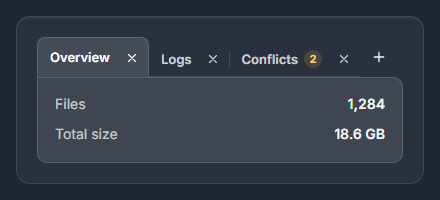

`tab-control-style="Document"` is `Nocturne.Styles.TabControl.Document`: browser-like tabs over a panel,
with a close button and a badge on each tab (`TabHelper`) and a "+" after them.

```cshtml
<nc-tab-control id="Files" tab-control-style="Document" show-add-button="true">
    <nc-tab-item header="Overview" show-close-button="true">…</nc-tab-item>
    <nc-tab-item header="Conflicts" badge="2" show-close-button="true">…</nc-tab-item>
</nc-tab-control>
```

The × raises `nc-tab-closing` (`{ index, name }`; cancel it with `preventDefault()` to keep the tab),
removes the tab and its page and raises `nc-tab-closed`. The "+" only raises `nc-tab-add`; add the tab
yourself:

```js
document.getElementById('Files').addEventListener('nc-tab-closing', e => {
  if (!confirm('Close ' + e.detail.name + '?')) e.preventDefault();
});
```

## HamburgerMenu

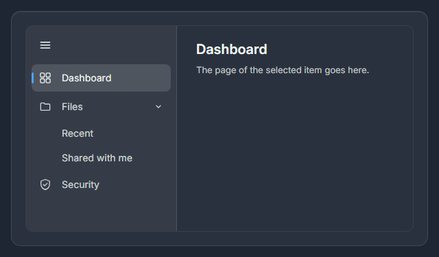

`nc-hamburger-menu` is the dark navigation pane of the WPF `HamburgerMenu`: icons with labels, a
button at the top that folds the pane to its icons, and groups that open and close their sub-items
(two levels; sub-items have no icon).

Items with `href` are links: the menu is the window's navigation, and the item of the current page has
`is-selected`. Items with content instead switch a panel to the right of the menu, as the control does
in a WPF window.

```cshtml
@* The window's navigation (in .nc-window__body, before the content) *@
<nc-hamburger-menu>
    <nc-hamburger-menu-item content="Dashboard" stroke-icon="Grid" href="/" is-selected="true" />
    <nc-hamburger-menu-item content="Employees" icon="AccountMultiple" href="/employees" />
    <nc-hamburger-menu-item content="Files" stroke-icon="Folder">
        <nc-hamburger-menu-item content="Recent" href="/files/recent" />
        <nc-hamburger-menu-item content="Shared with me" href="/files/shared" />
    </nc-hamburger-menu-item>
</nc-hamburger-menu>

@* Pages in the page *@
<nc-hamburger-menu selected-index="0">
    <nc-hamburger-menu-item content="Dashboard" stroke-icon="Grid">…the page…</nc-hamburger-menu-item>
    <nc-hamburger-menu-item content="Security" stroke-icon="Shield">…the page…</nc-hamburger-menu-item>
</nc-hamburger-menu>
```

```html
<nav class="nc-hamburger-menu" aria-label="Pages">
  <button type="button" class="nc-hamburger-menu__toggle" data-nc-toggle-pane aria-expanded="true" aria-label="Show page names">…</button>
  <a class="nc-hamburger-menu__item" href="/" title="Dashboard" aria-current="page">
    <span class="nc-hamburger-menu__icon"><svg class="nc-stroke-icon" aria-hidden="true">…</svg></span>
    <span class="nc-hamburger-menu__label">Dashboard</span>
  </a>
  <div class="nc-hamburger-menu__group">
    <button type="button" class="nc-hamburger-menu__item nc-hamburger-menu__group-header" data-nc-hamburger-group aria-expanded="false" title="Files">…</button>
    <div class="nc-hamburger-menu__sub-items" role="group" hidden>
      <a class="nc-hamburger-menu__item nc-hamburger-menu__item--sub" href="/files/recent" title="Recent"><span class="nc-hamburger-menu__label">Recent</span></a>
      …
    </div>
  </div>
</nav>
```

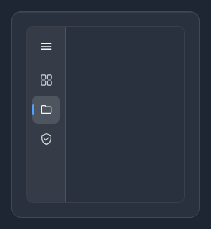

| Attribute | Default | Description |
| --- | --- | --- |
| `selected-index` | `-1` | counts groups and sub-items in order, as in WPF; a group passes it to its first sub-item |
| `is-pane-open` | `true` | `false` starts folded to the icons |
| `pane-width` | | the open pane's width in pixels |

`nc-hamburger-menu-item` takes `content`, `icon` or `stroke-icon`, `href`, `is-selected` and, for a
group, `is-expanded` (a group with the selected page opens by itself).

The window's menu (the one in `.nc-window__body`) remembers whether it is open (`localStorage`, key
`nocturne.paneOpen`) and starts folded on screens narrower than 640px. A button with
`data-nc-toggle-pane`, or a check box with `data-nc-pane-switch`, folds it from elsewhere. In the folded
pane a group opens the pane, since sub-items have no icons.

## Expander

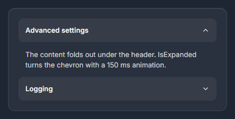

`nc-expander` is a `<details>`: a 48px header on the card surface whose chevron turns (150 ms) when it
opens. It works without the script.

```cshtml
<nc-expander header="Advanced settings" is-expanded="true">…</nc-expander>
```

```html
<details class="nc-expander" open="open">
  <summary>Advanced settings</summary>
  <div class="nc-expander__content">…</div>
</details>
```

| Attribute | Default | Description |
| --- | --- | --- |
| `header` | | the header text |
| `is-expanded` | `false` | starts open |

## Accordion

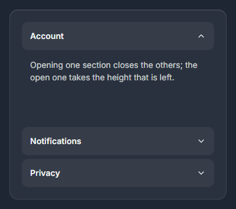

`nc-accordion` holds expanders 6px apart, one open at a time; the open one takes the height that is
left. The expanders share a `name`, so the browser closes the others itself.

```cshtml
<nc-accordion style="height:280px">
    <nc-expander header="Account" is-expanded="true">…</nc-expander>
    <nc-expander header="Notifications">…</nc-expander>
    <nc-expander header="Privacy">…</nc-expander>
</nc-accordion>
```

```html
<div class="nc-accordion" style="height:280px">
  <details class="nc-expander" open="open" name="nc-accordion-802af0f6">…</details>
  <details class="nc-expander" name="nc-accordion-802af0f6">…</details>
</div>
```

## GroupBox

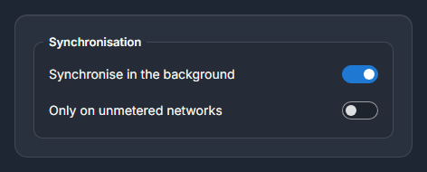

`nc-group-box` is a `<fieldset>`: a sunken frame with the header in a gap in its top edge.

```cshtml
<nc-group-box header="Synchronisation">…</nc-group-box>
```

```html
<fieldset class="nc-group-box"><legend class="nc-group-box__header">Synchronisation</legend>…</fieldset>
```

## Menu

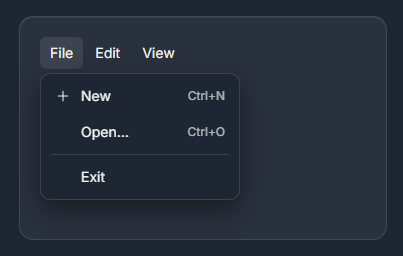

`nc-menu` is the menu bar; its `nc-menu-item`s are the top-level headers, and their children the items
of the menu each opens. An item with children of its own opens a submenu to the right. The menus are
popovers on the popup surface; the arrow keys move in them, Right opens a submenu and Left or Escape
close one.

```cshtml
<nc-menu>
    <nc-menu-item header="_File">
        <nc-menu-item header="_New" input-gesture-text="Ctrl+N" stroke-icon="Plus" />
        <nc-menu-item header="_Open…" input-gesture-text="Ctrl+O" />
        <nc-separator />
        <nc-menu-item header="E_xit" href="/logout" />
    </nc-menu-item>
    <nc-menu-item header="_Edit">…</nc-menu-item>
</nc-menu>
```

```html
<nav class="nc-menu" role="menubar">
  <button type="button" class="nc-menu-item" role="menuitem" popovertarget="nc-submenu-8b2b60e1" aria-haspopup="menu">File</button>
  <div class="nc-context-menu" popover id="nc-submenu-8b2b60e1" role="menu">
    <button type="button" class="nc-menu-item" role="menuitem">
      <span class="nc-menu-item__icon">…</span><span class="nc-menu-item__header">New</span><span class="nc-menu-item__gesture">Ctrl+N</span>
    </button>
    …
    <hr class="nc-menu-separator" />
    …
  </div>
  …
</nav>
```

| `nc-menu-item` attribute | Default | Description |
| --- | --- | --- |
| `header` | | the text (an `_` before an access key is dropped) |
| `input-gesture-text` | | the shortcut shown on the right |
| `icon` / `stroke-icon` | | an icon in the icon column |
| `is-checkable` / `is-checked` | `false` | a check mark in the icon column (`role="menuitemcheckbox"`) |
| `href` | | makes the item a link |

Menu items are buttons; handle their `click` (give them an `id`), or make them links with `href`. Use
`nc-separator` between groups.

## ContextMenu

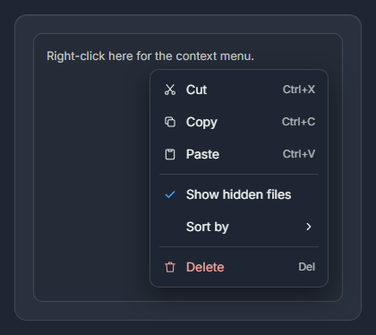

`nc-context-menu` is a menu that opens at the pointer when you right-click an element with
`data-nc-context-menu="<its id>"`.

```cshtml
<div data-nc-context-menu="FileMenu">…</div>

<nc-context-menu id="FileMenu">
    <nc-menu-item header="Copy" input-gesture-text="Ctrl+C" stroke-icon="Copy" />
    <nc-menu-item header="Show hidden files" is-checkable="true" is-checked="true" />
    <nc-menu-item header="Sort by"><nc-menu-item header="Name" /></nc-menu-item>
    <nc-separator />
    <nc-menu-item header="Delete" input-gesture-text="Del" stroke-icon="Delete" />
</nc-context-menu>
```

```html
<div class="nc-context-menu" id="FileMenu" popover="" role="menu">…</div>
```

## ToolBar

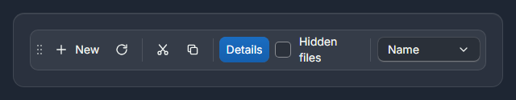

`nc-tool-bar` is the bar with the grip. Buttons in it are subtle until the mouse is over them, and an
`nc-separator` in it is the vertical one. `nc-tool-bar-tray` holds one or more bars.

```cshtml
<nc-tool-bar-tray>
    <nc-tool-bar>
        <nc-button stroke-icon="Plus" content="New" />
        <nc-button stroke-icon="Refresh" aria-label="Refresh" />
        <nc-separator />
        <nc-toggle-button content="Details" is-checked="true" />
        <nc-check-box content="Hidden files" />
    </nc-tool-bar>
</nc-tool-bar-tray>
```

```html
<div class="nc-tool-bar-tray">
  <div class="nc-tool-bar" role="toolbar">
    <span class="nc-tool-bar__thumb" aria-hidden="true"></span>
    <button type="button" class="nc-button">…New</button>
    <span class="nc-tool-bar__separator" role="separator"></span>
    …
  </div>
</div>
```

## StatusBar

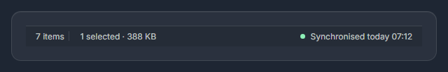

`nc-status-bar` is the strip at the bottom of the window (the last child of `body.nc-window`) or of a
panel. Items with `horizontal-alignment="Right"` move to the right end.

```cshtml
<nc-status-bar>
    <nc-status-bar-item>7 items</nc-status-bar-item>
    <nc-status-bar-item horizontal-alignment="Right">Synchronised today 07:12</nc-status-bar-item>
</nc-status-bar>
```

```html
<footer class="nc-status-bar">
  <span>7 items</span>
  <span class="nc-status-bar__item--right">Synchronised today 07:12</span>
</footer>
```

## GridSplitter

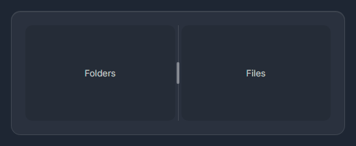

`nc-grid-splitter` sits between two panes of a flex row (or column) and resizes the pane before it when
dragged: a hairline with a small grip. In a flex column, or with `resize-direction="Rows"`, it resizes
heights. The pane keeps its `min-width` / `min-height`.

```cshtml
<div style="display:flex;height:400px">
    <aside style="width:240px;min-width:160px">Folders</aside>
    <nc-grid-splitter />
    <main style="flex:1">Files</main>
</div>
```

```html
<div class="nc-grid-splitter" role="separator" aria-orientation="vertical"></div>
```

## ToolTip

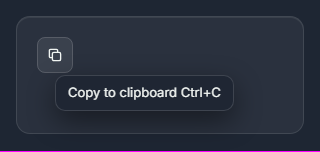

`tool-tip="…"` on a tag helper, or `nc-tool-tip="…"` on any element in a Razor view, writes
`data-nc-tool-tip`; `nocturne.js` shows the text in the Nocturne tool tip under the pointer. In plain
HTML, write `data-nc-tool-tip` yourself.

```cshtml
<nc-button button-style="Icon" stroke-icon="Copy" aria-label="Copy" tool-tip="Copy to clipboard" />
<span nc-tool-tip="Last synchronised at 07:12">Synchronised</span>
```

```html
<button type="button" class="nc-button nc-button--icon" aria-label="Copy" data-nc-tool-tip="Copy to clipboard">…</button>
```

The [WPF page](../navigation.md) describes the same controls for the desktop.
