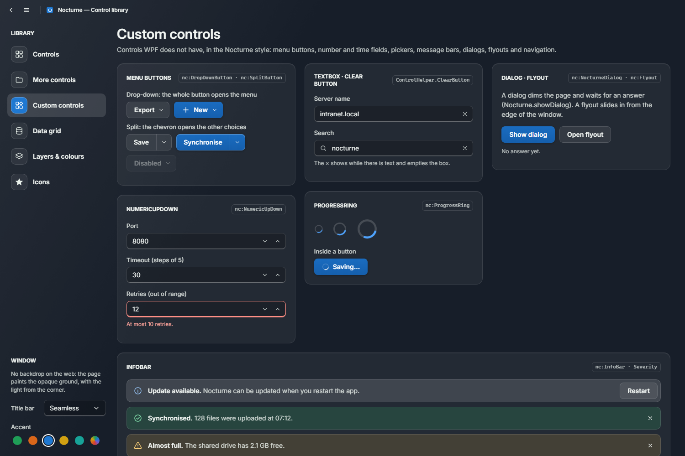
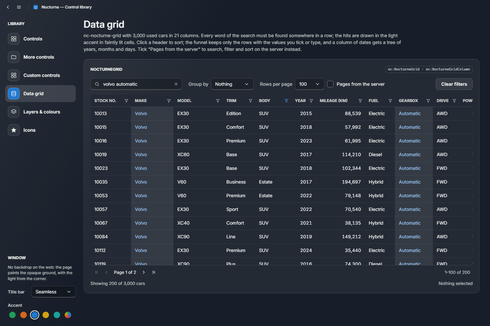
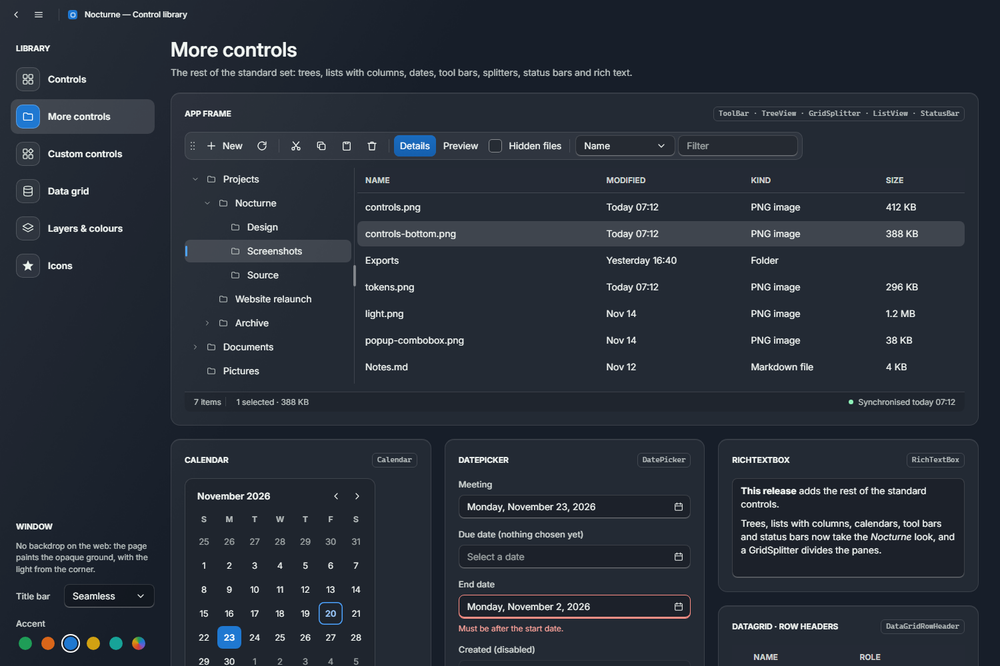
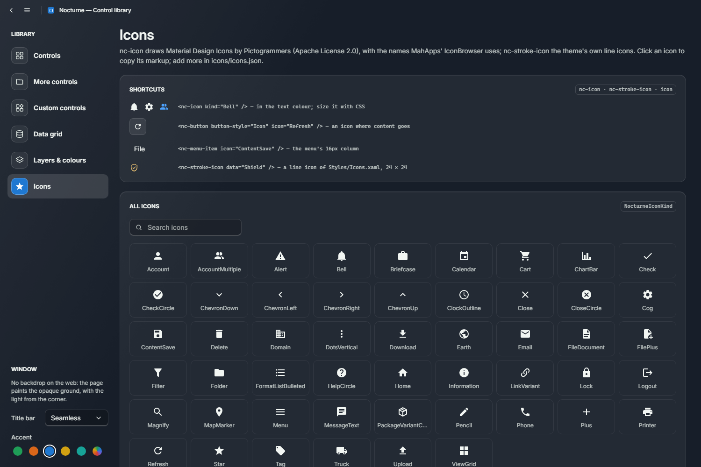
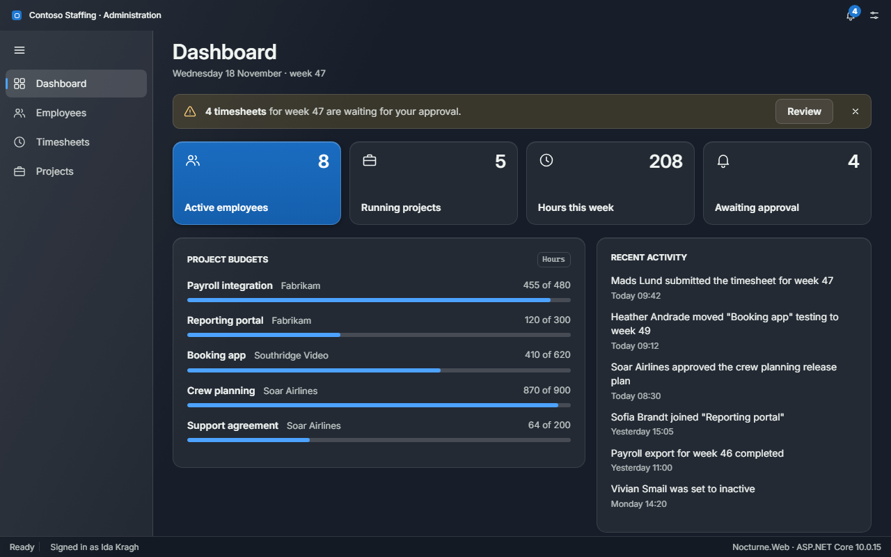
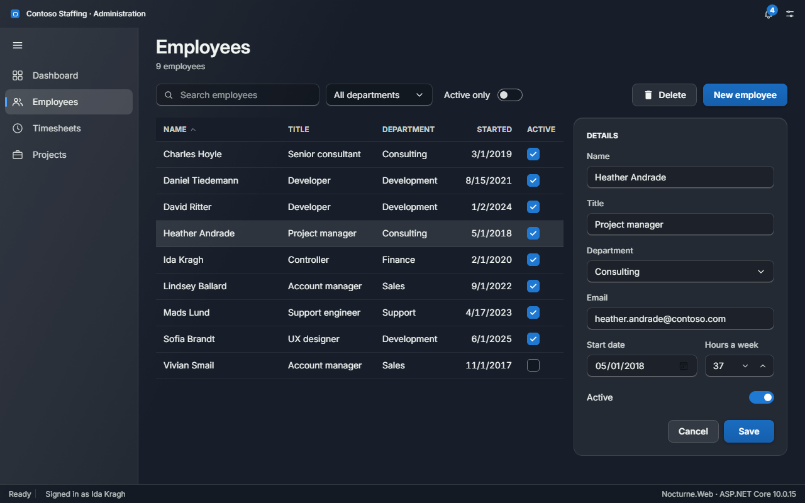
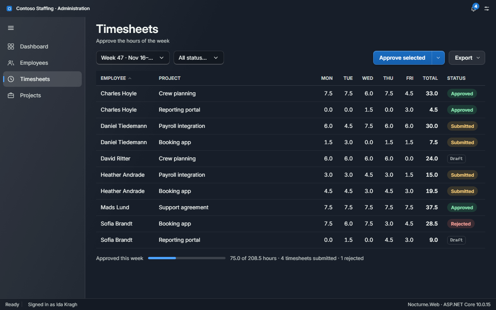
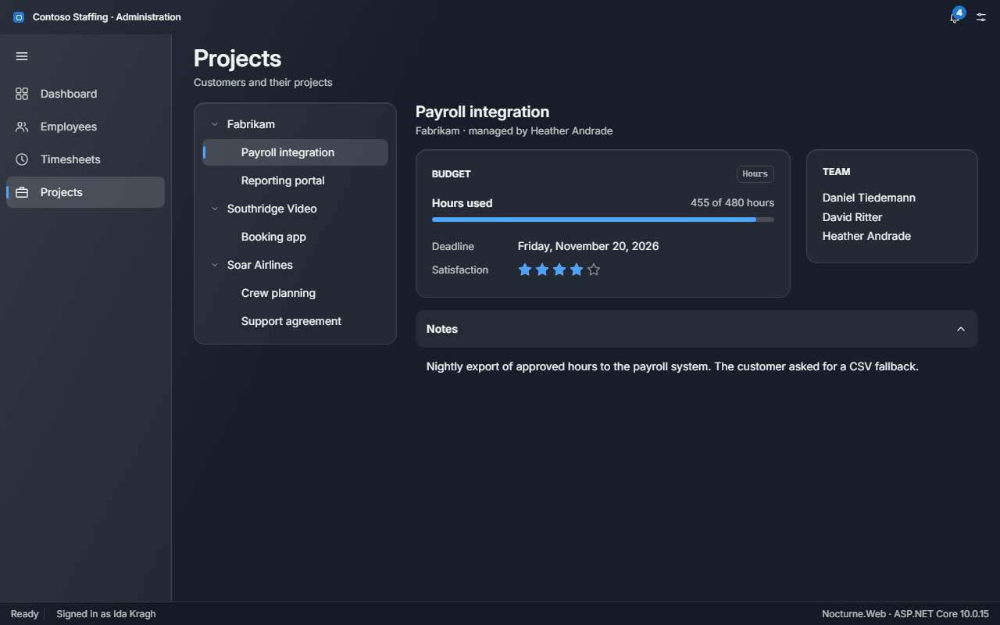

# Demo and samples

The repository has a web demo with every control and an MVC sample site built with the theme. Both are
in `NocturneTheme.slnx`.

## The web demo

```bash
dotnet run --project src/Nocturne.Web.Demo
```

It opens on `http://localhost:5190`. The demo is the WPF demo as a web page, with the same six pages in
a navigation list on the left and the window's settings (title bar style and accent) under it.

| Page | |
| --- | --- |
| Controls | the standard controls: buttons, text, combo boxes, check boxes, switches, sliders, lists, tabs |
| More controls | the rest of WPF's controls: trees, list views, data grids, calendars, menus, tool bars, status bars |
| Custom controls | the controls Nocturne adds: drop-down and split buttons, tiles, numeric input, pickers, the dialog and the flyout |
| Data grid | `nc-nocturne-grid` with 3,000 used cars in 21 columns; "Pages from the server" switches it to [server mode](lists.md#server-mode) (`/api/cars`) |
| Layers & colours | the surfaces, text colours and accents as the tokens draw them |
| Icons | every NocturneIcon with its name |





| More controls | Icons |
| --- | --- |
|  |  |

`/Demo/Gallery` has one sample per control, with the same names as the WPF gallery; the pictures on
the control pages come from it (`/Demo/Gallery?shot=<name>` shows one sample alone, with its drop-down
open). `tools/web_snapshots.py` takes the pictures with headless Edge.

## The MVC sample

```bash
dotnet run --project samples/Nocturne.Web.Samples.Mvc
```

It opens on `http://localhost:5180`: "Contoso Staffing · Administration", the WPF Admin sample as an
ASP.NET Core MVC site, with fixed data. The layout is `body.nc-window` with a hamburger menu of links,
a bell with a badge and a settings button in the title bar, a status bar, and a settings flyout with
the accent. It uses Tailwind (the browser build) for layout, with `nocturne.tailwind.css`'s theme
variables copied into the page.

### Dashboard



A warning info bar about the timesheets waiting for approval, an accent tile and three plain tiles
(two of them link to their pages), a card with a progress bar for the hours of each project's budget, and a
card with the recent activity.

### Employees



A search box, a department combo box and an "Active only" switch over a data grid of the staff; the
selected employee opens in a form on a card (text boxes, a combo box, a date field, a numeric
up-down and a switch) that posts back with model validation (`asp-for`, `asp-validation-for`). Delete asks in a `<dialog class="nc-dialog">`
with a danger button.

### Timesheets



Combo boxes for the week and the status, a primary split button ("Approve selected") and an Export
drop-down whose menus line up with the right edge of their buttons (`data-nc-align="right"`), and a data grid of
the week's hours with status pills.

### Projects



A tree view of customers and their projects as links, and for the chosen project a card with its
progress, a read-only rating, a data grid of its tasks and expanders with notes.

The [WPF sample apps](../samples.md) are the same pages for the desktop.
