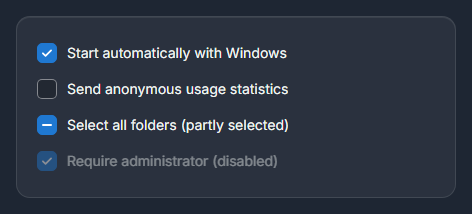
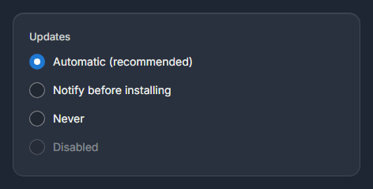
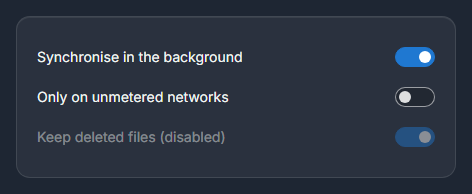
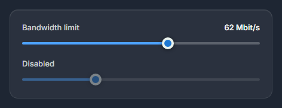
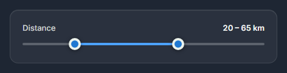
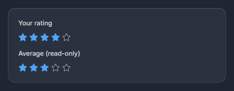

# Selection

## CheckBox



`nc-check-box` is a native check box in a label: a 20px box with 5px corners that fills with the accent
and a check mark when checked. `is-checked="null"` shows the dash of a partly checked box (the
input's `indeterminate`, set by `nocturne.js`).

```cshtml
<nc-check-box asp-for="StartWithWindows" content="Start automatically with Windows" />
<nc-check-box name="Statistics" content="Send anonymous usage statistics" />
<nc-check-box content="Select all folders (partly selected)" is-checked="null" />
<nc-check-box content="Require administrator" is-checked="true" is-enabled="false" />
```

```html
<label class="nc-check-box"><input checked="checked" type="checkbox" value="true" />Start automatically with Windows</label>
<label class="nc-check-box"><input data-nc-indeterminate="" type="checkbox" value="true" />Select all folders (partly selected)</label>
```

| Attribute | Default | Description |
| --- | --- | --- |
| `asp-for` | | binds a `bool` property, as `<input asp-for>` (with the hidden `false` field) |
| `content` | | the text; without it the element's content |
| `is-checked` | `false` | `true`, `false` or `null` (partly checked) |
| `name` / `value` / `id` | | without `asp-for`; the value is `true` unless given |

## RadioButton



`nc-radio-button` is a native radio button: a 20px ring with an accent dot when chosen. Radio buttons
with the same `group-name` exclude each other.

```cshtml
<nc-radio-button group-name="Updates" value="auto" content="Automatic (recommended)" is-checked="true" />
<nc-radio-button group-name="Updates" value="notify" content="Notify before installing" />
<nc-radio-button group-name="Updates" value="never" content="Never" />
```

```html
<label class="nc-radio-button"><input checked="checked" name="Updates" type="radio" value="auto" />Automatic (recommended)</label>
```

| Attribute | Default | Description |
| --- | --- | --- |
| `group-name` | | the group (the input's `name`) |
| `value` | the content | what the group posts when this one is chosen |
| `content` / `is-checked` / `id` | | as `nc-check-box` |

## Toggle switch



`nc-toggle-switch` is `Nocturne.Styles.ToggleSwitch`: a 40×20 pill whose knob slides to the right and
fills with the accent when on. It is a check box (`role="switch"`), so it posts like one.

```cshtml
<nc-toggle-switch asp-for="SyncInBackground">Synchronise in the background</nc-toggle-switch>
<nc-toggle-switch name="Metered" content="Only on unmetered networks" />
```

```html
<label class="nc-toggle-switch"><input checked="checked" role="switch" type="checkbox" />Synchronise in the background</label>
```

| Attribute | Default | Description |
| --- | --- | --- |
| `asp-for` | | binds a `bool` property |
| `content` | | the text; without it the element's content |
| `is-checked` | `false` | |
| `name` / `id` | | without `asp-for`; it posts `true` when on |

## Slider



`nc-slider` is a thin track with the part before the thumb in the light accent and a 20px round thumb. Drag
the thumb, click the track, or use the arrow keys (`small-change`), Page Up and Page Down
(`large-change`), Home and End.

```cshtml
<nc-slider name="Bandwidth" value="62" minimum="0" maximum="100" label="Bandwidth limit" />
<nc-slider value="4" maximum="10" tick-placement="BottomRight" tick-frequency="1" is-snap-to-tick-enabled="true" />
```

```html
<div class="nc-slider" role="slider" aria-valuemin="0" aria-valuemax="100" aria-valuenow="62" aria-orientation="horizontal" aria-label="Bandwidth limit">
  <div class="nc-slider__track"></div><div class="nc-slider__fill"></div><div class="nc-slider__thumb"></div>
  <input type="hidden" name="Bandwidth">
</div>
```

| Attribute | Default | Description |
| --- | --- | --- |
| `value` | `0` | |
| `minimum` / `maximum` | `0` / `10` | |
| `small-change` / `large-change` | | the steps of the arrow keys and of Page Up and Page Down |
| `orientation` | `Horizontal` | `Vertical` stands it up |
| `tick-placement` | `None` | `BottomRight` draws ticks under the track |
| `tick-frequency` | `1` | the distance between ticks |
| `is-snap-to-tick-enabled` | `false` | the value moves from tick to tick |
| `name` | | posts the value |
| `label` | | text for screen readers |

The slider raises `input` and `nc-change` while it moves and `change` when it stops, each with the value
in `event.detail`.

## RangeSlider



`nc-range-slider` has two thumbs with the light accent between them. It takes the attributes of `nc-slider`,
with `lower-value` and `upper-value` for the two values; with `name` it posts `<name>.LowerValue` and
`<name>.UpperValue`, which bind to a model with those two properties.

```cshtml
<nc-range-slider name="Distance" minimum="0" maximum="100" lower-value="20" upper-value="65" small-change="5" />
```

```html
<div class="nc-range-slider" role="slider" aria-valuemin="0" aria-valuemax="100" aria-valuenow="65" aria-orientation="horizontal" data-nc-lower-value="20" data-nc-small-change="5">
  <div class="nc-slider__track"></div><div class="nc-slider__fill"></div><div class="nc-slider__thumb"></div>
  <input type="hidden" name="Distance.LowerValue"><input type="hidden" name="Distance.UpperValue">
</div>
```

Its events carry `{ lowerValue, upperValue }`.

## Rating



`nc-rating` is a row of stars in the light accent; click one or use the arrow keys. `is-read-only="true"`
only shows the value.

```cshtml
<nc-rating value="4" />
<nc-rating value="3" is-read-only="true" />
```

```html
<span class="nc-rating" style="--value: 4; --max: 5;" role="slider" aria-valuemin="0" aria-valuemax="5" aria-valuenow="4" aria-label="Rating" data-nc-input=""></span>
<span class="nc-rating" style="--value: 3; --max: 5;" role="img" aria-label="3 of 5"></span>
```

| Attribute | Default | Description |
| --- | --- | --- |
| `value` | `0` | the stars that are filled |
| `maximum` | `5` | the number of stars |
| `is-read-only` | `false` | |

It raises `nc-change` with the new value.

The [WPF page](../selection.md) describes the same controls for the desktop.
