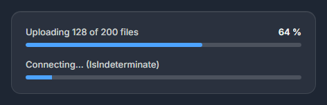
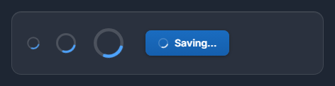
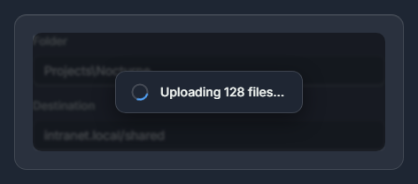
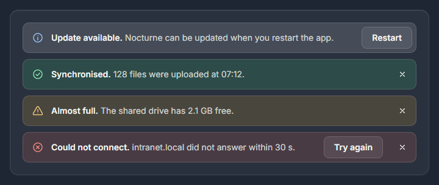

# Progress and status

## ProgressBar



`nc-progress-bar` is a `<progress>`: a 6px rounded track with the done part in the light accent.
`is-indeterminate="true"` runs a stripe along it instead.

```cshtml
<nc-progress-bar value="64" />
<nc-progress-bar is-indeterminate="true" />
```

```html
<progress class="nc-progress-bar" max="100" value="64"></progress>
<progress class="nc-progress-bar" max="100"></progress>
```

| Attribute | Default | Description |
| --- | --- | --- |
| `value` | `0` | |
| `maximum` | `100` | |
| `is-indeterminate` | `false` | |

From script, set the element's `value`, or remove the `value` attribute for the running stripe.

## ProgressRing



`nc-progress-ring` is a quarter arc in the light accent running round a faint track once a second,
32×32 unless `width` is given. `is-active="false"` hides it. The last ring in the picture sits in a
primary button that is saving (write that one as HTML, with `--nc-ring-size`).

```cshtml
<nc-progress-ring width="20" />
<nc-progress-ring />
```

```html
<span class="nc-progress-ring" role="progressbar" aria-label="Working" data-active="true" style="--nc-ring-size:20px;">
  <svg viewBox="0 0 32 32" aria-hidden="true">
    <circle class="nc-progress-ring__track" cx="16" cy="16" r="12.5"/>
    <path class="nc-progress-ring__arc" d="M16,3.5 A12.5,12.5 0 0 1 28.5,16"/>
  </svg>
</span>
```

| Attribute | Default | Description |
| --- | --- | --- |
| `is-active` | `true` | `false` hides the ring (`data-active="false"`) |
| `width` | `32` | the width and height in pixels |

## BusyIndicator



`nc-busy-indicator` blurs and dims its content while busy and shows a small card with a progress ring
and a message over it; the content cannot be used meanwhile, as `BusyIndicator` sets
`IsEnabled="False"` on it.

```cshtml
<nc-busy-indicator id="Upload" is-busy="true" busy-content="Uploading 128 files…">
    <nc-label content="Folder" />
    <nc-text-box text="Projects\Nocturne" />
</nc-busy-indicator>
```

```html
<div class="nc-busy-indicator" id="Upload" data-busy="true" aria-busy="true">
  <div class="nc-busy-indicator__content">…</div>
  <div class="nc-busy-indicator__card" role="status">
    <span class="nc-progress-ring" role="progressbar" aria-label="Working" data-active="true" style="--nc-ring-size:22px">…</span>
    <span>Uploading 128 files…</span>
  </div>
</div>
```

| Attribute | Default | Description |
| --- | --- | --- |
| `is-busy` | `false` | |
| `busy-content` | `Please wait…` | the message on the card |
| `blur-radius` | `4` | the blur of the content, as WPF's `BlurRadius`; `0` turns it off |

Switch it from script with the `data-busy` attribute:

```js
const busy = document.getElementById('Upload');
busy.dataset.busy = 'true';
await upload();
busy.dataset.busy = 'false';
```

## InfoBar



`nc-info-bar` is a rounded strip tinted by its severity, with the matching icon, a bold title before
the message, its content as actions on the right and a close button that hides it.

```cshtml
<nc-info-bar title="Update available." message="Nocturne can be updated when you restart the app." is-closable="false">
    <nc-button content="Restart" />
</nc-info-bar>
<nc-info-bar severity="Success" title="Synchronised." message="128 files were uploaded at 07:12." />
<nc-info-bar severity="Error" title="Could not connect." message="intranet.local did not answer within 30 s." />
```

```html
<div class="nc-info-bar nc-info-bar--success" role="status">
  <svg class="nc-stroke-icon nc-info-bar__icon" aria-hidden="true">…</svg>
  <span class="nc-info-bar__text">
    <span class="nc-info-bar__title">Synchronised.</span> <span class="nc-info-bar__message">128 files were uploaded at 07:12.</span>
  </span>
  <button type="button" class="nc-button nc-button--icon nc-button--subtle nc-info-bar__close" data-nc-dismiss aria-label="Close" title="Close">…</button>
</div>
```

| Attribute | Default | Description |
| --- | --- | --- |
| `severity` | `Info` | `Info`, `Success`, `Warning` or `Error` (an error bar is `role="alert"`) |
| `title` | | the bold text |
| `message` | | the text after it |
| `is-closable` | `true` | the close button; closing hides the bar and raises `nc-close` |
| `is-open` | `true` | `false` writes the bar `hidden`; show it with `bar.hidden = false` |

The [WPF page](../status.md) describes the same controls for the desktop.
