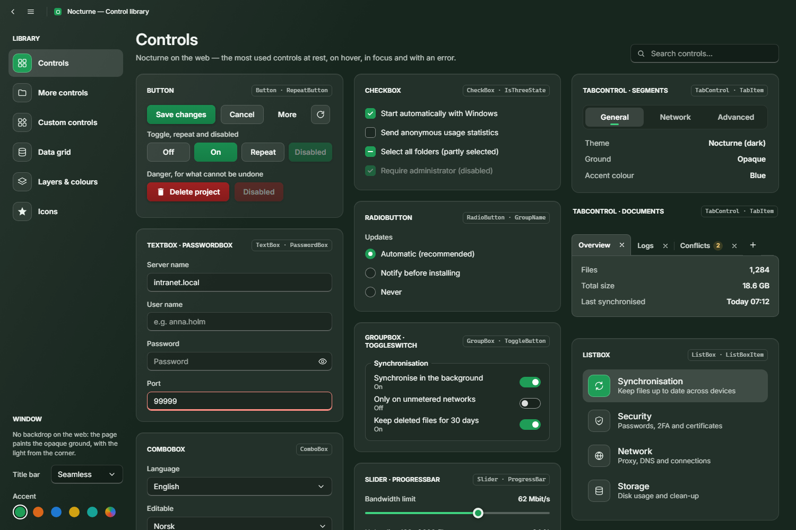
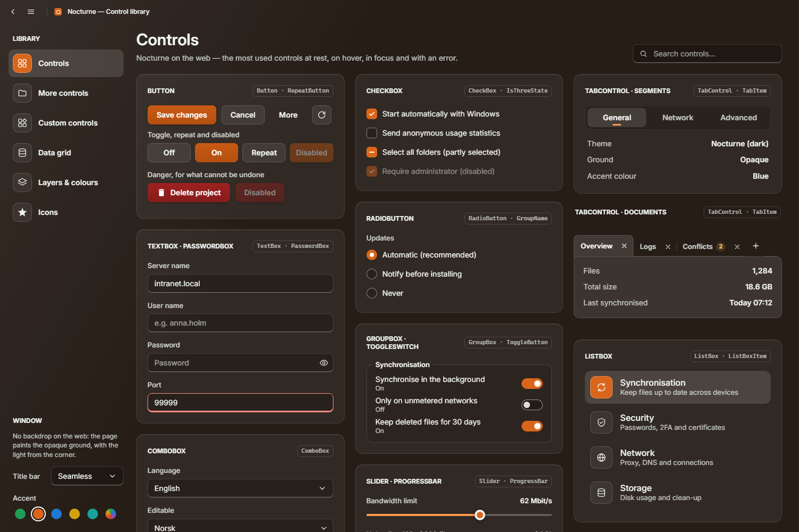
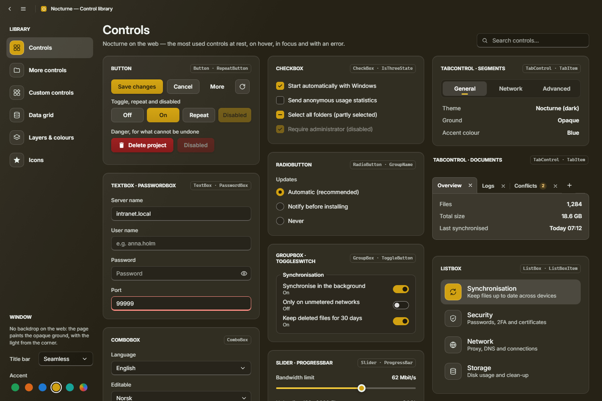
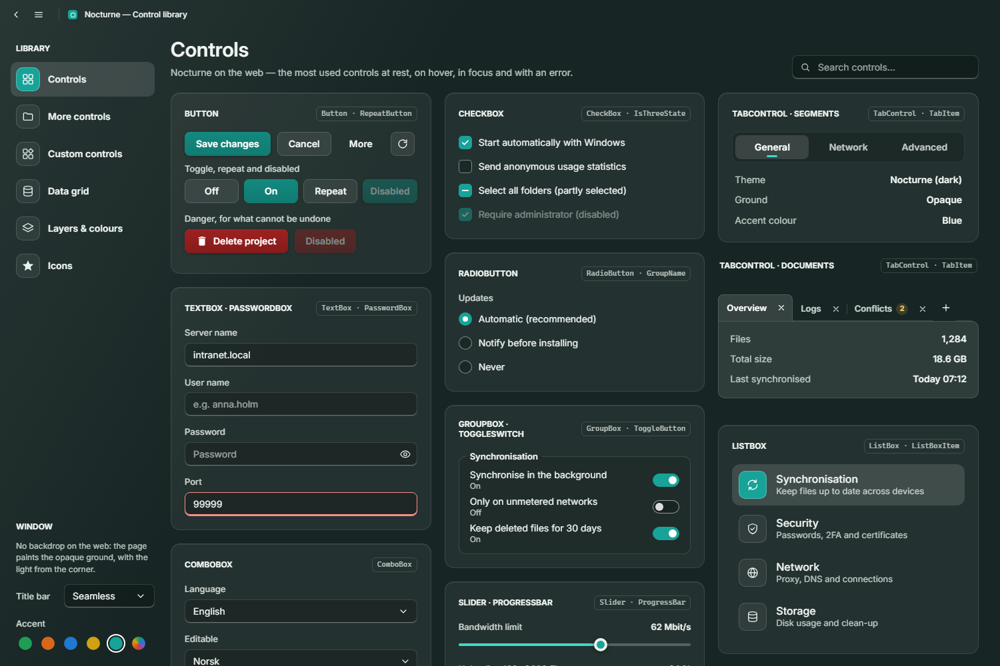
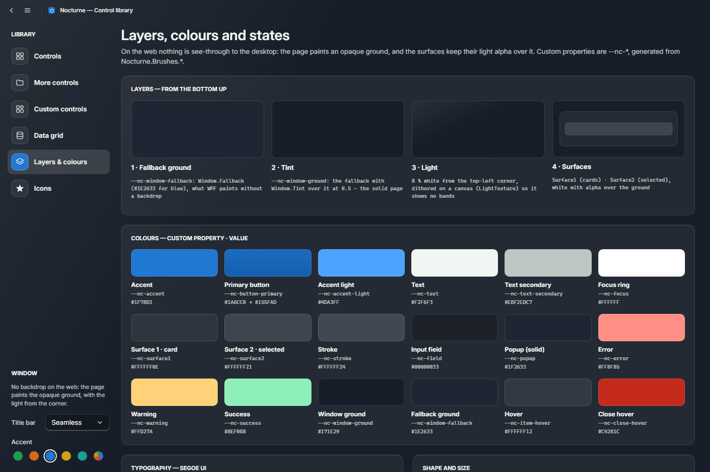

# Theme and accents

## The ground and the light

The WPF window shows the Windows backdrop through a dark tint. A web page cannot see the desktop, so
`body.nc-window` paints what that window shows over a dark desktop: the fallback ground mixed with the
tint at 50 % (`--nc-window-ground`). Menus, drop-downs, dialogs and flyouts are solid
(`--nc-popup`, the ground with the popup surface flattened onto it). Cards, hover and selection
surfaces keep their light alpha over the ground, as in WPF.

`<canvas class="nc-window__light">` draws the soft light from the top-left corner: 8 % white fading out
over the first 38 % of the diagonal. As a CSS gradient it would have about twenty alpha steps that show
as diagonal bands, so `nocturne.js` draws it dithered, pixel for pixel, as the WPF window does, and
draws it again 150 ms after a resize. Leave the canvas out for a page without the light.

## Accents



Blue is the default. The others are green (the colour of the original design), orange, yellow (with
dark text on it, as white on yellow is hard to read), teal, the browser's system accent colour, or any
colour:

```js
Nocturne.setAccent('green');    // blue, green, orange, yellow or teal
Nocturne.setAccent('#8E5CD9');  // any colour as #rrggbb
Nocturne.setAccent('system');   // the browser's AccentColor
```

The accent changes the primary button, selection, focus, links, the switch, the slider and the accent
title bar, and also tints the ground and the popups towards its hue, as `NocturneTheme.SetAccent` does
in WPF. A colour of your own gets the same treatment: `setAccent` derives the lighter and darker shades,
the ground and the text on the accent (white, or dark on a light colour) the way Nocturne.Wpf derives
them from Windows' accent palette.

| | | |
| --- | --- | --- |
|  |  |  |

The choice is remembered in the browser (`localStorage`, key `nocturne.accent`) and set again before
the page is drawn on the next visit, which is why the script loads in `<head>` without `defer`. A
remembered choice wins over the page's own; to start a page in another accent, set `data-accent` on
`<html>`:

```html
<html lang="en" data-accent="teal">
```

`'system'` reads the CSS colour `AccentColor`: Firefox and Safari report the operating system's accent
colour, other browsers a fixed blue or nothing (then the page stays blue).

### Accent pickers without script

Radio buttons with `data-nc-accent` and buttons with `data-nc-accent-button` change the accent when
chosen, and are kept in step with it (the radio of the current accent is checked, the button pressed):

```html
<label><input type="radio" name="accent" value="green" data-nc-accent> Green</label>
<label><input type="radio" name="accent" value="blue" data-nc-accent> Blue</label>
<button type="button" class="nc-button" data-nc-accent-button="teal">Teal</button>
```

### Following the accent from script

```js
Nocturne.NocturneTheme.accent;                       // 'blue', 'teal', 'system' or '#8E5CD9'
Nocturne.NocturneTheme.onAccentChanged(name => redrawChart());
document.addEventListener('nc-accent-changed', e => console.log(e.detail));
```

## CSS custom properties

`nocturne.tokens.css` (part of `nocturne.css`) holds every colour of Nocturne.Wpf's `Brushes.xaml` as a
`--nc-*` custom property, generated from the XAML, so the two never drift apart. The names follow the
brush keys: `Nocturne.Brushes.Text.Secondary` is `--nc-text-secondary`, `Nocturne.Brushes.Surface1`
is `--nc-surface1`. The ones you need most in your own CSS:

| Property | WPF key | Use |
| --- | --- | --- |
| `--nc-text` | `Nocturne.Brushes.Text` | Body text |
| `--nc-text-secondary` | `Nocturne.Brushes.Text.Secondary` | Captions, secondary text |
| `--nc-text-label` | `Nocturne.Brushes.Text.Label` | Field labels |
| `--nc-text-hint` | `Nocturne.Brushes.Text.Hint` | Hints under fields |
| `--nc-window-ground` | | The page ground (fallback mixed with tint) |
| `--nc-surface1` | `Nocturne.Brushes.Surface1` | Cards |
| `--nc-surface-sunken` | `Nocturne.Brushes.Surface.Sunken` | Sunken areas (tab strip, group box) |
| `--nc-stroke` / `--nc-divider` | `Nocturne.Brushes.Stroke` / `.Divider` | Borders and dividers |
| `--nc-popup` | `Nocturne.Brushes.Popup` | Menus, drop-downs, dialogs (solid) |
| `--nc-accent` | `Nocturne.Brushes.Accent` | The accent |
| `--nc-accent-light` | `Nocturne.Brushes.Accent.Light` | The light accent (rings, the progress arc) |
| `--nc-accent-text` | `Nocturne.Brushes.Accent.Text` | Links and accent text |
| `--nc-text-on-accent` | `Nocturne.Brushes.Text.OnAccent` | Text on an accent fill |
| `--nc-success`, `--nc-warning`, `--nc-error` | `Nocturne.Brushes.Success` … | Status colours |
| `--nc-font-family` | `Nocturne.Fonts.Family` | The font (Inter) |
| `--nc-font-size-default` | `Nocturne.Font.Size.Default` | 14px; `-small`, `-caption`, `-subtitle`, `-title` too |

The [WPF resource keys](../resource-keys.md) page lists every brush with its colour; the web demo's
"Layers & colours" page shows them in place.



## Overriding colours

Set a property again outside the Nocturne layers (any ordinary stylesheet loaded after
`nocturne.css`), on `:root` for the whole page or on an element for a part of it:

```css
:root {
  --nc-error: #E5534B;
}
.reports {
  --nc-surface1: rgb(255 255 255 / 0.06);
}
```

An accent of your own is better set with `Nocturne.setAccent('#rrggbb')`, which derives all the shades
and the ground; setting `--nc-accent` alone changes only the fill.

## The font

The theme's font is [Inter](https://rsms.me/inter/), served from the package
(`_content/Nocturne.Web/fonts/InterVariable*.woff2`, SIL Open Font License 1.1), with the system UI fonts
behind it for characters Inter lacks. Medium text uses Inter's weight 500. To use another font, set
the family:

```css
:root {
  --nc-font-family: "Segoe UI Variable", "Segoe UI", system-ui, sans-serif;
}
```

Monospaced text (tags, `.nc-text-block--mono`) uses `--nc-font-family-mono` (Cascadia Mono, Consolas).
