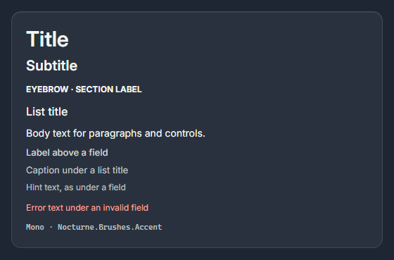
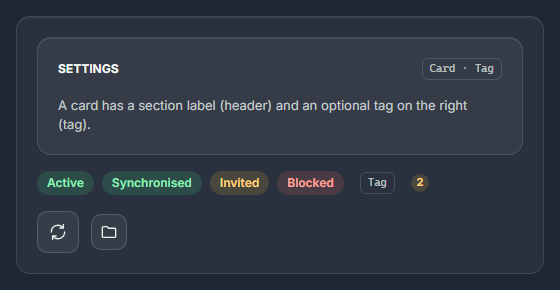
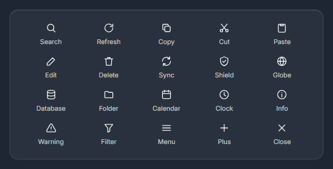
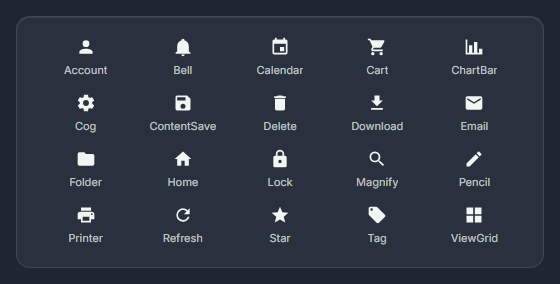
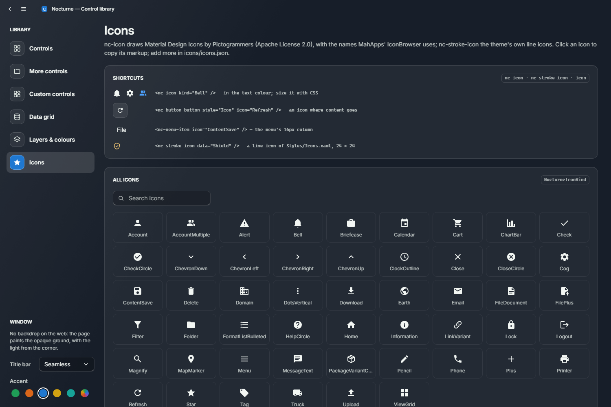

# Typography and surfaces

## Text styles



The `Nocturne.Styles.TextBlock.*` styles are classes; the page's own text is 14px Inter in
`--nc-text`. `nc-text-block` writes them with `text-block-style` (Title becomes an `<h1>`, Subtitle an
`<h2>`, the rest a `<p>` without margins), but the classes work on any element.

| Class | `text-block-style` | Size / weight | Use |
| --- | --- | --- | --- |
| `.nc-text-block--title` | `Title` | 30 / SemiBold | Page titles |
| `.nc-text-block--subtitle` | `Subtitle` | 20 / SemiBold | Sections, dialog titles |
| `.nc-text-block--eyebrow` | `Eyebrow` | 12 / Bold | Section labels above a group, in capitals |
| `.nc-text-block--list-title` | `ListTitle` | 16 / Medium | The first line of a list item |
| `.nc-text-block--body` | `Body` | 14 | Paragraphs |
| `.nc-label` | `Label` | 13 / Medium | Labels above fields |
| `.nc-text-block--caption` | `Caption` | 13, secondary colour | The second line of a list item, descriptions |
| `.nc-text-block--hint` | `Hint` | 12, hint colour | Help text under a field |
| `.nc-text-block--error` | `Error` | 12, red | The message under an invalid field |
| `.nc-text-block--mono` | `Mono` | 11, monospaced | Codes, keys, values |

```cshtml
<nc-text-block text-block-style="Title" text="Employees" />
<p class="nc-text-block--caption">8 people in 3 departments.</p>
```

```html
<h1 class="nc-text-block--title">Employees</h1>
```

## Cards



`nc-card` is the card surface: light and translucent, 14px corners and 20px padding. With `header` it
has a section label, and with `tag` a tag chip on the right (`Nocturne.Styles.Card`); without either it
is a plain card (`Nocturne.Styles.Border.Card`).

```cshtml
<nc-card header="SETTINGS" tag="Card · Tag">…</nc-card>
<nc-card>…</nc-card>
```

```html
<section class="nc-card">
  <header class="nc-card__header"><h3 class="nc-card__title">SETTINGS</h3><span class="nc-tag">Card · Tag</span></header>
  …
</section>
```

## Tags, pills and badges

| Tag helper | Class | Look |
| --- | --- | --- |
| `<nc-tag>` | `.nc-tag` | A small outlined label in monospaced text, as on the cards |
| `<nc-pill>` | `.nc-pill.nc-pill--success` | A rounded status label, green; `pill-style="Warning"` is amber and `"Error"` red |
| `<nc-badge>` | `.nc-badge` | A small round count in amber, as on the document tabs |

```cshtml
<nc-pill>Active</nc-pill>
<nc-pill pill-style="Warning">Invited</nc-pill>
<nc-pill pill-style="Error">Blocked</nc-pill>
<nc-tag>ListBox · ListBoxItem</nc-tag>
<nc-badge>2</nc-badge>
```

```html
<span class="nc-pill nc-pill--warning">Invited</span>
<span class="nc-tag">ListBox · ListBoxItem</span>
<span class="nc-badge">2</span>
```

## Icon tiles

`nc-icon-tile` puts an icon on a rounded square (`Nocturne.Styles.IconTile`, 42×42; `small="true"` for
`.Small`, 36×36). In a selected list item it fills with the accent.

```cshtml
<nc-icon-tile stroke-icon="Sync" />
<nc-icon-tile icon="Bell" small="true" />
```

```html
<span class="nc-icon-tile" aria-hidden="true"><svg class="nc-stroke-icon" aria-hidden="true">…</svg></span>
```

## Line icons



`nc-stroke-icon` draws one of the theme's own line icons (`Nocturne.Icons.*` in WPF): 24×24 drawings
with round ends, 20×20 in the text colour with a 1.6 stroke. `data` is the part of the WPF key after
`Nocturne.Icons.`; the controls take the same names in `stroke-icon`.

```cshtml
<nc-stroke-icon data="Search" />
<nc-stroke-icon data="Warning" stroke-thickness="2" label="Warning" />
```

```html
<svg class="nc-stroke-icon" aria-hidden="true" focusable="false"><use href="/_content/Nocturne.Web/img/icons.svg#stroke-search"></use></svg>
```

| Attribute | Default | Description |
| --- | --- | --- |
| `data` | | the icon (`ChevronDown`, `Search`, `Folder` …) |
| `stroke-thickness` | `1.6` | |
| `label` | | text for screen readers when the icon stands alone; without it the icon is hidden from them |

The set: `Check`, `ChevronDown`, `ChevronUp`, `ChevronRight`, `ChevronLeft`, `Close`, `Plus`, `Search`,
`Refresh`, `Eye`, `Copy`, `Cut`, `Paste`, `Undo`, `SelectAll`, `Edit`, `Delete`, `Sync`, `Shield`, `Globe`,
`Database`, `Grid`, `Layers`, `Text`, `Clock`, `Calendar`, `Folder`, `Info`, `CheckCircle`, `Warning`,
`Error`, `Components`, `Filter`, `PageFirst`, `PageLast`, `Menu`, `File`. Size one with CSS
(`width`, `height`); its colour is `currentColor`.

## NocturneIcon



`nc-icon` draws one of the filled Material Design Icons of `nc:NocturneIcon`, by the same name, 16×16 in
the text colour. The controls take the same names in `icon`. The set is the one in the
[WPF docs](../typography.md#nocturneicon); the web demo's Icons page shows every icon with its name.

```cshtml
<nc-icon kind="Bell" />
<nc-icon kind="AccountMultiple" label="Employees" style="width:24px;height:24px" />
```

```html
<svg class="nc-icon" aria-hidden="true" focusable="false"><use href="/_content/Nocturne.Web/img/icons.svg#bell"></use></svg>
```

| Attribute | Default | Description |
| --- | --- | --- |
| `kind` | | the icon (`NocturneIconKind`: `Bell`, `Cog`, `ViewGrid` …) |
| `label` | | text for screen readers when the icon stands alone |



The icons are symbols in `img/icons.svg`; `<use href="…/icons.svg#<kebab-name>">` draws one in plain
HTML (`AccountMultiple` is `#account-multiple`, a line icon `#stroke-<name>`).

The [WPF page](../typography.md) describes the same text styles and surfaces for the desktop.
