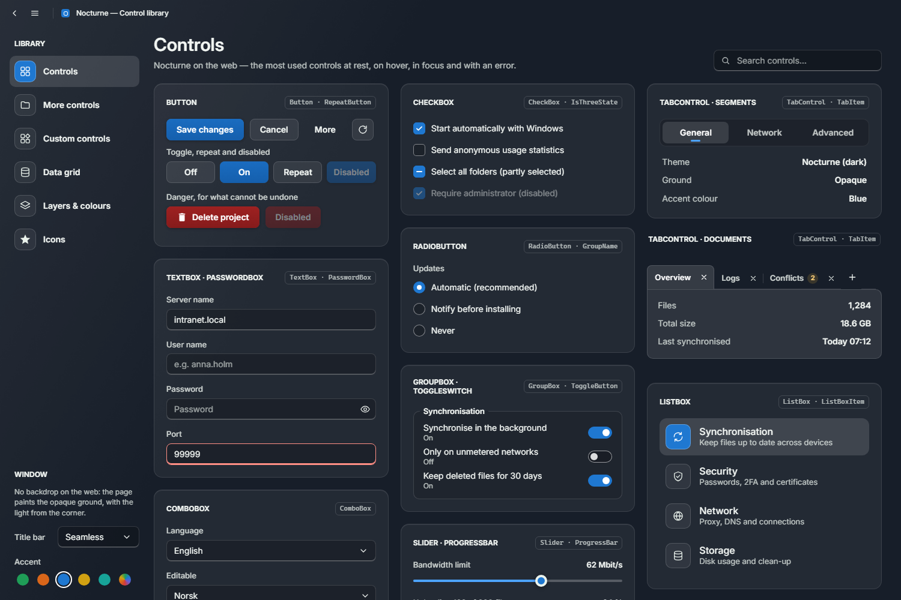
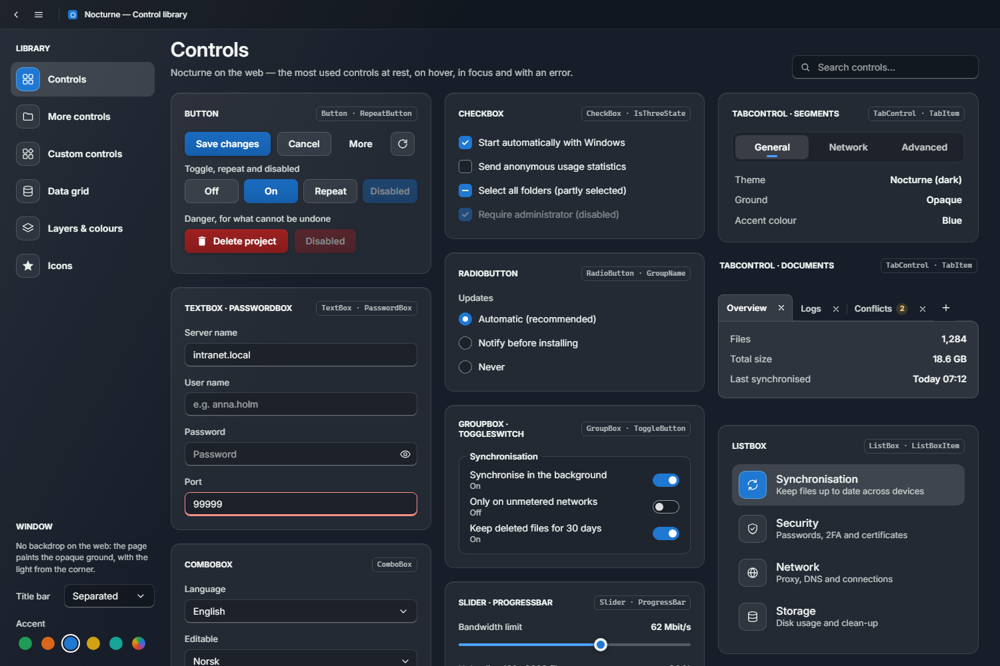
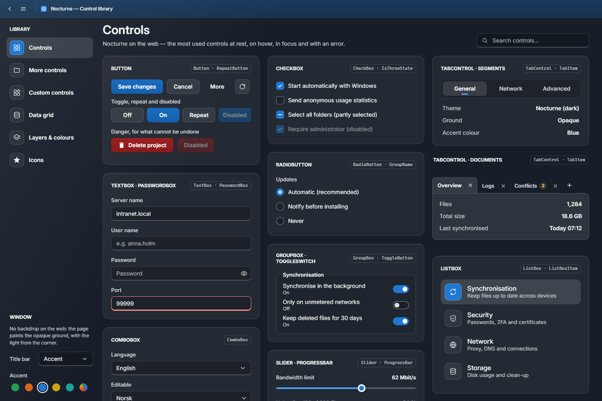
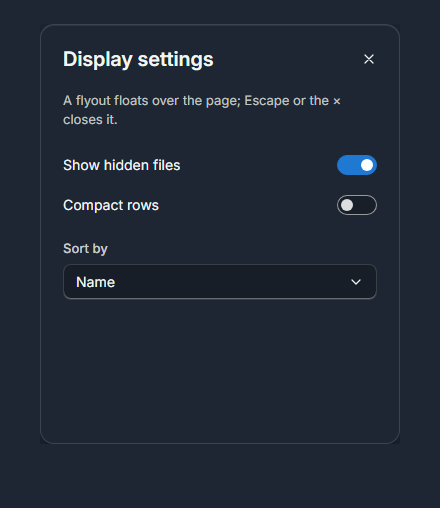
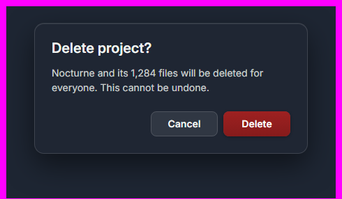

# Window and dialogs

## The window



`body.nc-window` is `NocturneWindow` as a page: the opaque ground, the light from the top-left
corner, a 44px title bar, the content under it and an optional status bar at the bottom. The body
fills the browser window (`100dvh`); the content scrolls inside `.nc-window__content`, so the title
bar stays put.

```cshtml
<body class="nc-window" data-title-bar-style="seamless">
    <canvas class="nc-window__light" aria-hidden="true"></canvas>

    <header class="nc-title-bar">
        <div class="nc-window-commands">
            <button type="button" aria-label="Back" title="Back"><nc-stroke-icon data="ChevronLeft" /></button>
        </div>
        <span class="nc-title-bar__icon"></span>
        <span class="nc-title-bar__title">Admin</span>
        <div class="nc-window-commands">
            <nc-badged badge="4"><nc-button button-style="IconSubtle" icon="Bell" aria-label="Notifications" /></nc-badged>
            <button type="button" data-nc-open="Settings" aria-label="Settings"><nc-icon kind="Cog" /></button>
        </div>
    </header>

    <div class="nc-window__body">
        <nc-hamburger-menu selected-index="0">…</nc-hamburger-menu>
        <main class="nc-window__content">
            @RenderBody()
        </main>
    </div>

    <nc-status-bar>
        <nc-status-bar-item>Ready</nc-status-bar-item>
    </nc-status-bar>
</body>
```

| Part | Class | |
| --- | --- | --- |
| Window | `body.nc-window` | The ground, the grid of title bar, body and status bar |
| Light | `canvas.nc-window__light` | The dithered light from the corner, drawn by `nocturne.js`; leave it out for none |
| Title bar | `header.nc-title-bar` | 44px; holds the commands, the icon and the title |
| Commands | `.nc-window-commands` | A group of 32px subtle buttons. The first child of the title bar is `LeftWindowCommands` (a thin divider follows it); a group after the title is `RightWindowCommands`, pushed to the right edge |
| Icon | `.nc-title-bar__icon` | Empty: the accent square of the WPF window. Put a 16px `` or `<svg>` in it for your own |
| Title | `.nc-title-bar__title` | 12px medium text, cut with an ellipsis |
| Body | `.nc-window__body` | A row: a navigation pane (`nc-hamburger-menu`, or your own `<aside>`) and the content |
| Content | `main.nc-window__content` | Scrolls; give it your page's padding |

Plain `<button>` and `<a>` elements in `.nc-window-commands` get the title bar look by themselves (a
pressed or `aria-current` one shows as selected); `nc-button` with `button-style="IconSubtle"` works too.

### Title bar styles

| Separated | Accent |
| --- | --- |
|  |  |

`data-title-bar-style` on the window is `TitleBarStyle`: `seamless` (the default; the title bar sits on
the ground), `separated` (a dark strip with a hairline under it) or `accent` (a strip tinted with the
accent, with the icon in the light accent so it does not sink into it).

```html
<body class="nc-window" data-title-bar-style="accent">
```

## Flyout



`nc-flyout` is a panel that slides in from an edge of the window and floats 12px from it (14px
corners, the popup surface). A button with `data-nc-open="<id>"` opens it (and closes it again);
Escape, the × or a button with `data-nc-close` inside it closes it. Opening moves the keyboard to its
first field, and closing gives it back, as `Flyout` in WPF does.

```cshtml
<nc-button data-nc-open="Settings" content="Display settings" />

<nc-flyout id="Settings" header="Display settings" width="360">
    <nc-toggle-switch is-checked="true">Show hidden files</nc-toggle-switch>
    <nc-toggle-switch>Compact rows</nc-toggle-switch>
</nc-flyout>
```

```html
<aside class="nc-flyout" id="Settings" data-position="right" aria-label="Display settings" style="width:360px;">
  <header class="nc-flyout__header">
    <span class="nc-flyout__title">Display settings</span>
    <button type="button" class="nc-button nc-button--icon nc-button--subtle nc-flyout__close" data-nc-close aria-label="Close" title="Close">…</button>
  </header>
  <div class="nc-flyout__content">…</div>
</aside>
```

| Attribute | Default | Description |
| --- | --- | --- |
| `id` | | the id `data-nc-open` names |
| `header` | | the title |
| `position` | `Right` | `Right`, `Left`, `Top` or `Bottom`: the edge it slides in from |
| `width` | | the width in pixels (for `Left` and `Right`) |
| `is-open` | `false` | starts open |
| `is-closable` | `true` | shows the × |
| `is-auto-close-enabled` | `false` | closes by itself after `auto-close-interval` ms; the timer starts again while the mouse is over it |
| `auto-close-interval` | `5000` | |
| `padding` | | the inner spacing as CSS (`12px 14px`) |

A flyout floats over the window. To keep one inside a smaller box, put it in an element with the class
`nc-flyout-host`. From script: `Nocturne.openFlyout('Settings')`, `Nocturne.closeFlyout('Settings')`;
the flyout raises `nc-open` and `nc-close`.

## Dialogs



`Nocturne.showDialog` is `ShowMessageAsync`: a card in the middle of the window, which dims everything
under the title bar. It returns a promise of `'affirmative'` or `'negative'` (Escape answers
`'negative'`), and gives the keyboard back to the element that had it.

```js
const answer = await Nocturne.showDialog({
  title: 'Delete project?',
  content: 'Nocturne and its 1,284 files will be deleted for everyone. This cannot be undone.',
  affirmativeText: 'Delete',
  negativeText: 'Cancel',
  affirmativeStyle: 'danger',
});
if (answer === 'affirmative') { … }

await Nocturne.showMessage('Saved', 'The timesheet was submitted.');   // one OK button
```

| Option | Default | |
| --- | --- | --- |
| `title` | | the heading |
| `content` | | text, or an element (a small form) |
| `affirmativeText` | `OK` | the main button |
| `negativeText` | | the second button; none without it |
| `affirmativeStyle` | `primary` | the main button's variant: `primary` or `danger` (for what cannot be undone) |

A dialog written in the page is a `<dialog class="nc-dialog">`. A button with `data-nc-open="<id>"`
opens it as a modal dialog; buttons with `data-nc-close` close it.

```html
<dialog class="nc-dialog" id="ConfirmDelete" aria-labelledby="ConfirmDeleteTitle">
  <div class="nc-dialog__card">
    <h2 class="nc-dialog__title" id="ConfirmDeleteTitle">Delete employee?</h2>
    <div class="nc-dialog__content">Anna Holm will be removed from the staff list.</div>
    <div class="nc-dialog__buttons">
      <button type="button" class="nc-button" data-nc-close autofocus>Cancel</button>
      <button type="submit" class="nc-button nc-button--danger" form="DeleteForm">Delete</button>
    </div>
  </div>
</dialog>
```

The [WPF page](../window.md) describes `NocturneWindow`, `NocturneDialog` and `Flyout`.
