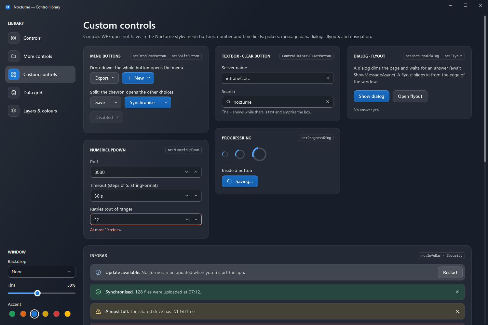
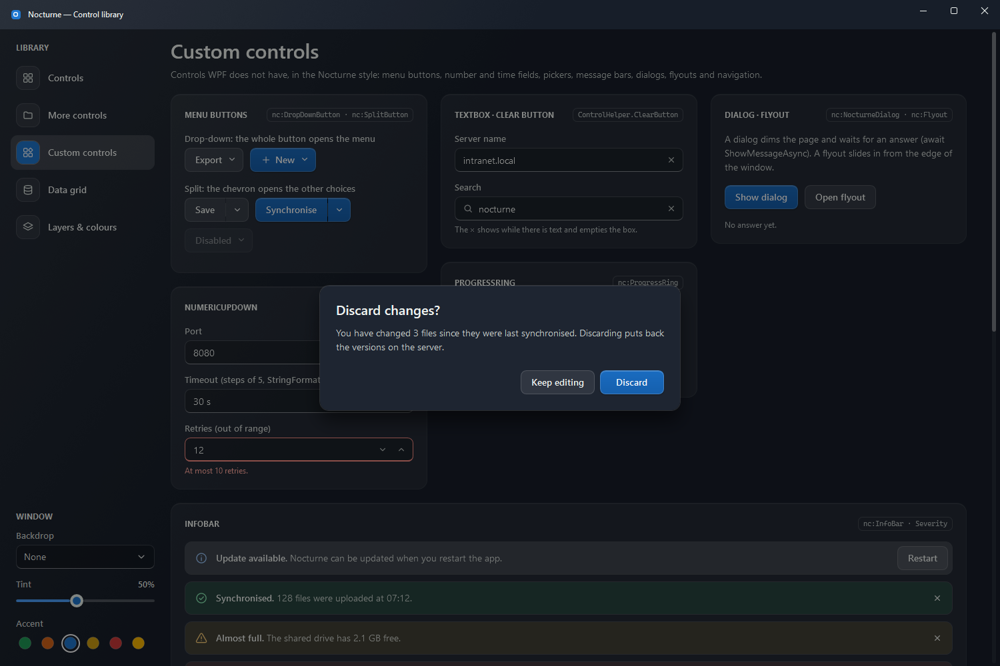
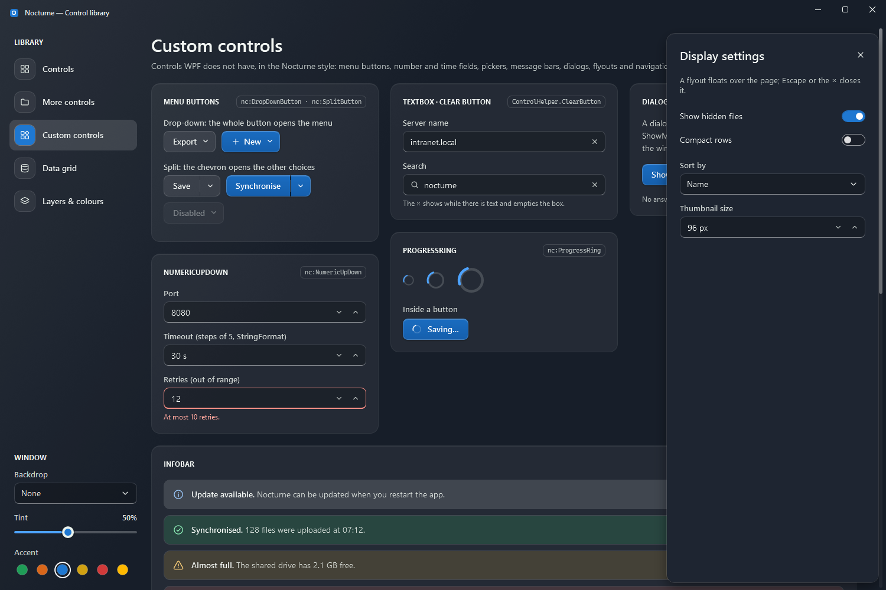

# Window and dialogs

## NocturneWindow



`nc:NocturneWindow` is the frame: the Windows 11 backdrop under a dark tint and the light from the
top-left corner ([Theme and accents](theming.md#the-layers-of-a-window)), a 44px title bar with the
title and its own minimise, maximise and close buttons, and the layers for flyouts and dialogs. While
a backdrop is active it extends the DWM frame over the whole window, so Windows draws the material
behind all of it.

```xml
<nc:NocturneWindow x:Class="MyApp.MainWindow"
                   xmlns="http://schemas.microsoft.com/winfx/2006/xaml/presentation"
                   xmlns:x="http://schemas.microsoft.com/winfx/2006/xaml"
                   xmlns:nc="urn:nocturne-wpf"
                   Title="Files" Backdrop="Acrylic" TintOpacity="0.5">
    <nc:NocturneWindow.RightWindowCommands>
        <Button Style="{StaticResource Nocturne.Styles.Button.Icon.Subtle}" ToolTip="Settings" Click="OnSettings">
            <nc:StrokeIcon Width="16" Height="16" Data="{StaticResource Nocturne.Icons.Components}" />
        </Button>
    </nc:NocturneWindow.RightWindowCommands>
    <!-- content -->
</nc:NocturneWindow>
```

| Property | |
| --- | --- |
| `Backdrop` | `Acrylic` (default), `Mica`, `MicaAlt` or `None` |
| `TintOpacity` | How strongly the dark tint covers the backdrop, 0 to 1 (0.5) |
| `IsBackdropActive` | Read-only: true while Windows draws the backdrop |
| `TitleBarHeight` | Height of the title bar (44) |
| `ShowIcon` | Shows `Icon` (or a small accent glyph when none is set) before the title (true) |
| `ShowMinButton`, `ShowMaxRestoreButton` | Hide the minimise or maximise button |
| `RightWindowCommands` | Content in the title bar before the caption buttons |
| `Flyouts` | The layer for [flyouts](#flyout), above the content and under the title bar |

## Dialogs



A dialog is drawn inside the window: the content dims, the dialog card sits in the middle, and the
call waits for the answer. Focus goes back where it was when it closes; Escape cancels.

```csharp
var answer = await ShowMessageAsync("Discard changes?",
    "You have changed 3 files since they were last synchronised.", "Discard", "Keep editing");
if (answer == MessageDialogResult.Affirmative)
{
    Discard();
}
```

`ShowMessageAsync(title, message, affirmativeText = "OK", negativeText = null)` shows one button, or
two when `negativeText` is given. For your own content, create a `nc:NocturneDialog` and show it with
`ShowDialogAsync`:

```csharp
var dialog = new NocturneDialog
{
    Title = "Rename folder",
    Content = new TextBox { Text = folder.Name },
    AffirmativeText = "Rename",
    NegativeText = "Cancel",
};
if (await ShowDialogAsync(dialog) == MessageDialogResult.Affirmative) { ... }
```

| `NocturneDialog` | |
| --- | --- |
| `Title` | The heading |
| `Content` | Text or any element under the heading |
| `AffirmativeText` | Text of the primary button |
| `NegativeText` | Text of the second button; hidden while null |
| `AffirmativeButtonStyle` | Style of the main button (`Nocturne.Styles.Button.Primary` when null) |
| `Close(result)` | Closes the dialog from code with `Affirmative`, `Negative` or `Canceled` |

## Flyout



`nc:Flyout` is a panel that slides in from an edge of the window (220 ms) and floats over the page.
Put flyouts in the window's `Flyouts` layer and open them with `IsOpen`:

```xml
<nc:NocturneWindow.Flyouts>
    <Grid>
        <nc:Flyout x:Name="SettingsFlyout" Header="Display settings" Width="360">
            <StackPanel>
                <CheckBox Style="{StaticResource Nocturne.Styles.ToggleSwitch}" Content="Show hidden files" />
            </StackPanel>
        </nc:Flyout>
    </Grid>
</nc:NocturneWindow.Flyouts>
```

```csharp
SettingsFlyout.IsOpen = true;
```

| Property | |
| --- | --- |
| `Header` | The heading |
| `IsOpen` | Slides the flyout in or out |
| `Position` | `Right` (default), `Left`, `Top` or `Bottom` |
| `IsClosable` | Shows the × button and closes on Escape (true) |
| `IsAutoCloseEnabled` | Closes `AutoCloseInterval` ms after opening (5000); the timer waits while the mouse is over the flyout |
