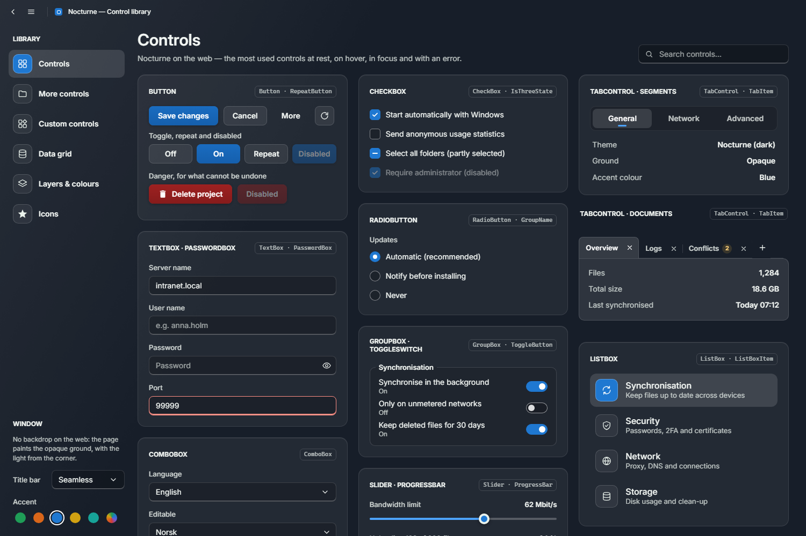

# Nocturne for the web

The Nocturne look of [Nocturne.Wpf](https://www.nuget.org/packages/Nocturne.Wpf) in HTML and CSS, for
admin portals and other business sites on ASP.NET Core. The package is a Razor class library with:

- **`nocturne.css`**: every control of the WPF library as CSS classes named after the WPF controls and
  style keys (`.nc-combo-box`, `.nc-button--primary`). The rules sit in cascade layers, so Tailwind or
  your own utility classes still win.
- **`nocturne.js`**: drop-downs, calendar, date and time pickers, sliders, menus, tabs, flyouts,
  dialogs, tool tips, validation call-outs, accents and the dithered light in the window corner. It has no dependencies.
- **Tag helpers** for every control: `<nc-combo-box>`, `<nc-tab-control>`, `<nc-date-picker>`,
  `<nc-data-grid>` … Their attributes are the WPF property names in kebab case.
- **NocturneGrid** (`<nc-nocturne-grid>`): the data grid of Nocturne.Wpf, with a word search that marks
  its hits, a value filter in every header, three-state sorting, grouping and paging, in the browser
  or, in server mode, on the server (`NocturneGridServer.Query`).
- **Icons**: Material Design Icons as an SVG sprite, with the same names as `NocturneIcon` in WPF,
  plus the theme's own line icons (`<nc-stroke-icon>`).

Unlike the WPF window, the page has no transparency to the desktop: the ground is the window's
opaque tinted colour and popups are solid.



## Getting started

```bash
dotnet add package Nocturne.Web
```

Add the tag helpers in `_ViewImports.cshtml`:

```cshtml
@addTagHelper *, Nocturne.Web
@using Nocturne.Web.TagHelpers
```

Load the theme in the layout's `<head>`, before Tailwind if you use it. Leave `defer` off the script,
because it sets the stored accent before the page is drawn:

```html
<link rel="stylesheet" href="~/_content/Nocturne.Web/css/nocturne.css" asp-append-version="true" />
<script src="~/_content/Nocturne.Web/js/nocturne.js" asp-append-version="true"></script>
```

Then write the controls as you would in XAML:

```cshtml
<nc-button button-style="Primary">Save</nc-button>
<nc-text-box asp-for="Name" placeholder="Search…" clear-button="true" />
<nc-tab-control tab-control-style="Default">
    <nc-tab-item header="General">…</nc-tab-item>
    <nc-tab-item header="Advanced">…</nc-tab-item>
</nc-tab-control>
```

Pick another accent from script (or set `data-accent` on `<html>`); the choice is remembered:

```js
Nocturne.setAccent('green');    // blue (default), green, orange, yellow, teal,
Nocturne.setAccent('#8E5CD9');  // any #hex colour,
Nocturne.setAccent('system');   // or the browser's system accent colour
```

## Documentation

Tag helpers, classes, icons and accents:
**https://montago.github.io/NocturneTheme/web.html**

Source, the web demo and issues: https://github.com/Montago/NocturneTheme

## License

MIT, except the icons (`img/icons.svg`), which are Material Design Icons under the Apache License 2.0
(`icons/` in the package). See `NOTICE.md` in the package for where the look comes from.
